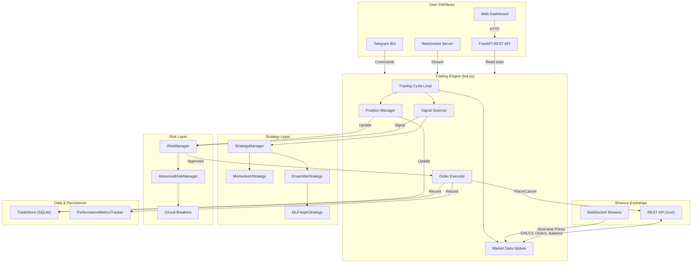

# AkibaCryptoBot — System Architecture

AkibaCryptoBot is an automated cryptocurrency trading engine built in Python. It connects to Binance (spot and futures), analyses the market with pluggable strategies (technical-analysis **and** machine-learning), enforces multi-layer risk controls, and exposes a FastAPI REST/WebSocket API plus a Telegram bot for monitoring and control.

---

## High-Level Data Flow



---

## Component Summary

| Component | Directory / File | Purpose |
|---|---|---|
| **Trading Engine** | `src/bot.py` | Main `AkibaCryptoBot` class — orchestrates the trading cycle |
| **Exchange Connector** | `src/exchange/binance_client.py` | Binance REST client via ccxt (spot + futures) |
| **WebSocket Manager** | `src/exchange/websocket_manager.py` | Real-time data streaming with auto-reconnect |
| **Strategy Framework** | `src/strategies/base_strategy.py` | `BaseStrategy` ABC + `StrategyManager` |
| **Momentum Strategy** | `src/strategies/momentum_strategy.py` | RSI, MACD, Bollinger Bands, ADX, Stochastic |
| **Ensemble Strategy** | `src/strategies/ensemble_strategy.py` | Weighted voting: 40% Momentum + 60% ML |
| **FreqAI ML Strategy** | `src/strategies/freqai/ml_freqai_strategy.py` | LightGBM classifier with feature engineering |
| **FreqAI Base** | `src/strategies/freqai/base_freqai_strategy.py` | Abstract base for ML-based strategies |
| **Technical Indicators** | `src/indicators/technical_indicators.py` | 20+ indicators (SMA, EMA, RSI, MACD, ATR, Ichimoku, SuperTrend, …) |
| **Pattern Recognition** | `src/indicators/technical_indicators.py` | Support/resistance, trend detection, divergence |
| **Risk Manager** | `src/risk_management.py` | Position sizing, stop loss, trailing stops, daily limits |
| **Advanced Risk** | `src/advanced_risk_management.py` | ATR/Kelly sizing, correlation analysis, portfolio heatmap |
| **Config Validator** | `src/config_validator.py` | Validates all config sections at startup |
| **Trade Store** | `src/persistence/trade_store.py` | Async SQLite persistence for open/closed trades |
| **Performance Tracker** | `src/performance/metrics_tracker.py` | Sharpe, Sortino, drawdown, profit factor, equity curve |
| **FastAPI App** | `src/api/app.py` | Application factory with lifespan-managed bot |
| **API Routes** | `src/api/routes/` | REST endpoints: status, account, trading, performance, risk, strategy, model |
| **WebSocket** | `src/api/websockets.py` | Real-time streaming endpoint |
| **Telegram Bot** | `src/notifications/telegram_bot.py` | 15+ commands, trade/error/daily notifications |
| **Logging** | `src/bot_logging/logger.py` | Rotating file logs: trades, errors, performance |
| **Backtesting** | `src/backtesting/engine.py` | Event-driven backtest engine |
| **Walk-Forward** | `src/backtesting/walkforward.py` | Walk-forward analysis with overfitting detection |
| **Backtest Runner** | `src/backtesting/backtest_runner.py` | CLI runner with synthetic data support |
| **Web UI** | `src/ui/` | Dashboard (HTML/CSS/JS) served by FastAPI |
| **Start Script** | `start_bot.py` | CLI entry point with argparse (FastAPI or legacy mode) |

---

## Trading Cycle Walkthrough

Each iteration of the trading loop in `AkibaCryptoBot.trading_cycle()` performs the following steps:

```
1. UPDATE MARKET DATA
   └─ Fetch OHLCV candles + current prices for all configured pairs

2. UPDATE PORTFOLIO VALUE
   └─ Record current portfolio value for drawdown tracking
   └─ Check circuit breakers (volatility spike, max drawdown)

3. MANAGE EXISTING POSITIONS
   └─ For each open trade:
       ├─ Update trailing stop loss
       ├─ Check stop-loss / take-profit triggers
       └─ Close position if exit condition met

4. SCAN FOR OPPORTUNITIES
   └─ For each configured pair (up to max_open_trades):
       ├─ Fetch market snapshot (OHLCV + price)
       ├─ Generate signal via active strategy
       ├─ Validate signal (strength, risk budget, correlations)
       ├─ Check bid-ask spread
       ├─ Calculate position size (risk-adjusted)
       └─ Place trade if all checks pass

5. SLEEP
   └─ Wait for the configured interval before next cycle
```

---

## Directory Structure

```
akibaCryptobot/
├── start_bot.py               # CLI entry point
├── config/
│   ├── config.json            # Main configuration
│   └── freqai_config.json     # ML model configuration
├── src/
│   ├── bot.py                 # Trading engine
│   ├── risk_management.py     # Core risk controls
│   ├── advanced_risk_management.py  # ATR/Kelly/correlation
│   ├── config_validator.py    # Config validation
│   ├── exchange/
│   │   ├── binance_client.py  # Binance REST client
│   │   └── websocket_manager.py  # WebSocket streaming
│   ├── strategies/
│   │   ├── base_strategy.py   # Strategy ABC + Manager
│   │   ├── momentum_strategy.py  # Technical analysis
│   │   ├── ensemble_strategy.py  # Multi-strategy voting
│   │   └── freqai/            # ML strategies
│   │       ├── base_freqai_strategy.py
│   │       └── ml_freqai_strategy.py
│   ├── indicators/
│   │   └── technical_indicators.py  # 20+ indicators
│   ├── api/
│   │   ├── app.py             # FastAPI factory
│   │   ├── dependencies.py    # DI (bot_state)
│   │   ├── websockets.py      # WS endpoint
│   │   └── routes/            # REST route modules
│   ├── persistence/
│   │   └── trade_store.py     # SQLite trade DB
│   ├── performance/
│   │   └── metrics_tracker.py # Performance analytics
│   ├── notifications/
│   │   └── telegram_bot.py    # Telegram integration
│   ├── backtesting/
│   │   ├── engine.py          # Backtest engine
│   │   ├── walkforward.py     # Walk-forward analysis
│   │   └── backtest_runner.py # CLI runner
│   ├── bot_logging/
│   │   └── logger.py          # Logging setup
│   └── ui/                    # Web dashboard
├── tests/                     # Test suite
├── docs/                      # Documentation (you are here)
├── .github/workflows/         # CI/CD pipelines
├── Dockerfile                 # Multi-stage Docker build
└── docker-compose.yml         # Container orchestration
```
