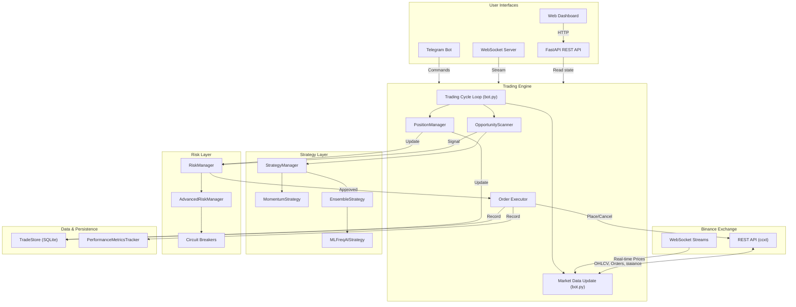

# AkibaCryptoBot — System Architecture

AkibaCryptoBot is an automated, **fully asynchronous** cryptocurrency trading engine built in Python using `asyncio`. It connects to Binance (spot and futures) via CCXT's async support, analyses the market with pluggable strategies (technical-analysis **and** machine-learning), enforces multi-layer risk controls, maintains database-exchange consistency via a dedicated reconciliation layer, and exposes a FastAPI REST/WebSocket API plus a Telegram bot for monitoring and control.

---

## High-Level Data Flow



---

## Component Summary

| Component | Directory / File | Purpose |
|---|---|---|
| **Trading Engine** | `src/bot.py` | Main `AkibaCryptoBot` class — lifecycle, market data, circuit breakers |
| **Position Manager** | `src/trading/position_manager.py` | Manages open positions: trailing stops, exit signals, closing trades |
| **Opportunity Scanner** | `src/trading/opportunity_scanner.py` | Scans for new trades: signal validation, spread checks, order placement |
| **Exchange Connector** | `src/exchange/binance_client.py` | Binance REST client via ccxt (spot + futures) |
| **WebSocket Manager** | `src/exchange/websocket_manager.py` | Real-time data streaming with auto-reconnect |
| **Strategy Framework** | `src/strategies/base_strategy.py` | `BaseStrategy` ABC + `StrategyManager` |
| **Momentum Strategy** | `src/strategies/momentum_strategy.py` | RSI, MACD, Bollinger Bands, ADX, Stochastic |
| **Ensemble Strategy** | `src/strategies/ensemble_strategy.py` | Weighted voting: 40% Momentum + 60% ML |
| **FreqAI ML Strategy** | `src/strategies/freqai/ml_freqai_strategy.py` | LightGBM classifier with feature engineering |
| **FreqAI Base** | `src/strategies/freqai/base_freqai_strategy.py` | Abstract base for ML-based strategies |
| **Technical Indicators** | `src/indicators/technical_indicators.py` | 20+ indicators (SMA, EMA, RSI, MACD, ATR, Ichimoku, SuperTrend, …) |
| **Pattern Recognition** | `src/indicators/technical_indicators.py` | Support/resistance, trend detection, divergence |
| **Risk Manager** | `src/risk_management.py` | Position sizing, stop loss, trailing stops, daily limits |
| **Advanced Risk** | `src/advanced_risk_management.py` | ATR/Kelly sizing, correlation analysis, portfolio heatmap |
| **Config Validator** | `src/config_validator.py` | Validates all config sections at startup |
| **Trade Store** | `src/persistence/trade_store.py` | Async SQLite persistence for trades (Unix timestamps) |
| **Performance Tracker** | `src/performance/metrics_tracker.py` | Sharpe, Sortino, drawdown, profit factor, equity curve |
| **Runtime Telemetry** | `src/services/telemetry_service.py` | In-memory event counts, queue depth, ingress age, exchange age, queue lag snapshots |
| **Order Book Service** | `src/services/order_book_service.py` | Normalized local depth state with queryable best bid/ask and depth windows |
| **Microstructure Features** | `src/indicators/microstructure_features.py` | Spread, depth imbalance, and replay-driven trade-pressure features for research and future low-latency strategies |
| **Native Hot-Path Ports** | `src/ports/native_market_data.py`, `src/ports/native_execution.py`, `src/ports/native_hot_path.py` | Abstract boundary contracts for a future native market-data/execution data plane |
| **Native IPC Protocol** | `src/runtime/ipc_protocol.py` | Versioned JSON envelope format for the Python/native hot-path boundary |
| **Native Shadow Bridge** | `src/runtime/native_shadow.py` | Read-only Python/native comparison bridge used for dual-run mismatch reporting |
| **Runtime Event Capture / Replay** | `src/runtime/event_capture.py`, `src/runtime/event_replay.py` | Bounded JSONL capture for hot-path events and deterministic replay helpers for debugging/tests |
| **Reconciliation Manager** | `src/monitoring/reconciliation.py` | Syncs DB state with exchange balances to find orphaned/lost trades |
| **FastAPI App** | `src/api/app.py` | Application factory with lifespan-managed bot |
| **API Routes** | `src/api/routes/` | REST endpoints: status, account, trading, performance, risk, strategy, model |
| **WebSocket** | `src/api/websockets.py` | Real-time streaming endpoint |
| **Telegram Bot** | `src/notifications/telegram_bot.py` | 15+ commands, trade/error/daily notifications |
| **Logging** | `src/bot_logging/logger.py` | Rotating file logs: trades, errors, performance |
| **Backtesting** | `src/backtesting/engine.py` | Event-driven backtest engine |
| **Walk-Forward** | `src/backtesting/walkforward.py` | Walk-forward analysis with overfitting detection |
| **Backtest Runner** | `src/backtesting/backtest_runner.py` | CLI runner with synthetic data support |
| **Runtime Shell** | `src/runtime/app.py`, `src/runtime/service_registry.py` | Event-driven runtime supervisor, service wiring, rollout state, and operator projections |
| **Web UI** | `src/ui/` | Dashboard (HTML/CSS/JS) served by FastAPI |
| **Start Script** | `start_bot.py` | CLI entry point with argparse (FastAPI or legacy mode) |

---

## Runtime Telemetry and Event Capture

The runtime surfaces latency and queue metrics through `runtime_telemetry` in `/api/status` and `/ws/status`. The goal is to make the hot path measurable before it is optimized.

- `latency.event_age_ms` measures how long a runtime event sat between `ts_received` and the observation time inside the runtime. Rising values indicate the bot is falling behind its own ingestion path.
- `latency.exchange_age_ms` measures the delay between the exchange timestamp and the time the runtime received the event. Rising values indicate feed delay, timestamp skew, or upstream staleness. Negative samples are ignored rather than polluting the summary.
- `latency.queue_lag_ms.<queue>` measures how long an event waited before a hot-path queue drained it. Rising queue lag together with rising queue depth is the clearest sign of a backlog.

The same telemetry snapshot also exposes:

- `total_events`
- `event_counts`
- `metric_counts`
- `queue_depths`
- `last_seen_at`

Important metric names emitted into `metric_counts`:

- `event_age_sample.<event_type>`
- `exchange_age_sample.<event_type>`
- `queue_depth.<queue_name>`
- `queue_lag_sample.<queue_name>`
- `dropped_event`
- `dropped_event.<consumer>`
- `dropped_event.<consumer>.<event_type>`
- `reconnect.<source>`
- `stale_symbol` and `stale_symbol.<symbol>`
- `shadow_drift` and `shadow_drift.<symbol>`
- `missing_symbol` and `missing_symbol.<symbol>` / `missing_symbol.<side>`

Interpretation is intentionally conservative:

- Growing queue depth plus growing queue lag is a promotion blocker.
- Repeated dropped events are a promotion blocker.
- Persistent `exchange_age_ms` growth should be treated as a feed/timestamp problem until proven otherwise.
- `startup_pending` is not a rollback signal by itself; it only means the runtime is still warming up.

Runtime event capture uses `src/runtime/event_capture.py` to write a bounded JSONL record of hot-path events for offline debugging. Replay support is for test and investigation flows, not for live hot-path execution.

### HFT Replay Boundary

The capture/replay path from Phases 12 and 13 is a research aid, not a venue-faithful HFT simulator.

For HFT-oriented research, the architecture expects a later simulation layer to preserve or approximate:

- queue position at the resting price level
- aggressive versus passive execution role
- partial fills across multiple depth updates
- stale-book invalidation after missing deltas or sequence gaps
- deterministic replay ordering for depth, trades, and cancels

Until that simulation layer exists, the current replay helpers should be treated as low-fidelity research tools rather than production-grade execution proof.

### Phase 15 Latency SLO Targets

These are documentation targets for the low-latency runtime and future HFT regime. They are not proof that the current deployment already meets HFT-grade timing.

| Stage | Target budget | Operator interpretation |
|---|---|---|
| `event_age_ms` | Prefer sub-50 ms average, investigate sustained growth above 100 ms | The runtime is falling behind its own ingest path |
| `exchange_age_ms` | Prefer sub-25 ms average, investigate sustained growth above 75 ms | The feed is stale, delayed, or timestamp-skewed |
| `queue_lag_ms.<queue>` | Prefer sub-25 ms average per hot-path queue, investigate sustained growth above 50 ms | A queue is backing up and the hot path is losing responsiveness |

Degraded-latency actions:

- warn when any hot-path budget is crossed once
- hold promotion when the same budget is crossed in repeated samples
- block or roll back when growth is paired with `metric_counts.dropped_event*`
- investigate network/feed health when `exchange_age_ms` rises before queue lag
- treat persistent queue lag and dropped events as a rollout blocker, not a cosmetic warning

## Native Hot-Path Boundary

Phase 14 introduces a native control-plane boundary without changing live trading behavior.

What moves first:

- market-data normalization through `NativeMarketDataGateway`
- execution submission through `NativeExecutionGateway`
- boundary messaging through `IPCEnvelope` and `IPC_PROTOCOL_VERSION`

How dual-run validation works:

- `RuntimeApp` can carry optional `NativeHotPathPorts`
- `runtime.native_shadow.NativeShadowBridge` compares Python runtime projections against an optional native snapshot
- operator surfaces can expose `native_shadow_report` with mismatch counts and summary text
- healthy cases stay benign when no native bundle or snapshot is present

The native boundary is comparison-only until a real native transport/process is introduced in a later phase.

## Operating Modes

The platform should be described in three distinct operating regimes:

| Mode | What it is | Operator expectation |
|---|---|---|
| **Standard algo** | The legacy candle/timeframe bot and its supporting services. This is the safest and simplest operating mode. | Prioritize correctness, reconciliation, and explainability. Expect coarse-cycle behavior and tolerate higher latency. |
| **Low-latency runtime** | The event-driven runtime with websocket feeds, rollout profiles, shadow validation, and operator projections. | Prioritize freshness, queue health, rollout health, and restart safety. Do not confuse this with HFT. |
| **HFT** | A future native hot-path regime with venue-near infrastructure, queue-sensitive execution, and strategy classes designed for market making or microstructure alpha. | Prioritize latency SLOs, fast kill-switch behavior, replay fidelity, and infrastructure discipline. This is not the current platform state. |

Current platform state:

- The repository now supports standard algo trading and a low-latency runtime migration path.
- The Python/native boundary exists, but the native hot path is still comparison-only.
- The repo should not describe itself as HFT-ready in production terms yet; it is still in the transition phase toward that goal.

## Trading Cycle Walkthrough

Each iteration of the trading loop in `AkibaCryptoBot.trading_cycle()` performs the following steps:

```
1. UPDATE MARKET DATA
   └─ Fetch OHLCV candles + current prices for all configured pairs

2. UPDATE PORTFOLIO VALUE
   └─ Record current portfolio value for drawdown tracking
   └─ Check circuit breakers (volatility spike, max drawdown)

3. MANAGE EXISTING POSITIONS  (PositionManager)
   └─ For each open trade:
       ├─ Update trailing stop loss
       ├─ Check stop-loss / take-profit triggers
       └─ Close position if exit condition met

4. RECONCILIATION  (ReconciliationManager)
   └─ Periodic check (~1 hour) to ensure DB trades match actual exchange balances
   └─ Report orphaned assets or lost trades via Telegram

5. SCAN FOR OPPORTUNITIES  (OpportunityScanner)
   └─ For each configured pair (up to max_open_trades):
       ├─ Fetch market snapshot (OHLCV + price)
       ├─ Generate signal via active strategy
       ├─ Validate signal (strength, risk budget, correlations)
       ├─ Check bid-ask spread
       ├─ Calculate position size (risk-adjusted)
       └─ Place trade if all checks pass

6. SLEEP
   └─ Wait for the configured interval before next cycle
```

---

## Directory Structure

```
akibaCryptobot/
├── start_bot.py               # CLI entry point
├── config/
│   ├── config.json            # Main configuration
│   └── freqai_config.json     # ML model configuration
├── src/
│   ├── bot.py                 # Trading engine orchestrator
│   ├── runtime/
│   │   ├── event_capture.py   # Bounded JSONL event capture
│   │   └── event_replay.py    # Deterministic replay helpers for tests/debugging
│   ├── trading/
│   │   ├── position_manager.py   # Open position management
│   │   └── opportunity_scanner.py # New trade scanning + execution
│   ├── risk_management.py     # Core risk controls
│   ├── advanced_risk_management.py  # ATR/Kelly/correlation
│   ├── config_validator.py    # Config validation
│   ├── exchange/
│   │   ├── binance_client.py  # Binance REST client
│   │   └── websocket_manager.py  # WebSocket streaming
│   ├── strategies/
│   │   ├── base_strategy.py   # Strategy ABC + Manager
│   │   ├── momentum_strategy.py  # Technical analysis
│   │   ├── ensemble_strategy.py  # Multi-strategy voting
│   │   └── freqai/            # ML strategies
│   │       ├── base_freqai_strategy.py
│   │       └── ml_freqai_strategy.py
│   ├── indicators/
│   │   └── technical_indicators.py  # 20+ indicators
│   ├── api/
│   │   ├── app.py             # FastAPI factory
│   │   ├── dependencies.py    # DI (bot_state)
│   │   ├── websockets.py      # WS endpoint
│   │   └── routes/            # REST route modules
│   ├── persistence/
│   │   └── trade_store.py     # SQLite trade DB
│   ├── performance/
│   │   └── metrics_tracker.py # Performance analytics
│   ├── notifications/
│   │   └── telegram_bot.py    # Telegram integration
│   ├── backtesting/
│   │   ├── engine.py          # Backtest engine
│   │   ├── walkforward.py     # Walk-forward analysis
│   │   └── backtest_runner.py # CLI runner
│   ├── bot_logging/
│   │   └── logger.py          # Logging setup
│   └── ui/                    # Web dashboard
├── tests/                     # Test suite
├── docs/                      # Documentation (you are here)
├── .github/workflows/         # CI/CD pipelines
├── Dockerfile                 # Multi-stage Docker build
└── docker-compose.yml         # Container orchestration
```
