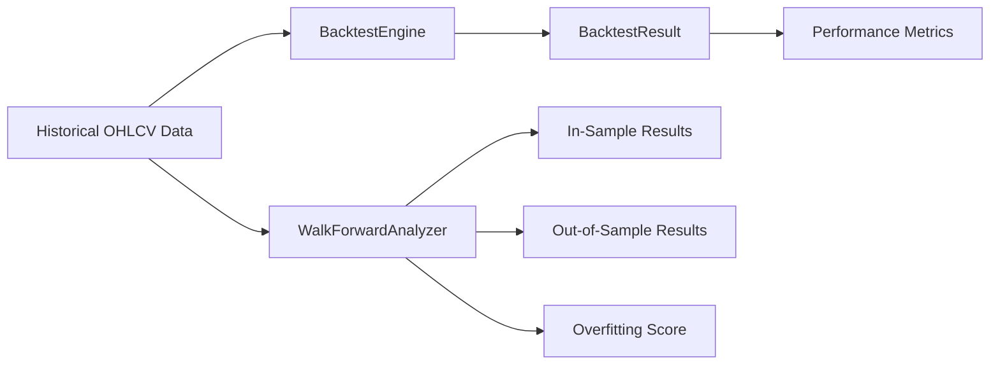

# Backtesting & Walk-Forward Analysis

AkibaCryptoBot includes a full backtesting framework for evaluating strategies against historical data before deploying them live.

---

## Architecture



| Component | File | Purpose |
|---|---|---|
| `BacktestEngine` | `src/backtesting/engine.py` | Event-driven backtest simulation |
| `WalkForwardAnalyzer` | `src/backtesting/walkforward.py` | Walk-forward analysis with overfitting detection |
| `backtest_runner.py` | `src/backtesting/backtest_runner.py` | CLI runner script |

---

## Running a Backtest

```bash
cd akibaCryptobot
python src/backtesting/backtest_runner.py
```

The runner:
1. Loads configuration from `config/config.json`
2. Generates synthetic OHLCV data (or loads real data if available)
3. Runs both a standard backtest and a walk-forward analysis
4. Saves results to `results/` as JSON files
5. Prints a formatted summary to the terminal

---

## How the Backtest Engine Works

The `BacktestEngine` simulates trading on historical data using an event-driven loop:

```
For each candle in the combined timeline:
    1. Check exit conditions for all open positions
       ├─ Stop loss hit?
       ├─ Take profit hit?
       └─ Strategy exit signal?
    2. Generate signal from strategy
    3. If signal is valid and within limits:
       ├─ Calculate position size
       ├─ Execute entry (simulated)
       └─ Record the trade
    4. Update equity curve
```

### Key features:
- **Multi-symbol support** — combines data from all pairs and processes in chronological order
- **Fee simulation** — configurable trading fee (default 0.1%)
- **Risk management** — uses `RiskManager` for position sizing and stop levels
- **Equity curve tracking** — records portfolio value at each step

---

## Backtest Results

`BacktestResult` contains:

| Metric | Description |
|---|---|
| `total_trades` | Number of completed trades |
| `winning_trades` | Trades with positive PnL |
| `losing_trades` | Trades with negative PnL |
| `win_rate` | Winning trades / Total trades |
| `total_pnl` | Absolute profit/loss |
| `total_pnl_percentage` | PnL as percentage of initial balance |
| `profit_factor` | Gross profits / Gross losses (>1 is profitable) |
| `sharpe_ratio` | Risk-adjusted return (annualized) |
| `max_drawdown` | Largest peak-to-trough decline |
| `avg_win` | Average winning trade PnL |
| `avg_loss` | Average losing trade PnL |
| `max_consecutive_wins` | Longest winning streak |
| `max_consecutive_losses` | Longest losing streak |
| `equity_curve` | List of portfolio values over time |
| `trades` | List of individual `BacktestTrade` objects |

---

## Walk-Forward Analysis

Walk-forward testing splits data into rolling **in-sample** (training) and **out-of-sample** (testing) windows to detect overfitting.

### Configuration

Set in `config/config.json`:

```json
{
  "walkforward": {
    "n_splits": 5,
    "train_ratio": 0.7,
    "retrain": true
  }
}
```

| Key | Default | Description |
|---|---|---|
| `n_splits` | 5 | Number of walk-forward windows |
| `train_ratio` | 0.7 | Fraction of each window used for training |
| `retrain` | true | Re-train ML models on each in-sample window |

### How It Works

```
|──── Window 1 ────|──── Window 2 ────|──── Window 3 ────|
|  Train  |  Test  |  Train  |  Test  |  Train  |  Test  |
|   70%   |  30%   |   70%   |  30%   |   70%   |  30%   |
```

1. Data is split into `n_splits` equal windows
2. For each window, the first `train_ratio` is used as in-sample
3. The strategy is tested on the remaining out-of-sample period
4. If `retrain` is enabled, ML models (FreqAI) are re-trained on each in-sample window
5. Results are aggregated and compared

### Overfitting Score

The analyzer calculates an **overfitting score** (0.0–1.0) by comparing in-sample vs out-of-sample performance degradation:

| Score | Interpretation |
|---|---|
| 0.0–0.3 | ✅ Low overfitting risk — strategy generalizes well |
| 0.3–0.6 | ⚠️ Moderate overfitting — review strategy parameters |
| 0.6–1.0 | 🚨 High overfitting — strategy likely curve-fit to historical data |

### Walk-Forward Metrics

All `BacktestResult` metrics are computed for both in-sample and out-of-sample periods, plus:

| Metric | Description |
|---|---|
| `overfitting_score` | Performance degradation measure |
| `in_sample_results` | List of backtest results for each training window |
| `out_of_sample_results` | List of backtest results for each test window |

---

## Hyperopt

AkibaCryptoBot now includes a Freqtrade-inspired hyperopt workflow powered by `optuna`, but executed against the native `BacktestEngine` rather than Freqtrade itself.

### Install

```bash
pip install -r requirements-hyperopt.txt
```

### Run

```bash
python scripts/run_hyperopt.py \
  --strategy momentum \
  --epochs 100 \
  --spaces buy roi stoploss \
  --loss ProfitDrawDownHyperOptLoss \
  --data-dir data/ohlcv
```

### Supported spaces

- `buy`
- `sell`
- `roi`
- `stoploss`
- `trailing`
- `trades`
- `default`
- `all`

### Outputs

Each run writes:
- a trial summary JSON under `results/hyperopt/`
- a merged best-config JSON under `results/hyperopt/`

The merged config applies the best parameter set to the current runtime config so you can promote it into your checked-in config after review.

## Microstructure Replay Features

Phase 13 adds replay-driven microstructure helpers in `src/indicators/microstructure_features.py`. These helpers are intended for offline research and future low-latency strategy work, not live execution.

The current primitives are:

- `spread_from_snapshot()` for best-ask minus best-bid spread
- `depth_imbalance()` for top-of-book or depth-window imbalance
- `trade_pressure()` for short-horizon buy/sell pressure from replayed trade records
- `feature_vector_from_replay()` for building research-ready feature rows from replayed depth sequences

These features are most useful when fed by the bounded capture/replay format introduced in Phase 12 and extended by the Phase 13 depth replay harness.

## HFT Simulation Requirements

Phase 15 defines the minimum execution-simulation quality needed before HFT-oriented research can be trusted. The current candle backtest engine and microstructure replay helpers are useful for research, but they are not yet sufficient to model real HFT execution behavior.

### Queue Position Modeling

HFT research needs queue-aware fill simulation, not just candle-close execution assumptions.

Minimum expectations:

- passive orders should track an estimated queue position at the target price level
- fills should depend on both queued volume ahead of the order and observed trade-through volume
- queue position should advance or decay as depth updates and trades arrive
- cancellations at the best price should affect whether the order becomes fillable sooner

If the simulator cannot represent queue position, it cannot reliably research market-making or other passive-order strategies.

### Aggressive vs Passive Fills

The replay layer must distinguish between aggressive and passive execution paths.

Minimum expectations:

- aggressive orders should fill against the available book depth at the time of submission, subject to slippage and depth exhaustion
- passive orders should only fill when market flow reaches the resting order
- partial fills should be possible on both paths
- the simulator should preserve whether the order was liquidity-taking or liquidity-providing

This distinction matters because HFT PnL and adverse-selection risk depend heavily on execution role.

### Stale-Book Invalidation

Replay or simulation must invalidate book state when the underlying data is incomplete or stale.

Minimum expectations:

- missing depth deltas, gaps, or sequence breaks should mark the book stale
- stale books should stop being used for precision fill estimates until the book is rebuilt
- trade events without corresponding book continuity should be treated as fidelity degradation, not silently accepted as exact fills
- the simulator should surface stale-book events so research runs can be filtered or discarded

### Replay Fidelity Expectations

For HFT research, replay fidelity must be explicit about what it preserves and what it does not.

Minimum expectations:

- preserve event order and timestamps for depth, trade, and cancellation events
- preserve sequence continuity or mark the replay as degraded when continuity is lost
- preserve enough depth history to reconstruct book changes between fills
- preserve trade side/pressure signals well enough for short-horizon research
- record when the replay is approximate rather than exact

Current state note:

- Phase 12 and Phase 13 provide bounded event capture, depth replay, and microstructure feature groundwork
- they do not yet provide a full queue-sensitive, venue-faithful HFT fill simulator
- HFT research should treat any results from the current replay stack as lower-fidelity until queue position and passive/aggressive fill behavior are modeled explicitly

## Interpreting Results

### Sharpe Ratio

| Value | Rating |
|---|---|
| < 0.5 | 🔴 Poor |
| 0.5 – 1.0 | 🟡 Moderate |
| 1.0 – 2.0 | 🟢 Good |
| > 2.0 | 🟢 Excellent |
| > 3.0 | 🏆 Outstanding |

### Sortino Ratio

Similar to Sharpe but only penalises downside volatility — generally higher than Sharpe for the same strategy. A value > 2.0 indicates good performance.

### Profit Factor

| Value | Interpretation |
|---|---|
| < 1.0 | 🔴 Losing money |
| 1.0 – 1.5 | 🟡 Marginally profitable |
| 1.5 – 2.0 | 🟢 Good |
| > 2.0 | 🟢 Excellent |
| > 3.0 | 🏆 Outstanding |

### Win Rate

| Value | Interpretation |
|---|---|
| < 40% | Requires a high win/loss ratio to be profitable |
| 40% – 50% | Average — needs good avg win/avg loss ratio |
| 50% – 60% | 🟢 Good |
| > 60% | 🟢 Excellent |

### Maximum Drawdown

| Value | Risk Level |
|---|---|
| < 10% | 🟢 Low risk |
| 10% – 20% | 🟡 Moderate risk |
| 20% – 30% | 🟠 High risk |
| > 30% | 🔴 Very high risk — reconsider strategy |

### Overall Checklist

| Signal | Target |
|---|---|
| Profit factor | > 1.5 |
| Sharpe ratio | > 1.0 |
| Max drawdown | < 20% |
| Overfitting score | < 0.3 |
| Win rate (in vs out-of-sample) | Consistent |

### Red Flags
- Sharpe drops significantly from in-sample to out-of-sample
- High overfitting score (> 0.6)
- Very few trades — insufficient data for statistical significance
- Max drawdown > 30%

> [!TIP]
> Always run walk-forward analysis before deploying a strategy live. A strategy that looks great in a single backtest may be overfit to historical data.

---

## Performance Metrics Tracker

The `PerformanceMetricsTracker` (`src/performance/metrics_tracker.py`) records live and backtest trade data and provides the API used by both the REST API and Telegram bot.

### Trade Data Structure

```python
@dataclass
class Trade:
    symbol: str
    side: str           # "buy" or "sell"
    entry_price: float
    exit_price: float
    amount: float
    entry_time: datetime
    exit_time: datetime
    pnl: float          # Absolute PnL after fees
    pnl_percent: float
    exit_reason: str    # "stop_loss", "take_profit", "strategy", etc.
    strategy: str
    fees: float
    metadata: Dict      # stop_loss, take_profit levels at entry
```

### Python API

```python
from performance.metrics_tracker import PerformanceMetricsTracker

tracker = PerformanceMetricsTracker(
    initial_balance=10000.0,
    risk_free_rate=0.02    # 2% annual risk-free rate for Sharpe calculation
)

# Record trade entry
tracker.record_trade_entry(
    symbol='BTC/USDT',
    side='buy',
    amount=0.1,
    entry_price=50000.0,
    strategy='momentum',
    metadata={'stop_loss': 49000.0, 'take_profit': 52000.0}
)

# Record trade exit
trade = tracker.record_trade_exit(
    symbol='BTC/USDT',
    exit_price=52000.0,
    exit_reason='take_profit',
    fees=5.2
)
print(f"Trade PnL: ${trade.pnl:.2f} ({trade.pnl_percent:.2f}%)")

# Get comprehensive metrics summary
metrics = tracker.get_metrics_summary()
print(f"Win Rate:     {metrics['win_rate']:.1f}%")
print(f"Sharpe:       {metrics['sharpe_ratio']:.3f}")
print(f"Max Drawdown: {metrics['max_drawdown_percent']:.2f}%")

# Per-strategy breakdown
momentum_perf = tracker.get_strategy_performance('momentum')
all_strats = tracker.get_all_strategies_performance()

# Export for external analysis
trades_df = tracker.export_trades_to_dataframe()
trades_df.to_csv('trade_history.csv')

equity_df = tracker.get_equity_curve_data()

# Generate full formatted ASCII report
report = tracker.generate_performance_report()
print(report)
```

### Implementation Notes

- **Metrics are cached for 60 seconds** to reduce recalculation overhead during rapid API polls
- **Balance syncs automatically** with the exchange every trading cycle, updating the equity curve and daily returns
- **Fees are included** in PnL calculations — `trade.pnl` is the net result after `trade.fees`
- **Both long and short** positions are supported
- **Per-strategy tracking** lets you compare Momentum vs ML vs Ensemble performance side by side
- All timestamps are in local timezone
