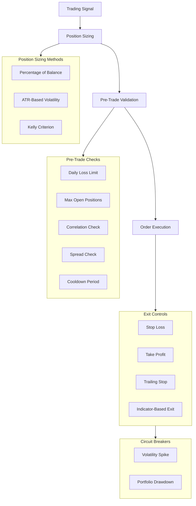

# Risk Management

AkibaCryptoBot employs a multi-layer risk management system that controls position sizing, enforces exit rules, monitors portfolio-level risk, and halts trading during extreme market conditions.

---

## Risk Architecture



---

## Position Sizing

Three methods are available, from simplest to most sophisticated:

### 1. Percentage of Balance (default)

```
position_size = balance × stake_amount
```

- Controlled by `trading.stake_amount` (default 5%)
- Capped by `risk_management.max_position_size`

### 2. ATR-Based Volatility Sizing

Adjusts position size based on market volatility:

```
ATR = Average True Range over 14 periods
risk_per_unit = ATR × atr_risk_multiplier
position_size = (balance × atr_risk_per_trade) / risk_per_unit
```

- Higher volatility → smaller position
- Lower volatility → larger position

### 3. Kelly Criterion

Calculates the mathematically optimal bet size:

```
kelly_fraction = win_rate - (1 - win_rate) / win_loss_ratio
adjusted = kelly_fraction × kelly_max_fraction  (safety cap)
position_size = base_position × adjusted
```

- `kelly_max_fraction` (default 0.25) limits Kelly to 25% of the full Kelly value for safety
- Falls back to percentage sizing if win/loss data is insufficient

### Combined Sizing

When advanced risk is enabled, the position sizing pipeline is:

```
1. Calculate ATR-based size
2. Apply Kelly adjustment
3. Cap at max_position_size × balance
4. Scale by signal strength (0.0–1.0)
```

---

## Stop Loss & Take Profit

### Static Levels

| Control | Default | Config Key |
|---|---|---|
| Stop Loss | 2% below entry | `risk_management.stop_loss_percent` |
| Take Profit | 4% above entry | `risk_management.take_profit_percent` |

### Dynamic Levels (ATR-based)

The `MomentumStrategy` calculates dynamic levels using ATR:

```
stop_loss  = entry_price - (ATR × 2.0)   [for longs]
take_profit = entry_price + (ATR × 3.0)  [for longs]
```

Provides wider stops in volatile markets and tighter stops in calm markets.

---

## Trailing Stop

When `risk_management.trailing_stop` is `true`:

1. After the price moves in your favour by `trailing_stop_positive` (default 1%), the trailing stop activates
2. The stop ratchets upward (for longs) as price increases
3. It never moves backward
4. Trailing stop is persisted to SQLite so it survives restarts

---

## Pre-Trade Validation

Before any trade is placed, these checks must pass:

| Check | Rule | Config Key |
|---|---|---|
| **Daily loss limit** | Total daily losses < `max_daily_loss` × balance | `risk_management.max_daily_loss` |
| **Max positions** | Open trades < `max_open_trades` | `trading.max_open_trades` |
| **Cooldown** | `cooldown_candles` have passed since last trade on this pair | `risk_management.cooldown_candles` |
| **Spread check** | Bid-ask spread < `max_spread_percent` | `risk_management.max_spread_percent` |
| **Correlation** | New position doesn't violate correlation diversification rules | Advanced risk config |
| **Signal strength** | Signal strength ≥ `min_signal_strength` | `strategy_config.min_signal_strength` |

---

## Correlation Diversification

The `AdvancedRiskManager` tracks correlations between assets:

1. Calculates rolling correlations between all pairs using closing prices
2. Before opening a new position, checks if the new asset is highly correlated (> threshold) with existing positions
3. Blocks the trade if it would concentrate risk in correlated assets

---

## Circuit Breakers

Two circuit breakers can halt all trading automatically:

### Volatility Circuit Breaker

```
If current_volatility > historical_average × volatility_threshold → HALT
```

- `circuit_breaker.volatility_threshold` (default `3.0`)
- Triggers when market volatility is 3× the normal level
- Checked every trading cycle using ATR across all tracked pairs

### Drawdown Circuit Breaker

```
If (peak_portfolio_value - current_value) / peak_portfolio_value > drawdown_threshold → HALT
```

- `circuit_breaker.drawdown_threshold` (default `0.20`)
- Triggers when portfolio drawdown exceeds 20%
- Uses `portfolio_value_history` tracked each cycle

### When a Circuit Breaker Triggers:

1. `circuit_breaker_active` flag is set to `true`
2. `circuit_breaker_reason` describes why
3. No new trades are opened
4. Existing positions are **not** automatically closed (they still have stop losses)
5. The Telegram bot and API report the circuit breaker state
6. Manual intervention is needed to resume (or wait for conditions to normalize)

---

## Portfolio Risk Report

The risk system generates a comprehensive report accessible via:
- **Telegram:** `/risk` command
- **API:** `GET /api/risk`

Report includes:
- Daily PnL and trade count
- Current position exposure per asset
- Portfolio drawdown (current vs peak)
- Correlation matrix
- Circuit breaker status
- Risk utilization (how much of the risk budget is consumed)

---

## Configuration Summary

```json
{
  "risk_management": {
    "max_position_size": 0.05,
    "max_daily_loss": 0.02,
    "stop_loss_percent": 0.02,
    "take_profit_percent": 0.04,
    "trailing_stop": true,
    "trailing_stop_positive": 0.01,
    "cooldown_candles": 5,
    "max_spread_percent": 0.5
  },
  "circuit_breaker": {
    "volatility_threshold": 3.0,
    "drawdown_threshold": 0.20
  }
}
```

> [!CAUTION]
> These defaults are conservative. Increasing `max_daily_loss` or `max_position_size` above 5% significantly increases risk of ruin. Always backtest risk parameter changes before deploying live.
