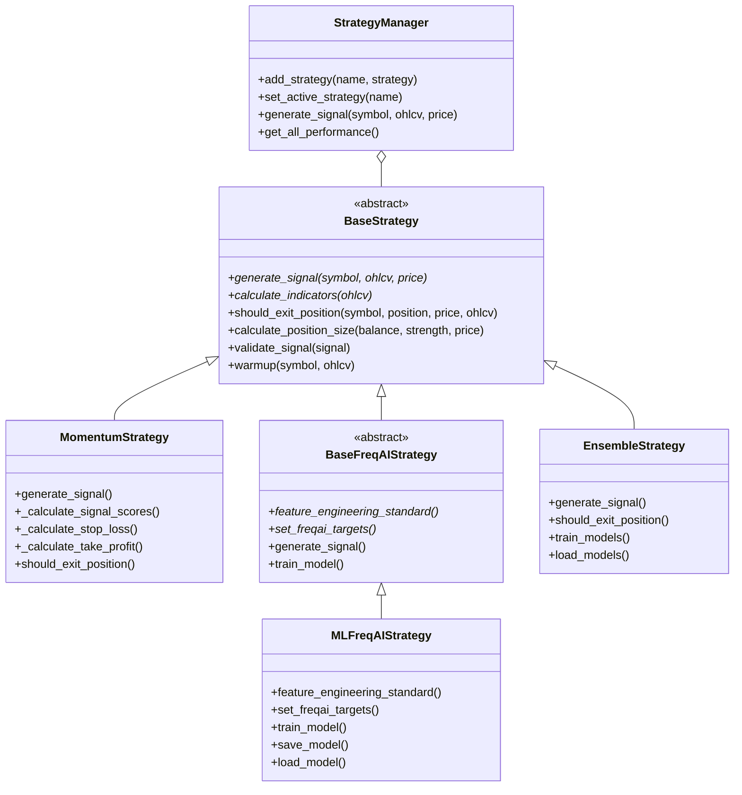

# Trading Strategies

AkibaCryptoBot uses a pluggable strategy system. Every strategy inherits from `BaseStrategy`, and the `StrategyManager` handles registration, selection, and signal dispatch.

## Operating Modes

The documentation and operator expectations should distinguish three different trading regimes:

| Mode | Typical cadence | Strategy style | Operator focus |
|---|---|---|---|
| **Standard algo** | Candle or fixed-cycle scans | Momentum, ensemble, and other timeframe-driven strategies | Correctness, stability, risk control, and explainability |
| **Low-latency runtime** | Event-driven, websocket-fed, rollout-aware | Runtime-managed entries/exits, replay-backed validation, and microstructure-adjacent research | Feed freshness, queue lag, rollout health, and restart safety |
| **HFT** | Venue-near, latency-budgeted, queue-sensitive | Market making, inventory-aware quoting, order-flow alpha, microstructure stat-arb | Latency SLOs, kill-switch response, fill quality, and infrastructure discipline |

Current platform state:

- Standard algo strategies are supported today.
- The low-latency runtime exists and can be rolled out in paper/live stages.
- The native hot-path boundary is in place for future extraction.
- The repo is not yet a true HFT platform; HFT is a future operating regime and should be documented as such.

When evaluating a strategy or an operator surface, use the operating mode to decide what “healthy” means:

- Standard algo: successful signal generation, sensible risk controls, and reliable cycle completion.
- Low-latency runtime: fresh market data, bounded queue lag, clean rollout health, and benign shadow divergence.
- HFT: latency SLO compliance, order-book fidelity, fast anomaly handling, and venue-near execution discipline.

---

## Strategy Hierarchy



---

## Signal Types

| Signal | Meaning |
|---|---|
| `BUY` | Open a long position |
| `SELL` | Open a short position |
| `HOLD` | No action |
| `CLOSE_LONG` | Exit an existing long |
| `CLOSE_SHORT` | Exit an existing short |

Each signal carries a **strength** value (0.0–1.0) that influences position sizing. A signal must meet `min_signal_strength` (default `0.45`) to be acted upon.

---

## Built-in Strategies

### 1. MomentumStrategy

A technical-analysis strategy that combines multiple indicators into a composite score.

**BUY conditions** (each adds to the buy score):
- RSI between `rsi_oversold` and `rsi_overbought` (+0.2)
- MACD line > Signal line (+0.25)
- Price below middle Bollinger Band (+0.15)
- Stochastic %K < `stoch_oversold` (+0.15)
- ADX > `adx_threshold` (+0.1)
- Volume above `min_volume_ratio` × average (+0.15)

**SELL conditions** (mirror logic):
- RSI > `rsi_overbought` (+0.2)
- MACD line < Signal line (+0.25)
- Price above upper Bollinger Band (+0.15)
- Stochastic %K > `stoch_overbought` (+0.15)
- ADX > `adx_threshold` (+0.1)
- Volume above average (+0.15)

**Dynamic exit logic:**
- ATR-based stop loss / take profit
- Indicator reversal detection (RSI flip, MACD crossover)
- Bollinger Band breakout exits

**Required history:** 200 candles

---

### 2. EnsembleStrategy

Combines Momentum and FreqAI ML signals using weighted voting.

| Component | Weight | Type |
|---|---|---|
| MomentumStrategy | 40% | Technical Analysis |
| MLFreqAIStrategy | 60% | Machine Learning |

**Signal generation:**
1. Each sub-strategy generates its own signal independently
2. BUY signals contribute `+weight × strength`, SELL signals contribute `−weight × strength`
3. Net score > agreement threshold → BUY; net score < −threshold → SELL
4. Final strength = weighted average of contributing signals

**Exit logic:** Exit if a majority of sub-strategies agree on exiting.

**Minimum agreement threshold:** 0.3 (configurable)

---

### 3. MLFreqAIStrategy (FreqAI)

A LightGBM-based classifier that predicts future price direction.

**Feature engineering (30+ features):**
- RSI (14), MACD (line, signal, histogram), Bollinger Bands (upper, middle, lower, %B, width)
- Stochastic %K/%D, ADX, ATR, OBV
- Price change percentages (1, 3, 5, 10 periods)
- Rolling volatility (10, 20 periods)
- Volume ratio vs 20-period average
- SMA/EMA crossover signals

**Target:** Future price direction over `lookahead_period` candles (default 5)
- Label `1` (buy) if future return > +1%
- Label `-1` (sell) if future return < −1%
- Label `0` (hold) otherwise

**Training:** `train_model()` trains on historical data with 80/20 train/test split. Model is saved to `models/<SYMBOL>_freqai.joblib` with a timestamp for expiry tracking.

**Model expiry:** Models older than `model_expiry_hours` (default 48) are flagged; the strategy falls back to a weak signal.

---

## How to Select a Strategy

Set the `strategy` key in `config/config.json`:

```json
{
  "trading": {
    "strategy": "ensemble"
  }
}
```

Or override via CLI:

```bash
python start_bot.py --strategy momentum
python start_bot.py --strategy ensemble
```

---

## Creating a Custom Strategy

1. Create a new file `src/strategies/my_strategy.py`
2. Inherit from `BaseStrategy`
3. Implement the required abstract methods

```python
from strategies.base_strategy import BaseStrategy, TradingSignal, SignalType
from indicators.technical_indicators import TechnicalIndicators

class MyStrategy(BaseStrategy):
    def __init__(self, config):
        super().__init__(config)
        self.name = "MyStrategy"

    def calculate_indicators(self, ohlcv_data):
        """Add your indicators to the dataframe."""
        df = ohlcv_data.copy()
        df["rsi"] = TechnicalIndicators.rsi(df["close"], period=14)
        df["sma_50"] = TechnicalIndicators.sma(df["close"], period=50)
        return df

    def generate_signal(self, symbol, ohlcv_data, current_price):
        """Return a TradingSignal or None."""
        df = self.calculate_indicators(ohlcv_data)
        latest = df.iloc[-1]

        if latest["rsi"] < 30 and current_price > latest["sma_50"]:
            return TradingSignal(
                signal_type=SignalType.BUY,
                strength=0.7,
                price=current_price,
                timestamp=datetime.now(),
                stop_loss=current_price * 0.98,
                take_profit=current_price * 1.04,
            )
        return None

    def get_required_history(self):
        return 100
```

3. Register your strategy by adding it to `_load_strategies()` in `bot.py`, or use `StrategyManager.add_strategy("my_strategy", MyStrategy(config))`.

---

## Available Indicators

The `TechnicalIndicators` class provides static methods for all supported indicators:

| Category | Indicators |
|---|---|
| **Trend** | SMA, EMA, Hull MA, KAMA, ADX, Ichimoku Cloud, SuperTrend |
| **Momentum** | RSI, MACD, Stochastic, Williams %R, CCI |
| **Volatility** | Bollinger Bands, ATR |
| **Volume** | OBV, VWAP, MFI |
| **Pattern** | Support/Resistance detection, Trend detection, Divergence detection |
