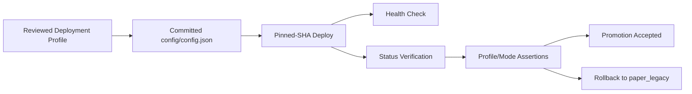

# Phase 10 Profile-Aware Deployment Verification and Paper Promotion Spec

## Status

Draft implementation spec for the tenth refactor milestone.

## Purpose

Phase 9 completed the profile-driven paper rollout contract:

- reviewed deployment profiles exist
- live-runtime guardrails are enforced
- operator surfaces expose configured and effective runtime ownership
- a local helper can switch the sample config between reviewed profiles
- integration coverage verifies promotion, rollback, and live guard behavior

What remains weak is the deployment path itself.
The current direct-deploy flow can still be noisy, and deploy-time verification does not yet assert that the server actually came up on the expected profile and effective runtime mode.

Phase 10 makes deployment profile-aware and verification-driven so paper promotion can be executed with tighter operational guarantees.

## Dependencies

Phase 10 depends on:

- [docs/specs/PHASE_8_PAPER_PRIMARY_ACTIVATION_SPEC.md](/home/lekim/Projects/akibaCryptobot/docs/specs/PHASE_8_PAPER_PRIMARY_ACTIVATION_SPEC.md)
- [docs/specs/PHASE_9_PAPER_DEFAULT_AND_LIVE_GUARDS_SPEC.md](/home/lekim/Projects/akibaCryptobot/docs/specs/PHASE_9_PAPER_DEFAULT_AND_LIVE_GUARDS_SPEC.md)
- [scripts/deploy_snapshot.sh](/home/lekim/Projects/akibaCryptobot/scripts/deploy_snapshot.sh)
- [scripts/set_runtime_profile.py](/home/lekim/Projects/akibaCryptobot/scripts/set_runtime_profile.py)
- [docs/DEPLOYMENT.md](/home/lekim/Projects/akibaCryptobot/docs/DEPLOYMENT.md)
- [docs/CONFIGURATION.md](/home/lekim/Projects/akibaCryptobot/docs/CONFIGURATION.md)
- [src/api/routes/status.py](/home/lekim/Projects/akibaCryptobot/src/api/routes/status.py)

## Problem Statement

Current gaps after Phase 9:

1. Deploy verification confirms health, but it does not assert that the server is running the expected deployment profile.
2. Deploy logs still emit noisy `curl` failures after otherwise successful restarts.
3. Operators can promote a paper profile locally, but the deploy path does not yet verify the profile/mode that actually came up on the server.
4. Rollback is documented, but deploy-time checks do not yet distinguish between “service is healthy” and “service is healthy on the intended profile.”
5. The project is ready for paper promotion, but the deployment control plane is not yet tight enough for repetitive runtime cutover work.

## Phase 10 Goals

1. Make deploys profile-aware and verification-driven.
2. Verify configured deployment profile and effective runtime mode after deploy.
3. Remove misleading post-success deploy noise from the direct deploy helper.
4. Keep rollback to `paper_legacy` explicit and easy to verify.
5. Prepare the codebase for actual paper-profile promotion work on the server.

## Phase 10 Non-Goals

1. Live-money runtime activation.
2. Removing the legacy loop.
3. Strategy changes.
4. HFT-specific execution work.
5. Replacing the current deployment mechanism with a full orchestration platform.

## Architecture Decision

Phase 10 treats deployment verification as a first-class contract.



The key decision is that a deploy is not complete when the process is merely healthy.
It is complete when the server is healthy **and** reports the expected profile and runtime ownership.

## Target Topology

Paper deploy workflow should become:

1. apply reviewed profile locally
2. commit reviewed config change
3. deploy pinned SHA
4. assert server health
5. assert configured deployment profile
6. assert effective runtime mode and ownership
7. continue promotion or roll back

## Required Surfaces

### Deploy Helper

Priority targets:

- [scripts/deploy_snapshot.sh](/home/lekim/Projects/akibaCryptobot/scripts/deploy_snapshot.sh)

Minimum guarantees:

- pinned SHA deploy remains mandatory
- health check output is deterministic
- post-success noise is removed
- optional expected profile/mode assertions can fail the deploy

### Promotion Helper Flow

Priority targets:

- [scripts/set_runtime_profile.py](/home/lekim/Projects/akibaCryptobot/scripts/set_runtime_profile.py)
- deploy docs only if no extra helper is needed

Minimum guarantees:

- operators can promote and roll back with a small, explicit command sequence
- no server-side config mutation path is added

### Deployment Documentation

Priority targets:

- [docs/DEPLOYMENT.md](/home/lekim/Projects/akibaCryptobot/docs/DEPLOYMENT.md)
- [docs/CONFIGURATION.md](/home/lekim/Projects/akibaCryptobot/docs/CONFIGURATION.md)

Minimum guarantees:

- docs show the exact promotion/rollback command flow
- docs show what post-deploy assertions must pass
- docs distinguish health success from profile/mode success

## File Layout

```text
scripts/
  deploy_snapshot.sh
  set_runtime_profile.py
tests/
  test_set_runtime_profile.py
  runtime/
    test_phase10_deploy_verification.py
docs/
  CONFIGURATION.md
  DEPLOYMENT.md
  specs/
    PHASE_10_PROFILE_AWARE_DEPLOY_SPEC.md
```

## Core Design Decisions

### 1. Health Alone Is Not Enough

If the service starts but the server reports the wrong deployment profile or runtime mode, the deploy must be considered failed.

### 2. Deployment Must Stay Pinned and Reviewable

The deploy path must keep using reviewed repo state and pinned SHAs.
No hidden server-side mutations are allowed.

### 3. Promotion and Rollback Must Use the Same Control Plane

The same helper/docs flow should cover both promotion and rollback, with only the selected profile changing.

### 4. Deploy Logs Must Be Trustworthy

Noise after success undermines operator confidence.
The direct deploy helper should print a clear success/failure boundary.

## Task Breakdown

### P10-01: Harden direct deploy helper output and sequencing

Acceptance:

- deploy helper no longer emits misleading post-success curl failures
- deploy output is deterministic and easy to interpret
- pinned SHA remains explicit

### P10-02: Add expected profile/mode verification to deploy helper

Acceptance:

- deploy helper can assert configured deployment profile after restart
- deploy helper can assert effective runtime mode after restart
- mismatches fail the deploy loudly

### P10-03: Document profile-aware paper promotion and rollback

Acceptance:

- docs show how to apply `paper_shadow`, `paper_runtime_entries`, `paper_runtime_primary`, and `paper_legacy`
- docs show expected status fields after deploy
- docs show rollback verification steps

### P10-04: Add integration coverage for deploy verification logic

Acceptance:

- tests cover expected-profile assertions
- tests cover expected-effective-mode assertions
- tests cover clean success and mismatch failure paths

### P10-05: Prepare the first paper promotion runbook

Acceptance:

- the repo contains a concise operator runbook for the first real `paper_shadow` promotion
- the runbook references exact status fields and expected values
- rollback to `paper_legacy` is listed as the immediate fallback

## Acceptance Criteria

Phase 10 is complete when:

1. Direct deploys can verify the intended profile and runtime mode.
2. Deploy logs clearly distinguish success from failure.
3. Paper promotion and rollback use a documented, repeatable command flow.
4. Profile-aware deploy verification is covered by tests.
5. The repo is operationally ready for the first real paper-profile promotion.

## Rollout Notes

Recommended implementation order:

1. deploy helper cleanup
2. expected profile/mode assertions
3. docs/runbook
4. integration coverage
5. first promotion checklist

Recommended first paper promotion after Phase 10:

1. apply `paper_shadow`
2. commit and deploy pinned SHA
3. verify `configured_deployment_profile=paper_shadow`
4. verify `effective_runtime_mode=shadow`
5. verify rollout health remains `shadow_ready`
6. promote further only after operator review
