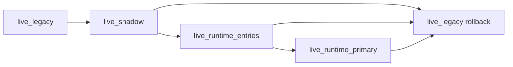

# Phase 11 Live Runtime Activation Spec

## Status

Draft implementation spec for the eleventh refactor milestone.

## Purpose

Phase 10 completed the paper rollout control plane:

- deployment profiles are explicit
- paper promotion and rollback are documented
- deploy verification is deterministic
- runtime startup has a distinct `startup_pending` state
- `paper_shadow` can be promoted and observed safely

What remains unfinished is live production activation.
The runtime can shadow and trade in paper mode, but the repo still treats live runtime ownership as something to reject unless explicitly overridden.

Phase 11 defines the live rollout contract so the runtime can be introduced to live trading through guarded, reversible steps rather than a direct cutover.

## Dependencies

Phase 11 depends on:

- [docs/specs/PHASE_8_PAPER_PRIMARY_ACTIVATION_SPEC.md](/home/lekim/Projects/akibaCryptobot/docs/specs/PHASE_8_PAPER_PRIMARY_ACTIVATION_SPEC.md)
- [docs/specs/PHASE_9_PAPER_DEFAULT_AND_LIVE_GUARDS_SPEC.md](/home/lekim/Projects/akibaCryptobot/docs/specs/PHASE_9_PAPER_DEFAULT_AND_LIVE_GUARDS_SPEC.md)
- [docs/specs/PHASE_10_PROFILE_AWARE_DEPLOY_SPEC.md](/home/lekim/Projects/akibaCryptobot/docs/specs/PHASE_10_PROFILE_AWARE_DEPLOY_SPEC.md)
- [src/runtime/config.py](/home/lekim/Projects/akibaCryptobot/src/runtime/config.py)
- [src/runtime/mode.py](/home/lekim/Projects/akibaCryptobot/src/runtime/mode.py)
- [src/bot.py](/home/lekim/Projects/akibaCryptobot/src/bot.py)
- [start_bot.py](/home/lekim/Projects/akibaCryptobot/start_bot.py)
- [scripts/deploy_snapshot.sh](/home/lekim/Projects/akibaCryptobot/scripts/deploy_snapshot.sh)
- [docs/DEPLOYMENT.md](/home/lekim/Projects/akibaCryptobot/docs/DEPLOYMENT.md)

## Problem Statement

Current live behavior is intentionally conservative:

1. `live_legacy` is the only reviewed live deployment profile.
2. Runtime-owned live modes are guarded by `allow_live_runtime=true`, but there is no reviewed rollout path that makes this operationally safe.
3. There is no live canary progression equivalent to `paper_shadow -> paper_runtime_entries -> paper_runtime_primary`.
4. Deployment and operator surfaces do not yet treat live runtime activation as a separate operational discipline from paper rollout.
5. A runtime failure in live mode currently relies too heavily on generic rollback behavior instead of purpose-built live guardrails.

## Phase 11 Goals

1. Introduce reviewed live deployment profiles with an explicit canary progression.
2. Keep live runtime activation opt-in and operator-visible.
3. Add live-specific startup checks and rollback guidance.
4. Make deploy verification assert both profile/mode and live rollout safety state.
5. Produce a live canary runbook that is as explicit as the paper rollout runbook.

## Phase 11 Non-Goals

1. Low-latency order-book trading.
2. Native hot-path extraction.
3. HFT-specific infrastructure or colocation work.
4. Strategy redesign.
5. Removing the legacy engine.

## Proposed Deployment Profiles

Add these reviewed live profiles:

- `live_shadow`
- `live_runtime_entries`
- `live_runtime_primary`

Expected intent:

- `live_shadow`: runtime observes only, legacy remains authoritative
- `live_runtime_entries`: runtime owns entries, legacy owns exits
- `live_runtime_primary`: runtime owns entries and exits

`live_legacy` remains the default rollback profile.

## Architecture Decision

Live rollout should use the same phased ownership ladder as paper, but with stricter acceptance gates.



The key design rule is that live activation must not invent a new control plane.
It should reuse the profile-driven rollout model already established in paper mode, with stricter guardrails and narrower promotion criteria.

## Required Surfaces

### Runtime Configuration and Validation

Priority targets:

- [src/runtime/mode.py](/home/lekim/Projects/akibaCryptobot/src/runtime/mode.py)
- [src/runtime/config.py](/home/lekim/Projects/akibaCryptobot/src/runtime/config.py)
- [config/config.json](/home/lekim/Projects/akibaCryptobot/config/config.json)

Minimum guarantees:

- live profiles parse cleanly
- live runtime activation still requires explicit operator intent
- override-only config does not activate runtime by accident

### Bot Startup and Fail-Fast Guards

Priority targets:

- [src/bot.py](/home/lekim/Projects/akibaCryptobot/src/bot.py)
- [start_bot.py](/home/lekim/Projects/akibaCryptobot/start_bot.py)

Minimum guarantees:

- live runtime startup can fail fast before orders are placed
- guard messages tell the operator exactly why startup was refused
- live runtime canary state is logged at startup

### Operator Surfaces

Priority targets:

- [src/api/routes/status.py](/home/lekim/Projects/akibaCryptobot/src/api/routes/status.py)
- [src/api/websockets.py](/home/lekim/Projects/akibaCryptobot/src/api/websockets.py)
- [src/notifications/telegram_bot.py](/home/lekim/Projects/akibaCryptobot/src/notifications/telegram_bot.py)

Minimum guarantees:

- status distinguishes paper from live rollout
- status distinguishes live canary from live primary
- operator surfaces make rollback recommendation explicit

### Deployment and Runbook

Priority targets:

- [scripts/set_runtime_profile.py](/home/lekim/Projects/akibaCryptobot/scripts/set_runtime_profile.py)
- [scripts/deploy_snapshot.sh](/home/lekim/Projects/akibaCryptobot/scripts/deploy_snapshot.sh)
- [docs/DEPLOYMENT.md](/home/lekim/Projects/akibaCryptobot/docs/DEPLOYMENT.md)
- [docs/CONFIGURATION.md](/home/lekim/Projects/akibaCryptobot/docs/CONFIGURATION.md)

Minimum guarantees:

- live profile promotion requires explicit reviewed config state
- rollout steps are documented in the same style as paper promotion
- rollback to `live_legacy` is immediate and deterministic

## File Layout

```text
src/runtime/
  config.py
  mode.py
src/
  bot.py
start_bot.py
scripts/
  set_runtime_profile.py
  deploy_snapshot.sh
docs/
  CONFIGURATION.md
  DEPLOYMENT.md
tests/
  runtime/
    test_phase11_live_profiles.py
    test_phase11_live_rollout_integration.py
```

## Core Design Decisions

### 1. Live Rollout Must Mirror Paper Rollout

Paper and live should use the same profile model.
That keeps promotion logic understandable and testable.

### 2. Live Runtime Requires Explicit Intent

Live runtime must never activate due to a partial config or stale override.
The operator must opt in through a reviewed profile and live override path.

### 3. Rollback Must Remain Legacy-Based

The emergency fallback is still `live_legacy`, not a partially running runtime mode.

### 4. Canary Before Primary

There should be no path from `live_legacy` directly to `live_runtime_primary`.

## Task Breakdown

### P11-01: Add reviewed live deployment profiles

Acceptance:

- `live_shadow`, `live_runtime_entries`, and `live_runtime_primary` are added to runtime mode/profile parsing
- sample config and validation support them cleanly

### P11-02: Add live runtime startup guardrails and fail-fast behavior

Acceptance:

- live runtime-owned profiles require explicit override
- startup failures are clear and operator-readable
- override-only config does not implicitly activate runtime

### P11-03: Expose live rollout state on operator surfaces

Acceptance:

- status, websocket, and Telegram surfaces distinguish live rollout profiles
- recommended action is explicit for canary vs primary vs rollback

### P11-04: Document and verify live canary deploy flow

Acceptance:

- deploy helper usage covers live canary profiles
- docs include `live_shadow` and rollback flow
- profile/mode assertions remain deploy-time verified

### P11-05: Add end-to-end live rollout integration coverage

Acceptance:

- tests cover `live_legacy`, `live_shadow`, `live_runtime_entries`, and live rejection without override
- tests verify rollback recommendations and startup-pending behavior in live mode

## Acceptance Criteria

Phase 11 is complete when:

1. reviewed live deployment profiles exist
2. live runtime can be activated only by explicit reviewed intent
3. canary live rollout is documented and testable
4. rollback to `live_legacy` is immediate and verified
5. operator surfaces clearly expose live runtime ownership and health state

## Recommended Implementation Order

1. live profiles
2. live startup guardrails
3. operator surface visibility
4. deploy/runbook updates
5. integration coverage
