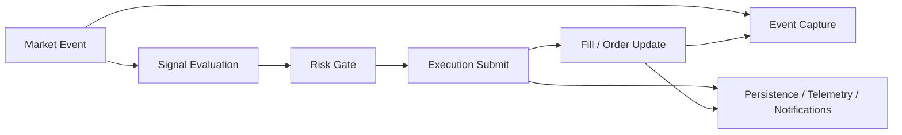

# Phase 12 Low-Latency Event Plane Spec

## Status

Draft implementation spec for the twelfth refactor milestone.

## Purpose

Phases 1 through 11 establish a safe runtime rollout architecture.
What they do not yet provide is a true low-latency trading data plane.

The runtime still depends on components and control flow that were designed for a candle-driven, minute-loop trading engine.
That is acceptable for staged migration, but it is not enough for low-latency trading or eventual HFT.

Phase 12 turns the runtime into a latency-aware event plane with explicit hot-path ownership, incremental market state, and measurable timing budgets.

## Dependencies

Phase 12 depends on:

- [docs/specs/PHASE_2_MARKET_DATA_SHADOW_SPEC.md](/home/lekim/Projects/akibaCryptobot/docs/specs/PHASE_2_MARKET_DATA_SHADOW_SPEC.md)
- [docs/specs/PHASE_3_EXECUTION_POSITION_SPEC.md](/home/lekim/Projects/akibaCryptobot/docs/specs/PHASE_3_EXECUTION_POSITION_SPEC.md)
- [docs/specs/PHASE_5_SIGNAL_STRATEGY_SPEC.md](/home/lekim/Projects/akibaCryptobot/docs/specs/PHASE_5_SIGNAL_STRATEGY_SPEC.md)
- [src/runtime/app.py](/home/lekim/Projects/akibaCryptobot/src/runtime/app.py)
- [src/services/market_data_service.py](/home/lekim/Projects/akibaCryptobot/src/services/market_data_service.py)
- [src/services/signal_service.py](/home/lekim/Projects/akibaCryptobot/src/services/signal_service.py)
- [src/services/execution_service.py](/home/lekim/Projects/akibaCryptobot/src/services/execution_service.py)
- [src/services/telemetry_service.py](/home/lekim/Projects/akibaCryptobot/src/services/telemetry_service.py)

## Problem Statement

Current runtime behavior is event-driven, but not yet low-latency by design:

1. Market state is centered on candles and top-of-book snapshots, not a formally budgeted hot path.
2. Runtime telemetry counts events, but it does not yet enforce or surface latency budgets between stages.
3. Warm-path work and hot-path work are separated conceptually, but not yet measured or optimized as a data plane.
4. The runtime still assumes human-scale rollout observability rather than machine-scale latency discipline.
5. There is no explicit event replay format for low-latency debugging and timing analysis.

## Phase 12 Goals

1. Define a hot path for market event -> signal -> risk -> execution.
2. Add stage-level latency metrics and queue lag metrics.
3. Keep warm-path work explicitly off the trading path.
4. Make incremental state updates the default for hot services.
5. Introduce deterministic event capture and replay for hot-path debugging.

## Phase 12 Non-Goals

1. Full order-book trading.
2. Native hot-path extraction.
3. Colocation or kernel/network tuning.
4. Replacing Python for the control plane.
5. New strategy families beyond the current candle-based logic.

## Architecture Decision

Phase 12 splits the runtime into explicit hot and warm lanes.



The main design rule is that the hot path must be measurable, bounded, and isolated from bookkeeping.

## Required Surfaces

### Runtime Event Plane

Priority targets:

- [src/runtime/app.py](/home/lekim/Projects/akibaCryptobot/src/runtime/app.py)
- [src/runtime/service_registry.py](/home/lekim/Projects/akibaCryptobot/src/runtime/service_registry.py)
- [src/domain/events.py](/home/lekim/Projects/akibaCryptobot/src/domain/events.py)

Minimum guarantees:

- explicit hot-path event types
- event timestamps are preserved through the trading path
- replayable event boundaries are stable

### Market Data and Signal Services

Priority targets:

- [src/services/market_data_service.py](/home/lekim/Projects/akibaCryptobot/src/services/market_data_service.py)
- [src/services/signal_service.py](/home/lekim/Projects/akibaCryptobot/src/services/signal_service.py)
- [src/strategies/indicator_cache.py](/home/lekim/Projects/akibaCryptobot/src/strategies/indicator_cache.py)

Minimum guarantees:

- incremental updates remain in memory
- slow recomputation is not on the hot path
- market gaps and stale state are visible in telemetry

### Execution and Telemetry

Priority targets:

- [src/services/execution_service.py](/home/lekim/Projects/akibaCryptobot/src/services/execution_service.py)
- [src/services/telemetry_service.py](/home/lekim/Projects/akibaCryptobot/src/services/telemetry_service.py)

Minimum guarantees:

- latency metrics exist for:
  - market event -> signal
  - signal -> risk decision
  - risk decision -> order submit
  - submit -> exchange ack
  - ack -> fill handling
- queue depth and lag are operator-visible

### Event Capture and Replay

Priority targets:

- new runtime capture/replay helper modules under `src/runtime/`
- new focused test support under `tests/runtime/`

Minimum guarantees:

- a bounded event log format exists
- captured runtime events can be replayed through services deterministically enough for debugging

## File Layout

```text
src/runtime/
  app.py
  service_registry.py
  event_capture.py
  event_replay.py
src/services/
  market_data_service.py
  signal_service.py
  execution_service.py
  telemetry_service.py
tests/runtime/
  test_phase12_latency_metrics.py
  test_phase12_event_replay.py
docs/
  ARCHITECTURE.md
  API_REFERENCE.md
```

## Core Design Decisions

### 1. Hot Path and Warm Path Are Different Systems

The code may live in one process, but the design must treat them differently.

### 2. Latency Must Be Observable Before It Is Optimized

We should not guess which stage is slow.
We should measure it.

### 3. Replayability Beats Ad Hoc Debugging

If a runtime decision is hard to explain after the fact, the event plane is not mature enough.

### 4. Python Is Still Acceptable at This Stage

Phase 12 makes the Python runtime low-latency aware.
It does not yet move the hot path out of Python.

## Task Breakdown

### P12-01: Add hot-path latency metrics and queue lag metrics

Acceptance:

- hot-path timing metrics are recorded consistently
- queue depth and dropped-event metrics are visible

### P12-02: Harden incremental market/signal state updates

Acceptance:

- signal generation remains incremental
- slow recompute paths are isolated from the hot path

### P12-03: Add runtime event capture format

Acceptance:

- hot-path events can be persisted to a bounded capture format
- capture format preserves ordering and timestamps

### P12-04: Add runtime event replay harness

Acceptance:

- captured events can be replayed through signal/execution paths in tests
- replay is stable enough for debugging latency and sequencing issues

### P12-05: Document latency budgets and operator interpretation

Acceptance:

- docs explain what each latency metric means
- docs explain when queue lag or dropped events are promotion blockers

## Acceptance Criteria

Phase 12 is complete when:

1. the runtime exposes stage-level latency metrics
2. hot-path and warm-path responsibilities are operationally distinct
3. incremental updates dominate the runtime signal path
4. event capture and replay exist for debugging
5. the platform is ready to support non-candle low-latency research

## Recommended Implementation Order

1. telemetry and latency metrics
2. market/signal hot-path hardening
3. event capture
4. replay harness
5. docs
