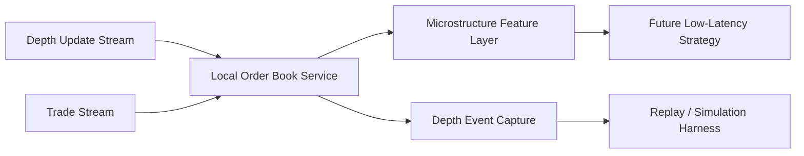

# Phase 13 Order Book and Microstructure Replay Spec

## Status

Draft implementation spec for the thirteenth refactor milestone.

## Purpose

The current runtime is still candle- and snapshot-oriented.
That is useful for staged migration, but it is not the foundation for native low-latency order-book trading.

Phase 13 adds a local order-book data model, event capture for microstructure data, and a replay/simulation surface that can support low-latency strategies and realistic execution research.

## Dependencies

Phase 13 depends on:

- [docs/specs/PHASE_12_LOW_LATENCY_EVENT_PLANE_SPEC.md](/home/lekim/Projects/akibaCryptobot/docs/specs/PHASE_12_LOW_LATENCY_EVENT_PLANE_SPEC.md)
- [src/services/market_data_service.py](/home/lekim/Projects/akibaCryptobot/src/services/market_data_service.py)
- [src/adapters/binance/ws_gateway.py](/home/lekim/Projects/akibaCryptobot/src/adapters/binance/ws_gateway.py)
- [src/exchange/websocket_manager.py](/home/lekim/Projects/akibaCryptobot/src/exchange/websocket_manager.py)
- [src/runtime/event_capture.py](/home/lekim/Projects/akibaCryptobot/src/runtime/event_capture.py)

## Problem Statement

Current market data is insufficient for microstructure-aware trading:

1. There is no local order-book state model.
2. Only top-of-book and klines are normalized into runtime state.
3. There is no depth-sequence handling or gap detection for order-book updates.
4. Backtests and debugging cannot replay order-book state transitions.
5. There is no execution simulator for queue-sensitive order behavior.

## Phase 13 Goals

1. Add normalized local order-book state.
2. Preserve sequence-aware depth updates and gap detection.
3. Capture order-book events in a replayable format.
4. Build a replay harness that reconstructs market state over time.
5. Provide the first microstructure feature layer for future low-latency strategies.

## Phase 13 Non-Goals

1. Native-code execution path.
2. Colocation or exchange-near deployment.
3. Full market-making strategy implementation.
4. Tick-perfect exchange fill modeling.
5. Replacing candle strategies entirely.

## Architecture Decision

Order-book state should be a first-class service, not an ad hoc extension of candle caches.



The main rule is that order-book state must be reconstructible from captured events.

## Required Surfaces

### Local Order Book Service

Priority targets:

- new order-book service under `src/services/`
- exchange websocket normalization in [src/adapters/binance/ws_gateway.py](/home/lekim/Projects/akibaCryptobot/src/adapters/binance/ws_gateway.py)

Minimum guarantees:

- best bid/ask and depth levels are represented explicitly
- sequence numbers or exchange ordering metadata are preserved when available
- stale or gapped order-book state is detectable

### Microstructure Feature Layer

Priority targets:

- new microstructure feature helpers under `src/strategies/` or `src/indicators/`

Minimum guarantees:

- spread
- depth imbalance
- short-horizon trade pressure
- basic queue-sensitive state inputs

### Replay and Simulation

Priority targets:

- new replay/simulation helpers under `src/runtime/` or `src/backtesting/`

Minimum guarantees:

- replay can rebuild order-book state over time
- replay can feed strategy inputs deterministically
- replay can support future fill/slippage modeling

## File Layout

```text
src/services/
  order_book_service.py
src/runtime/
  depth_capture.py
  depth_replay.py
src/indicators/
  microstructure_features.py
tests/runtime/
  test_phase13_order_book_service.py
  test_phase13_depth_replay.py
tests/indicators/
  test_microstructure_features.py
docs/
  ARCHITECTURE.md
  BACKTESTING.md
```

## Core Design Decisions

### 1. Order Book State Must Be Explicit

The runtime should not hide microstructure state inside generic market-data snapshots.

### 2. Capture Before Complex Strategy Work

If depth data cannot be replayed, it is too early to trust microstructure strategies.

### 3. Replay Must Be Good Enough for Research

It does not need to be exchange-perfect on day one, but it must be coherent and reproducible.

### 4. Market-Data Gaps Are First-Class Risk Events

Gap detection is not an implementation detail.
It directly affects whether low-latency strategy decisions are trustworthy.

## Task Breakdown

### P13-01: Add normalized order-book state service

Acceptance:

- local depth state exists per symbol
- best bid/ask and configurable depth windows are queryable

### P13-02: Add sequence/gap detection for depth updates

Acceptance:

- stale or gapped order-book state is flagged
- operator surfaces or telemetry can reflect invalid depth state

### P13-03: Add order-book capture format

Acceptance:

- depth updates and trade events can be recorded for replay
- ordering metadata is preserved

### P13-04: Add order-book replay harness

Acceptance:

- replay can reconstruct the local book
- replay can drive feature generation deterministically

### P13-05: Add microstructure feature primitives

Acceptance:

- spread, imbalance, and trade-pressure features are exposed
- tests verify feature behavior on replayed order-book sequences

## Acceptance Criteria

Phase 13 is complete when:

1. local order-book state exists and is replayable
2. order-book gaps and stale state are detectable
3. microstructure features are available for strategy work
4. replay can feed future low-latency backtests
5. the codebase is ready for the first order-book-driven strategy phase

## Recommended Implementation Order

1. order-book service
2. gap detection
3. capture format
4. replay harness
5. feature primitives
