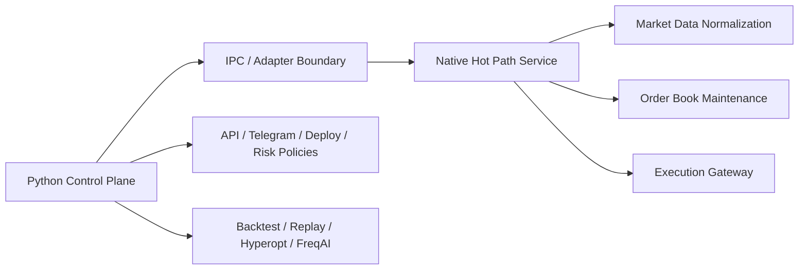

# Phase 14 Native Hot Path Extraction Spec

## Status

Draft implementation spec for the fourteenth refactor milestone.

## Purpose

Phases 12 and 13 make the Python runtime latency-aware and capable of order-book research.
That still does not make the platform a true low-latency production engine.

The latency-critical path will eventually hit Python limits in:

- market-data normalization
- order-book maintenance
- execution decision latency
- queue-sensitive state updates

Phase 14 defines the boundary for moving the hot path into a native component while preserving the existing Python control plane.

## Dependencies

Phase 14 depends on:

- [docs/specs/PHASE_12_LOW_LATENCY_EVENT_PLANE_SPEC.md](/home/lekim/Projects/akibaCryptobot/docs/specs/PHASE_12_LOW_LATENCY_EVENT_PLANE_SPEC.md)
- [docs/specs/PHASE_13_ORDER_BOOK_AND_REPLAY_SPEC.md](/home/lekim/Projects/akibaCryptobot/docs/specs/PHASE_13_ORDER_BOOK_AND_REPLAY_SPEC.md)
- [src/ports/exchange.py](/home/lekim/Projects/akibaCryptobot/src/ports/exchange.py)
- [src/runtime/app.py](/home/lekim/Projects/akibaCryptobot/src/runtime/app.py)
- [src/services/execution_service.py](/home/lekim/Projects/akibaCryptobot/src/services/execution_service.py)

## Problem Statement

Python remains useful, but it should not own the eventual lowest-latency path:

1. Python object churn and async scheduling overhead will limit deterministic latency.
2. Local order-book mutation and exchange event normalization become expensive under higher message rates.
3. The current runtime does not yet define a stable IPC or adapter boundary for a native data plane.
4. Hot-path and control-plane responsibilities still live in the same language/runtime.
5. There is no native service contract for substitution or dual-run validation.

## Phase 14 Goals

1. Define a clean native hot-path boundary.
2. Keep Python as orchestration, observability, and research control plane.
3. Make market-data normalization and order-book maintenance replaceable by a native service.
4. Make execution submission and order-state updates replaceable by a native service.
5. Allow dual-run validation between Python and native implementations.

## Phase 14 Non-Goals

1. Full colocation program.
2. Exchange-specific market-making strategy implementation.
3. Production migration to a specific native language in one phase.
4. Removing Python from the stack.
5. Solving all latency work before infrastructure tuning.

## Architecture Decision

The system becomes a split control plane / data plane architecture.



The key design rule is that the boundary must be explicit and testable before any large native rewrite starts.

## Required Surfaces

### Native Boundary Contracts

Priority targets:

- new ports/adapters under `src/ports/` and `src/adapters/`
- runtime app boot wiring in [src/runtime/app.py](/home/lekim/Projects/akibaCryptobot/src/runtime/app.py)

Minimum guarantees:

- Python can talk to a native market-data provider through a narrow contract
- Python can talk to a native execution provider through a narrow contract
- dual-run validation is possible against the Python implementation

### IPC and Serialization

Priority targets:

- new IPC adapter layer under `src/runtime/` or `src/adapters/`

Minimum guarantees:

- message formats are versioned
- serialization is efficient and explicit
- failure modes are operator-visible

### Dual-Run Verification

Priority targets:

- new integration tests under `tests/runtime/`

Minimum guarantees:

- Python and native paths can be run in shadow side-by-side
- major state mismatches are detectable and attributable

## File Layout

```text
src/ports/
  native_market_data.py
  native_execution.py
src/adapters/
  native/
    market_data_adapter.py
    execution_adapter.py
src/runtime/
  ipc_protocol.py
  native_shadow.py
tests/runtime/
  test_phase14_native_boundary.py
  test_phase14_native_shadow.py
docs/
  ARCHITECTURE.md
  DEPLOYMENT.md
```

## Core Design Decisions

### 1. Native Extraction Starts at the Boundary, Not the Rewrite

The interface must exist before the implementation migrates.

### 2. Dual-Run Shadowing Is Mandatory

A native hot path should first run in shadow or mirrored mode before it is trusted.

### 3. Control Plane Stays in Python

Deployment, operator tooling, research, and much of risk policy can remain Python-based.

### 4. Serialization and IPC Are Part of the Trading System

They are not glue code.
They are part of the latency and correctness budget.

## Task Breakdown

### P14-01: Define native market-data and execution ports

Acceptance:

- Python runtime can boot against abstract native interfaces
- Python implementations still satisfy the same contracts

### P14-02: Define IPC protocol and serialization format

Acceptance:

- message envelopes and failure behavior are explicit
- versioning strategy exists

### P14-03: Add native shadow adapter path

Acceptance:

- native services can run in shadow mode without owning trading decisions
- Python and native state can be compared

### P14-04: Add dual-run mismatch reporting

Acceptance:

- operator surfaces or telemetry report divergence between Python and native paths

### P14-05: Document migration boundary and rollout strategy

Acceptance:

- docs explain what moves to native first
- docs explain how shadow validation works before cutover

## Acceptance Criteria

Phase 14 is complete when:

1. the Python runtime can speak to a native hot-path contract
2. IPC and serialization are explicit and testable
3. native shadow validation is possible
4. mismatch reporting exists
5. the platform is ready for incremental native extraction rather than a monolithic rewrite

## Recommended Implementation Order

1. boundary contracts
2. IPC protocol
3. shadow adapter
4. mismatch reporting
5. docs
