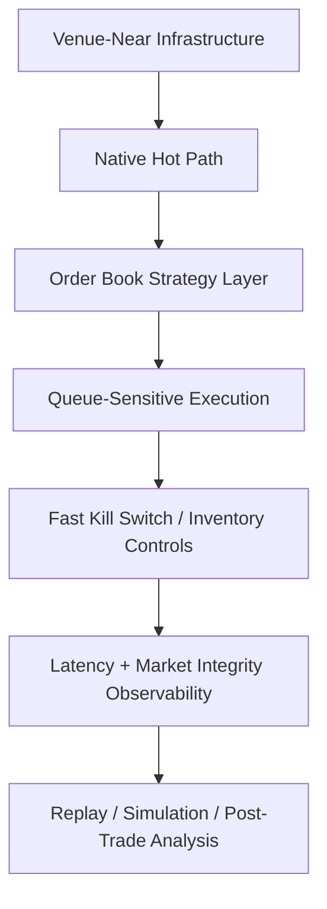

# Phase 15 HFT Infrastructure and Strategy Spec

## Status

Draft implementation spec for the fifteenth refactor milestone.

## Purpose

Even with live runtime support, a low-latency event plane, order-book replay, and a native hot path, the platform is still not automatically a true HFT system.

HFT is an end-to-end property of:

- strategy class
- infrastructure placement
- latency discipline
- failure handling
- replay and simulation quality

Phase 15 defines the infrastructure, observability, and strategy requirements that separate a fast trading engine from a genuine HFT platform.

## Dependencies

Phase 15 depends on:

- [docs/specs/PHASE_11_LIVE_RUNTIME_ACTIVATION_SPEC.md](/home/lekim/Projects/akibaCryptobot/docs/specs/PHASE_11_LIVE_RUNTIME_ACTIVATION_SPEC.md)
- [docs/specs/PHASE_12_LOW_LATENCY_EVENT_PLANE_SPEC.md](/home/lekim/Projects/akibaCryptobot/docs/specs/PHASE_12_LOW_LATENCY_EVENT_PLANE_SPEC.md)
- [docs/specs/PHASE_13_ORDER_BOOK_AND_REPLAY_SPEC.md](/home/lekim/Projects/akibaCryptobot/docs/specs/PHASE_13_ORDER_BOOK_AND_REPLAY_SPEC.md)
- [docs/specs/PHASE_14_NATIVE_HOT_PATH_SPEC.md](/home/lekim/Projects/akibaCryptobot/docs/specs/PHASE_14_NATIVE_HOT_PATH_SPEC.md)

## Problem Statement

The platform still lacks several HFT-class properties:

1. No venue-near or colocated deployment model.
2. No HFT-grade timing discipline or latency SLO framework.
3. No market-making or microstructure-native strategy family.
4. No queue-position or aggressive/passive order simulator suitable for HFT research.
5. No infrastructure-level runbooks for degraded latency, exchange anomalies, or fast kill-switch response.

## Phase 15 Goals

1. Define infrastructure requirements for genuine low-latency production.
2. Define HFT-specific observability and control-plane expectations.
3. Define the first HFT strategy families appropriate for the platform.
4. Define simulation/replay expectations needed before trusting those strategies.
5. Separate “fast algorithmic trading” from “true HFT” in repo documentation and rollout criteria.

## Phase 15 Non-Goals

1. Claiming the current Python stack is already HFT.
2. Implementing all HFT strategies in one phase.
3. Solving venue access, legal, or business constraints inside code.
4. Eliminating slower research strategies from the platform.
5. Hard-coding one infrastructure provider or one colocated venue in this spec.

## Architecture Decision

True HFT should be treated as a separate operating regime, not just a faster version of current candle strategies.



## Required Surfaces

### Infrastructure and Timing Discipline

Priority targets:

- deployment docs and runbooks
- observability layer
- native hot-path rollout docs

Minimum guarantees:

- latency budgets are formalized
- clock synchronization expectations are explicit
- exchange disconnect and degraded-latency runbooks exist

### HFT Strategy Framework

Priority targets:

- new strategy hierarchy for microstructure-native strategies
- simulation/replay harness from earlier phases

Minimum guarantees:

- the platform can distinguish:
  - candle strategies
  - low-latency order-book strategies
  - HFT-only strategies

### Execution and Risk Controls

Priority targets:

- native execution service
- live rollout controls
- inventory/risk policies

Minimum guarantees:

- fast kill switch exists
- inventory exposure rules are explicit
- adverse selection and stale-book rules are part of the design

## File Layout

```text
docs/
  ARCHITECTURE.md
  DEPLOYMENT.md
  BACKTESTING.md
  RISK_MANAGEMENT.md
  STRATEGIES.md
tests/
  runtime/
    test_phase15_hft_operating_modes.py
```

## Core Design Decisions

### 1. HFT Is a Different Strategy Class

RSI/MACD candle logic and order-book market making should not be treated as the same operational mode.

### 2. Infrastructure Is Part of the Strategy

If the infrastructure cannot meet the latency budget, the strategy is invalid in production.

### 3. Replay Quality Is a Production Dependency

For HFT-class strategies, poor replay and simulation is not a research inconvenience.
It is a correctness problem.

### 4. Safety Must Be Faster Than Trading

Kill-switch response, stale-book detection, and exchange anomaly handling must not lag behind the strategy engine.

## Task Breakdown

### P15-01: Define HFT operating modes and documentation boundaries

Acceptance:

- docs distinguish standard algo, low-latency runtime, and HFT modes
- operator expectations differ by mode

### P15-02: Define latency SLOs and observability requirements

Acceptance:

- latency budgets exist for hot-path stages
- degraded-latency actions are documented

### P15-03: Define first HFT strategy families

Acceptance:

- repo docs identify initial candidate families:
  - market making
  - inventory-aware quoting
  - short-horizon order-flow alpha
  - microstructure stat-arb

### P15-04: Define queue/fill simulation requirements

Acceptance:

- replay/backtest docs specify the minimum execution simulation requirements for HFT research

### P15-05: Define production kill-switch and anomaly runbooks

Acceptance:

- docs specify what causes immediate halt
- docs specify how operators recover after a halt

## Acceptance Criteria

Phase 15 is complete when:

1. the repo has an explicit HFT operating model
2. latency SLOs and anomaly controls are documented
3. the first HFT strategy families are defined as future implementation targets
4. replay/simulation requirements are documented for HFT research
5. the platform has a credible roadmap from low-latency trading engine to true HFT stack

## Recommended Implementation Order

1. operating-mode definitions
2. latency SLOs and observability requirements
3. HFT strategy-family documentation
4. replay/simulation requirements
5. kill-switch and anomaly runbooks
