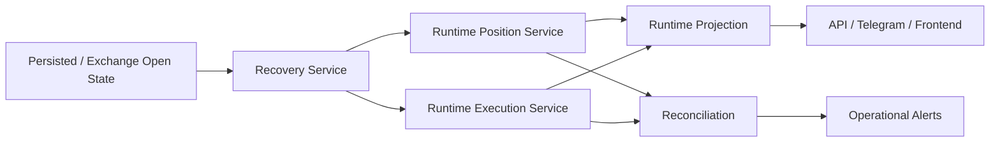

# Phase 18 Runtime Trading Correctness Spec

## Status

Draft implementation spec for the eighteenth refactor milestone.

## Purpose

The runtime is already the primary paper trading path, but it is not yet fully trustworthy as an operational source of truth under restart, carried-position, and reconciliation pressure.

Phase 18 makes the runtime primary path correct before any serious live expansion.

## Dependencies

Phase 18 depends on:

- [src/operations/model_training_manager.py](/home/lekim/Projects/akibaCryptobot/src/operations/model_training_manager.py)
- [src/operations/alert_evaluator.py](/home/lekim/Projects/akibaCryptobot/src/operations/alert_evaluator.py)
- [src/operations/alerts.py](/home/lekim/Projects/akibaCryptobot/src/operations/alerts.py)
- [docs/API_REFERENCE.md](/home/lekim/Projects/akibaCryptobot/docs/API_REFERENCE.md)
- [docs/RISK_MANAGEMENT.md](/home/lekim/Projects/akibaCryptobot/docs/RISK_MANAGEMENT.md)
- [src/bot.py](/home/lekim/Projects/akibaCryptobot/src/bot.py)
- [src/runtime/app.py](/home/lekim/Projects/akibaCryptobot/src/runtime/app.py)
- [src/services/position_service.py](/home/lekim/Projects/akibaCryptobot/src/services/position_service.py)
- [src/services/recovery_service.py](/home/lekim/Projects/akibaCryptobot/src/services/recovery_service.py)
- [src/services/execution_service.py](/home/lekim/Projects/akibaCryptobot/src/services/execution_service.py)
- [src/api/routes/status.py](/home/lekim/Projects/akibaCryptobot/src/api/routes/status.py)
- [src/api/routes/trading.py](/home/lekim/Projects/akibaCryptobot/src/api/routes/trading.py)

## Problem Statement

The runtime primary path still has unresolved correctness risks:

1. Carried legacy positions are not fully hydrated into runtime-owned state during cutover.
2. Restart recovery does not yet rebuild runtime state as the canonical source of truth in every mixed or primary mode.
3. Reconciliation around runtime-owned positions and orders is not yet tight enough to trust under live ownership.
4. Operator surfaces can still present legacy/runtime ambiguity during transitional states.
5. The runtime primary path has not yet been validated under sustained open-to-close lifecycle soak criteria.

## Phase 18 Goals

1. Hydrate carried positions into runtime-owned state deterministically.
2. Make restart recovery rebuild runtime position/order state without manual repair.
3. Tighten reconciliation so runtime-owned state is auditable against exchange and persistence.
4. Remove operator ambiguity between legacy and runtime trade views.
5. Define and pass soak criteria for runtime-primary trade lifecycle correctness.

## Phase 18 Non-Goals

1. Live runtime activation.
2. New strategy logic.
3. Order-book or microstructure strategy work.
4. Native hot-path extraction.
5. Replacing the existing persistence layer.

## Architecture Decision

The runtime must become the canonical owner of runtime-primary state. Transitional compatibility should not leak legacy state assumptions into runtime-owned modes.



## Required Surfaces

### Recovery and Hydration

Priority targets:

- [src/services/recovery_service.py](/home/lekim/Projects/akibaCryptobot/src/services/recovery_service.py)
- [src/runtime/app.py](/home/lekim/Projects/akibaCryptobot/src/runtime/app.py)
- [src/services/position_service.py](/home/lekim/Projects/akibaCryptobot/src/services/position_service.py)

Minimum guarantees:

- persisted open trades can be restored into runtime state
- exchange-held protection is not duplicated during recovery
- carried positions survive restart without legacy-only repair paths

### Reconciliation and State Integrity

Priority targets:

- [src/bot.py](/home/lekim/Projects/akibaCryptobot/src/bot.py)
- [src/api/routes/trading.py](/home/lekim/Projects/akibaCryptobot/src/api/routes/trading.py)
- [src/api/routes/status.py](/home/lekim/Projects/akibaCryptobot/src/api/routes/status.py)

Minimum guarantees:

- runtime-owned modes report runtime state clearly
- mismatch reasons are explicit
- reconciliation distinguishes harmless dust from actionable runtime drift

## File Layout

```text
src/services/
  recovery_service.py
  position_service.py
  execution_service.py
src/runtime/
  app.py
src/api/routes/
  status.py
  trading.py
tests/runtime/
  test_phase18_recovery_hydration.py
  test_phase18_reconciliation.py
tests/
  test_api_app.py
  test_bot_logic.py
```

## Core Design Decisions

### 1. Runtime-Owned Modes Must Not Depend on Legacy State Views

Once runtime owns a lifecycle, API and operator surfaces should not silently fall back to legacy counts.

### 2. Recovery Must Rebuild, Not Guess

Restart recovery should rebuild runtime state from persistence plus exchange truth, not infer positions from partial projection state.

### 3. Reconciliation Must Explain Drift

The operator needs explicit categories for:

- carried positions restored successfully
- exchange-only orphan state
- persistence-only stale state
- protection mismatch

### 4. Soak Criteria Are Part of Correctness

Correctness is not just a passing unit test. Runtime primary must survive sustained startup, entry, protection, exit, and restart loops.

## Task Breakdown

### P18-01: Runtime carried-position hydration

Acceptance:

- carried open trades are restored into runtime position state during runtime-owned startup
- projected active positions match restored carried trades
- operator surfaces show runtime-owned carried positions instead of empty projection counts

### P18-02: Restart recovery and protection integrity

Acceptance:

- restart recovery restores entry, protection, and partial-fill state cleanly
- exchange-native protection is not duplicated on restart
- recovery produces explicit reports for restored vs unresolved state

### P18-03: Runtime-owned reconciliation tightening

Acceptance:

- reconciliation distinguishes runtime drift from harmless orphan balances
- runtime-owned order/position mismatches are surfaced explicitly
- runtime primary modes can identify unresolved state before continuing

### P18-04: Operator surface clarity cleanup

Acceptance:

- `/api/status`, `/api/trades`, Telegram, and frontend no longer blur legacy and runtime state in runtime-owned modes
- carried-position and mismatch state are operator-readable

### P18-05: Runtime-primary soak coverage

Acceptance:

- tests cover open-to-close lifecycle under runtime primary
- tests cover restart during open position / open protection / pending exit
- docs define pass criteria for runtime-primary soak before live rollout

## Acceptance Criteria

Phase 18 is complete when:

1. runtime-owned positions survive restart and cutover correctly
2. runtime primary surfaces are not ambiguous about state ownership
3. reconciliation can explain and surface runtime drift clearly
4. runtime-primary lifecycle tests cover carried-position and restart cases
5. the runtime primary paper path is trustworthy enough to support live canary work

## Recommended Implementation Order

1. carried-position hydration
2. restart recovery and protection integrity
3. runtime reconciliation tightening
4. operator surface clarity
5. soak coverage and operator criteria
