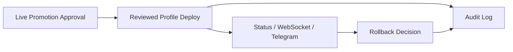

# Phase 19 Live Approval and Audit Spec

## Status

Draft implementation spec for the nineteenth refactor milestone.

## Purpose

The repo already has live runtime profiles and guardrails, but live activation still relies too heavily on config edits and implied operator intent.

Phase 19 adds the minimum approval and audit layer needed to ship live runtime promotion as a product flow rather than an engineering-only procedure.

## Dependencies

Phase 19 depends on:

- [docs/specs/PHASE_11_LIVE_RUNTIME_ACTIVATION_SPEC.md](/home/lekim/Projects/akibaCryptobot/docs/specs/PHASE_11_LIVE_RUNTIME_ACTIVATION_SPEC.md)
- [docs/specs/PHASE_18_RUNTIME_TRADING_CORRECTNESS_SPEC.md](/home/lekim/Projects/akibaCryptobot/docs/specs/PHASE_18_RUNTIME_TRADING_CORRECTNESS_SPEC.md)
- [src/api/routes/status.py](/home/lekim/Projects/akibaCryptobot/src/api/routes/status.py)
- [src/api/routes/trading.py](/home/lekim/Projects/akibaCryptobot/src/api/routes/trading.py)
- [src/notifications/telegram_bot.py](/home/lekim/Projects/akibaCryptobot/src/notifications/telegram_bot.py)
- [src/persistence/trade_store.py](/home/lekim/Projects/akibaCryptobot/src/persistence/trade_store.py)
- [scripts/set_runtime_profile.py](/home/lekim/Projects/akibaCryptobot/scripts/set_runtime_profile.py)
- [scripts/deploy_snapshot.sh](/home/lekim/Projects/akibaCryptobot/scripts/deploy_snapshot.sh)

## Problem Statement

Live activation still lacks a proper operator control layer:

1. `allow_live_runtime=true` is necessary but not sufficient as an approval mechanism.
2. There is no durable record of who promoted or rolled back a live profile.
3. There is no explicit approval reason, expiry, or acknowledgment model for live promotions.
4. Operator surfaces do not yet expose live rollout approval state as a first-class concept.
5. Live promotion and rollback remain more procedural than productized.

## Phase 19 Goals

1. Add an explicit live promotion approval model.
2. Persist approval and rollout audit history durably.
3. Surface live approval state in API, Telegram, and frontend.
4. Make rollback reasons and live promotion transitions auditable.
5. Keep the implementation minimal and product-focused.

## Phase 19 Non-Goals

1. Multi-user RBAC.
2. Full workflow engine or ticketing integration.
3. Automatic live promotion without operator intent.
4. Replacing git-reviewed deployment profiles.
5. Alerting redesign.

## Architecture Decision

Live activation remains profile-driven, but promotion now requires an explicit operator approval record before a reviewed live profile is considered valid.



## Required Surfaces

### Approval and Audit Persistence

Priority targets:

- persistence layer
- bot-level operator helpers

Minimum guarantees:

- live approval records persist across restart
- promotion and rollback events are auditable

### Operator Surfaces

Priority targets:

- [src/api/routes/status.py](/home/lekim/Projects/akibaCryptobot/src/api/routes/status.py)
- [src/notifications/telegram_bot.py](/home/lekim/Projects/akibaCryptobot/src/notifications/telegram_bot.py)
- frontend status surfaces

Minimum guarantees:

- operators can see whether a live promotion is approved
- audit state is readable without inspecting deploy logs

## File Layout

```text
src/operations/
  live_rollout_approval.py
src/api/routes/
  status.py
  trading.py
src/notifications/
  telegram_bot.py
src/ui/js/
  app.js
tests/runtime/
  test_phase19_live_approval.py
tests/
  test_api_app.py
  test_telegram_bot.py
```

## Core Design Decisions

### 1. Approval Is a Release Constraint, Not the Product Goal

This phase exists to make live rollout safe, not to overshadow runtime correctness.

### 2. Approval Must Be Explicit

Live runtime should not become active because a stale config flag happens to exist.

### 3. Audit Must Be Durable and Readable

An operator should be able to answer:

- who approved
- when
- why
- what profile was promoted
- what caused rollback

without digging through transient logs alone.

## Task Breakdown

### P19-01: Live approval state model and persistence

Acceptance:

- live approval records persist durably
- approval includes actor, reason, timestamp, target profile, and optional expiry

### P19-02: Approval-aware startup/deploy validation

Acceptance:

- live runtime deploy/startup can refuse execution without an active approval
- refusal messages are explicit and operator-readable

### P19-03: Audit log for promotion and rollback

Acceptance:

- live profile promotions and rollbacks are recorded durably
- rollback reason is visible to operators

### P19-04: Operator surface alignment

Acceptance:

- API, Telegram, and frontend show live approval and latest rollout event
- operators can see whether the current live mode is approved or running under rollback guidance

### P19-05: Integration coverage and runbook

Acceptance:

- tests cover approval required, approval expired, promotion recorded, rollback recorded
- deploy/runbook docs explain the approval sequence clearly

## Acceptance Criteria

Phase 19 is complete when:

1. live runtime requires explicit approval beyond config state
2. live promotions and rollbacks are durably auditable
3. approval and audit state are visible on operator surfaces
4. rollback remains immediate and deterministic
5. the live rollout path is productized enough to execute a canary responsibly

## Recommended Implementation Order

1. approval state model
2. approval-aware startup/deploy validation
3. audit logging
4. operator surface visibility
5. integration coverage and runbook
