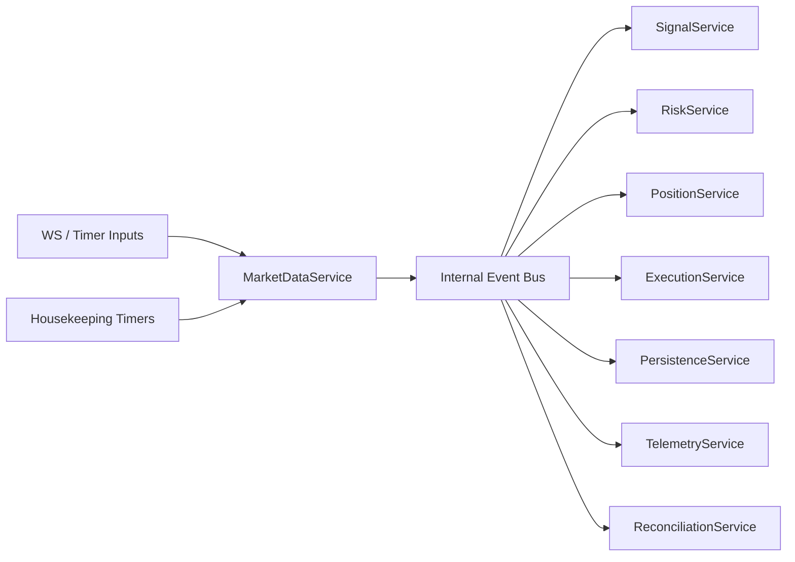

# Phase 1 Event-Driven Runtime Spec

## Status

Draft implementation spec for the first refactor milestone.

## Purpose

This document defines the first concrete implementation slice for moving AkibaCryptoBot from a cycle-driven trading loop to an event-driven runtime that is compatible with low-latency trading now and leaves a clean seam for a future HFT-oriented execution core.

Phase 1 does not attempt to build true HFT. It establishes the runtime contracts, service boundaries, typed event model, and migration path required before the hot path can be optimized safely.

## Current State

The current production flow is centered on [src/bot.py](/home/lekim/Projects/akibaCryptobot/src/bot.py), which runs a 60-second cycle:

- `AkibaCryptoBot.CYCLE_INTERVAL_SECONDS = 60`
- `AkibaCryptoBot.start()`
- `AkibaCryptoBot.trading_cycle()`
- `AkibaCryptoBot.update_market_data()`
- `AkibaCryptoBot.update_portfolio_value()`

Trade entry and exit logic is split across:

- [src/trading/opportunity_scanner.py](/home/lekim/Projects/akibaCryptobot/src/trading/opportunity_scanner.py)
- [src/trading/position_manager.py](/home/lekim/Projects/akibaCryptobot/src/trading/position_manager.py)

Websocket support exists in:

- [src/exchange/websocket_manager.py](/home/lekim/Projects/akibaCryptobot/src/exchange/websocket_manager.py)

but it is not the primary runtime driver yet.

## Phase 1 Goals

1. Introduce typed runtime contracts for events, state, and services.
2. Create a new service-based runtime that can run beside the current bot.
3. Normalize websocket and timer inputs into a single internal event model.
4. Separate hot-path trading logic from non-critical background work.
5. Make the refactor safe for AI-assisted incremental delivery.

## Phase 1 Non-Goals

1. Replacing all current business logic.
2. Rewriting all strategies.
3. Implementing exchange-native stop loss or take profit.
4. Building a full local order book.
5. Replacing SQLite.
6. Achieving true HFT latency.

## Design Constraints

1. The existing bot must remain runnable during migration.
2. The new runtime must support shadow mode before live cutover.
3. Contracts must be typed, testable, and deterministic.
4. The hot path must avoid direct database and notification dependencies.
5. The architecture must support later extraction of market data and execution into a native component without strategy rewrites.

## Target Runtime Topology



### Service Lanes

- Hot path:
  - `MarketDataService`
  - `SignalService`
  - `RiskService`
  - `ExecutionService`
  - `PositionService`
- Warm path:
  - `PersistenceService`
  - `TelemetryService`
  - `ReconciliationService`
- Cold path:
  - backtesting
  - hyperopt
  - FreqAI training

## Phase 1 File Layout

```text
src/
  domain/
    __init__.py
    events.py
    models.py
    state.py
  runtime/
    __init__.py
    app.py
    config.py
    service_registry.py
  services/
    __init__.py
    base.py
    market_data_service.py
    telemetry_service.py
  ports/
    __init__.py
    exchange.py
  adapters/
    __init__.py
    binance/
      __init__.py
      ws_gateway.py
  tests/
    runtime/
      test_app.py
      test_market_data_service.py
      test_event_contracts.py
```

Phase 1 intentionally avoids touching `risk`, `execution`, and `strategy` implementation details beyond contract definition.

## Contract Definitions

### 1. Base Event Contract

All runtime messages must satisfy:

```python
from dataclasses import dataclass
from datetime import datetime
from typing import Literal

EventType = Literal[
    "market.tick",
    "market.kline",
    "market.kline_closed",
    "market.spread",
    "timer.housekeeping",
    "runtime.shutdown",
]

@dataclass(slots=True, frozen=True)
class EventMeta:
    event_id: str
    event_type: EventType
    source: str
    symbol: str | None
    ts_exchange: datetime | None
    ts_received: datetime

@dataclass(slots=True, frozen=True)
class RuntimeEvent:
    meta: EventMeta
    payload: object
```

Requirements:

- `event_id` must be unique and traceable in logs.
- `source` must identify adapter origin such as `binance.ws.book_ticker`.
- `ts_received` must be set at ingestion time.
- `ts_exchange` may be `None` for timer events.

### 2. Market Event Payloads

```python
@dataclass(slots=True, frozen=True)
class BookTickerPayload:
    bid_price: float
    bid_qty: float
    ask_price: float
    ask_qty: float

@dataclass(slots=True, frozen=True)
class KlinePayload:
    interval: str
    open_time: datetime
    close_time: datetime
    open: float
    high: float
    low: float
    close: float
    volume: float
    is_closed: bool

@dataclass(slots=True, frozen=True)
class HousekeepingPayload:
    reason: str
```

### 3. Live Symbol State

```python
from collections import deque
from dataclasses import dataclass, field

@dataclass(slots=True)
class Candle:
    open_time: datetime
    close_time: datetime
    open: float
    high: float
    low: float
    close: float
    volume: float

@dataclass(slots=True)
class SymbolState:
    symbol: str
    best_bid: float | None = None
    best_ask: float | None = None
    last_price: float | None = None
    spread_bps: float | None = None
    candles_1m: deque[Candle] = field(default_factory=lambda: deque(maxlen=2048))
    last_kline_close: datetime | None = None
```

Rules:

- `SymbolState` is mutable and owned by `MarketDataService`.
- Other services consume read-only snapshots or derived events.
- No other service may mutate symbol market state directly.

### 4. Service Protocol

```python
from typing import Protocol

class AsyncService(Protocol):
    async def start(self) -> None: ...
    async def stop(self) -> None: ...
```

### 5. Exchange Gateway Contract

```python
class MarketDataGateway(Protocol):
    async def connect(self) -> None: ...
    async def disconnect(self) -> None: ...
    async def subscribe_book_ticker(self, symbol: str) -> None: ...
    async def subscribe_kline(self, symbol: str, interval: str) -> None: ...
```

Phase 1 scope is market-data-only. Order submission remains in the legacy path.

## Runtime Responsibilities

### RuntimeApp

`RuntimeApp` owns:

- config loading
- service construction
- event bus creation
- task lifecycle management
- shutdown sequencing

`RuntimeApp` must not contain business logic for trading decisions.

### MarketDataService

`MarketDataService` owns:

- websocket connection startup
- adapter callback registration
- event normalization
- per-symbol in-memory state
- publication of normalized runtime events

`MarketDataService` must not:

- place orders
- compute full strategy signals
- write to the database

### TelemetryService

`TelemetryService` owns:

- event counters
- queue depth metrics
- handler latency metrics
- websocket reconnect metrics
- structured event tracing

Phase 1 minimum metrics:

- event ingest count by type
- per-symbol event rate
- queue depth
- normalization latency
- end-to-end event handling latency for market-data events

## Event Bus Design

Phase 1 bus is in-process only.

Implementation choice:

- `asyncio.Queue[RuntimeEvent]` for each consumer or fan-out subscription
- no Redis, Kafka, or NATS in Phase 1

Reasoning:

- lower operational overhead
- easier deterministic tests
- simpler failure analysis
- no premature distributed complexity

## Service Boot Sequence

1. Load runtime config.
2. Create queues.
3. Create gateways.
4. Create services.
5. Register subscriptions and callbacks.
6. Start telemetry.
7. Start market data.
8. Enter steady-state event handling.

Shutdown sequence:

1. Emit `runtime.shutdown`.
2. Stop new ingress.
3. Drain queues with timeout.
4. Stop services in reverse order.
5. Close gateways.

## File Skeletons

### `src/domain/events.py`

Must contain:

- event type literals
- `EventMeta`
- `RuntimeEvent`
- payload dataclasses for market and timer events

### `src/domain/models.py`

Must contain:

- `Candle`
- `SymbolState`
- any immutable snapshots consumed by downstream services

### `src/runtime/config.py`

Must contain:

- runtime-specific settings extracted from existing config
- symbol subscriptions
- kline intervals
- queue limits
- telemetry toggles

### `src/runtime/app.py`

Must contain:

- `RuntimeApp`
- service wiring
- `TaskGroup` lifecycle
- shutdown hooks

### `src/services/base.py`

Must contain:

- base service protocol or abstract class
- common logger helpers
- startup and shutdown semantics

### `src/services/market_data_service.py`

Must contain:

- adapter callback handlers
- event normalization
- state updates
- fan-out publication

### `src/adapters/binance/ws_gateway.py`

Must contain:

- wrapper over existing [src/exchange/websocket_manager.py](/home/lekim/Projects/akibaCryptobot/src/exchange/websocket_manager.py)
- typed callback bridge
- symbol subscription helpers

## Migration Strategy

### Stage 1

Introduce the new runtime in shadow mode only.

- It consumes live websocket data.
- It builds symbol state.
- It exports metrics.
- It does not place trades.

### Stage 2

Use the new market state as a read-only sidecar for the legacy bot.

- legacy bot remains the trader
- new runtime proves data quality and stability

### Stage 3

Move one consumer at a time from the legacy loop to the event runtime.

Recommended order:

1. telemetry
2. signal generation
3. risk
4. execution
5. position lifecycle

## Failure Modes

Phase 1 must handle:

1. websocket disconnects
2. malformed payloads
3. queue backpressure
4. duplicate kline close events
5. stale symbol state
6. partial startup failure
7. shutdown during active event flow

Required behaviors:

- reconnect with bounded backoff
- log malformed events with source and symbol
- increment dropped-event counters if queue limits are exceeded
- ignore duplicate kline closes by `(symbol, interval, close_time)`
- mark symbol state stale after timeout
- fail startup cleanly if a required service cannot start

## Testing Plan

### Unit Tests

- event dataclass validation
- symbol state updates from book ticker
- symbol state updates from kline
- duplicate closed-kline suppression
- queue publication behavior
- shutdown propagation

### Integration Tests

- runtime starts and stops cleanly
- simulated websocket callbacks update symbol state
- telemetry receives and counts normalized events
- market-data fan-out reaches multiple consumers

### Regression Guardrails

- no DB dependency in `MarketDataService`
- no exchange order calls in Phase 1 services
- no direct mutation of `SymbolState` outside `MarketDataService`

## Acceptance Criteria

Phase 1 is complete when all of the following are true:

1. A new `RuntimeApp` can boot independently from the legacy trading loop.
2. The runtime can subscribe to configured symbols and at least one kline interval.
3. Book ticker and kline events are normalized into typed runtime events.
4. Per-symbol live state is updated from normalized events only.
5. Telemetry exposes event counts, queue depth, and processing latency.
6. The runtime can run in shadow mode for at least one trading session without crashing.
7. The legacy bot remains operational and unchanged as fallback.

## Out of Scope For Follow-Up Phase

These items belong to the next phases, not Phase 1:

- native stop loss and take profit submission
- order state machine
- position state machine
- hot-path risk engine
- persistence event log
- incremental indicators
- strategy contract rewrite

## Task Breakdown

### P1-01: Create domain event models

- create `src/domain/events.py`
- create `src/domain/models.py`
- add unit tests for schema correctness

### P1-02: Create runtime shell

- create `src/runtime/app.py`
- create `src/runtime/config.py`
- create `src/runtime/service_registry.py`
- add start and stop integration tests

### P1-03: Create service base layer

- create `src/services/base.py`
- standardize logger and lifecycle semantics

### P1-04: Create Binance websocket gateway adapter

- create `src/adapters/binance/ws_gateway.py`
- wrap callback registration from the existing websocket manager
- normalize callback payload entry points

### P1-05: Create MarketDataService

- subscribe to symbols
- update `SymbolState`
- publish runtime events

### P1-06: Create TelemetryService

- subscribe to the event bus
- emit counters and timing logs

### P1-07: Add shadow-mode runner

- run the new runtime beside the legacy bot
- do not place trades
- log divergences and data gaps

## Definition of Done

Phase 1 is done only when:

1. all acceptance criteria pass
2. tests for new contracts and runtime services are green
3. shadow mode has been executed against live or sandbox websocket input
4. runtime metrics confirm stable event processing
5. no legacy trading behavior has been regressed
