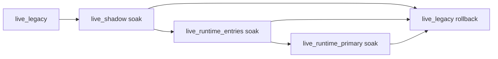

# Phase 20 Live Runtime Execution Spec

## Status

Draft implementation spec for the twentieth refactor milestone.

## Purpose

Phase 11 defined the live rollout contract. Phases 18 and 19 make the runtime trustworthy and the live control path auditable.

Phase 20 executes the live rollout path as a real product flow:

- `live_shadow`
- `live_runtime_entries`
- `live_runtime_primary`

## Dependencies

Phase 20 depends on:

- [docs/specs/PHASE_18_RUNTIME_TRADING_CORRECTNESS_SPEC.md](/home/lekim/Projects/akibaCryptobot/docs/specs/PHASE_18_RUNTIME_TRADING_CORRECTNESS_SPEC.md)
- [docs/specs/PHASE_19_LIVE_APPROVAL_AND_AUDIT_SPEC.md](/home/lekim/Projects/akibaCryptobot/docs/specs/PHASE_19_LIVE_APPROVAL_AND_AUDIT_SPEC.md)
- [src/operations/alert_evaluator.py](/home/lekim/Projects/akibaCryptobot/src/operations/alert_evaluator.py)
- [src/operations/alerts.py](/home/lekim/Projects/akibaCryptobot/src/operations/alerts.py)
- [src/api/routes/status.py](/home/lekim/Projects/akibaCryptobot/src/api/routes/status.py)
- [src/notifications/telegram_bot.py](/home/lekim/Projects/akibaCryptobot/src/notifications/telegram_bot.py)
- [scripts/set_runtime_profile.py](/home/lekim/Projects/akibaCryptobot/scripts/set_runtime_profile.py)
- [scripts/deploy_snapshot.sh](/home/lekim/Projects/akibaCryptobot/scripts/deploy_snapshot.sh)

## Problem Statement

The code supports live profiles, but the product flow is not complete until each stage is executed with explicit gates, soak criteria, and rollback drills.

## Phase 20 Goals

1. Execute `live_shadow`, `live_runtime_entries`, and `live_runtime_primary` through reviewed promotion steps.
2. Verify training restrictions and alert behavior in each live stage.
3. Prove rollback to `live_legacy` during live canary operation.
4. Record soak criteria and promotion decisions as part of the product flow.
5. Make live runtime activation a repeatable operator process.

## Phase 20 Non-Goals

1. Low-latency order-book trading.
2. Native hot-path execution.
3. HFT strategy rollout.
4. Automatic promotion without operator approval.
5. Broad infrastructure redesign.

## Architecture Decision

Live runtime should be executed exactly like a canary ladder, with each stage proving a narrower set of risks before the next one is attempted.



## Required Surfaces

### Promotion Gates

Priority targets:

- status and rollout health
- training status
- alert state
- approval/audit state

Minimum guarantees:

- promotion only happens when the system is healthy
- rollback triggers are explicit and operator-visible

### Soak and Verification

Priority targets:

- deployment runbook
- operator surfaces
- test coverage for stage-specific behavior

Minimum guarantees:

- each stage has entry criteria
- each stage has exit criteria
- rollback is practiced, not assumed

## File Layout

```text
docs/
  DEPLOYMENT.md
  API_REFERENCE.md
  TELEGRAM_COMMANDS.md
tests/runtime/
  test_phase20_live_rollout_gates.py
  test_phase20_live_rollback_drills.py
```

## Core Design Decisions

### 1. Live Canary Is a Product Flow

Promotion is not “set a config and hope.” It is a gated operator process.

### 2. Each Stage Must Prove a Smaller Risk

- `live_shadow`: startup, visibility, health, and rollback
- `live_runtime_entries`: runtime entry correctness with legacy exits
- `live_runtime_primary`: full runtime lifecycle ownership

### 3. Training Remains Locked Down

Live activation does not relax server-side training restrictions.

## Task Breakdown

### P20-01: Live shadow execution criteria

Acceptance:

- `live_shadow` has explicit preflight, soak, and rollback criteria
- runtime health, training restrictions, and alert visibility are verified under live shadow

### P20-02: Live runtime-entries execution criteria

Acceptance:

- `live_runtime_entries` criteria are explicit
- runtime entry ownership is verified under live conditions
- rollback to `live_legacy` remains immediate

### P20-03: Live runtime-primary execution criteria

Acceptance:

- `live_runtime_primary` criteria are explicit
- runtime-owned exits and protections are verified under live conditions

### P20-04: Alert and rollback drill verification

Acceptance:

- live rollout runbook includes alert-triggered hold/rollback behavior
- training restrictions are verified in live profiles
- at least one rollback drill is defined for each live canary stage

### P20-05: Product runbook and integration coverage

Acceptance:

- operator docs and tests cover the full live ladder end to end
- the live activation flow is repeatable by an operator without engineering improvisation

## Acceptance Criteria

Phase 20 is complete when:

1. the live rollout ladder has been defined as a concrete product flow
2. each stage has explicit gates, soak criteria, and rollback criteria
3. alert behavior and training restrictions are verified in live stages
4. rollback to `live_legacy` has a rehearsed path
5. `live_runtime_primary` is a productized target rather than a theoretical profile

## Recommended Implementation Order

1. live shadow criteria
2. live runtime-entries criteria
3. live runtime-primary criteria
4. alert and rollback drills
5. end-to-end runbook and integration coverage
