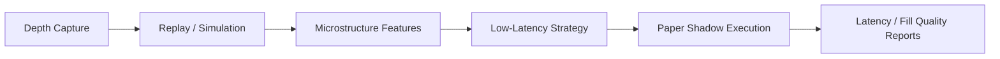

# Phase 21 Low-Latency Trading Product Spec

## Status

Draft implementation spec for the twenty-first refactor milestone.

## Purpose

The current product is a runtime-driven algorithmic trading platform. It is not yet a differentiated low-latency trading product.

Phase 21 turns the earlier event-plane and order-book groundwork into a product:

- order-book capture and replay
- microstructure-aware paper strategies
- shadow execution for low-latency strategies
- explicit latency and fill-quality reporting

## Dependencies

Phase 21 depends on:

- [docs/specs/PHASE_12_LOW_LATENCY_EVENT_PLANE_SPEC.md](/home/lekim/Projects/akibaCryptobot/docs/specs/PHASE_12_LOW_LATENCY_EVENT_PLANE_SPEC.md)
- [docs/specs/PHASE_13_ORDER_BOOK_AND_REPLAY_SPEC.md](/home/lekim/Projects/akibaCryptobot/docs/specs/PHASE_13_ORDER_BOOK_AND_REPLAY_SPEC.md)
- [docs/specs/PHASE_20_LIVE_RUNTIME_EXECUTION_SPEC.md](/home/lekim/Projects/akibaCryptobot/docs/specs/PHASE_20_LIVE_RUNTIME_EXECUTION_SPEC.md)
- [src/services/market_data_service.py](/home/lekim/Projects/akibaCryptobot/src/services/market_data_service.py)
- [src/runtime/projection.py](/home/lekim/Projects/akibaCryptobot/src/runtime/projection.py)
- [src/backtesting/](/home/lekim/Projects/akibaCryptobot/src/backtesting)

## Problem Statement

The platform still lacks the product features that define low-latency strategy work:

1. no production-ready order-book capture path
2. no replayable depth-driven research flow
3. no microstructure feature set surfaced as a product capability
4. no first-class low-latency paper strategy in shadow
5. no product metric for latency-to-decision and fill quality

## Phase 21 Goals

1. Capture and persist order-book/depth data for research and replay.
2. Build the first microstructure-aware paper strategy path.
3. Run low-latency strategies in shadow before ownership cutover.
4. Measure decision latency and fill quality explicitly.
5. Expose low-latency strategy results as a distinct product capability.

## Phase 21 Non-Goals

1. Native hot-path cutover.
2. Colocation or HFT infrastructure.
3. Live HFT strategy rollout.
4. Replacing all candle strategies.
5. Full venue abstraction redesign.

## Architecture Decision

Low-latency trading should be productized as a research-plus-shadow path first, not as an immediate ownership cutover.



## Required Surfaces

### Capture and Replay

Priority targets:

- market-data adapters
- event persistence
- backtesting/replay tools

Minimum guarantees:

- depth snapshots and deltas are durable enough for replay
- replay can drive the same strategy contract used in shadow

### Operator and Research Surfaces

Priority targets:

- status/metrics surfaces
- performance reports
- strategy docs

Minimum guarantees:

- low-latency strategy performance is distinguishable from candle strategies
- latency and fill quality are operator-visible

## File Layout

```text
src/market_data/
  order_book.py
src/backtesting/
  replay_engine.py
src/strategies/
  microstructure/
tests/runtime/
  test_phase21_order_book_capture.py
  test_phase21_shadow_strategy.py
docs/
  BACKTESTING.md
  STRATEGIES.md
  API_REFERENCE.md
```

## Core Design Decisions

### 1. Order-Book Strategy Work Starts in Shadow

The first microstructure strategies should not own live trading immediately.

### 2. Replay Fidelity Is a Product Feature

If the replay path is poor, the low-latency product is not credible.

### 3. Fill Quality Must Be Measured

Low-latency claims are meaningless without slippage, spread capture, and timing metrics.

## Task Breakdown

### P21-01: Order-book capture product path

Acceptance:

- depth snapshots and deltas are captured and stored in a replayable form
- capture health is observable

### P21-02: Replay and fill-simulation path

Acceptance:

- replay can feed low-latency strategy logic
- fill simulation covers spread/slippage assumptions explicitly

### P21-03: Microstructure feature surface

Acceptance:

- imbalance, spread, short-horizon volatility, and flow features are available to strategies

### P21-04: First low-latency paper strategy in shadow

Acceptance:

- a microstructure-aware strategy can run in paper shadow mode
- no ownership cutover is required for first validation

### P21-05: Latency and fill-quality reporting

Acceptance:

- reports expose decision latency, order submit latency, spread capture, and realized fill quality

## Acceptance Criteria

Phase 21 is complete when:

1. order-book data can be captured and replayed credibly
2. the first microstructure-aware strategy runs in paper shadow
3. latency and fill-quality metrics are visible
4. the product can differentiate candle strategies from low-latency strategies
5. the platform is ready for real native hot-path validation work

## Recommended Implementation Order

1. order-book capture
2. replay and simulation
3. microstructure features
4. first shadow strategy
5. latency/fill-quality reporting
