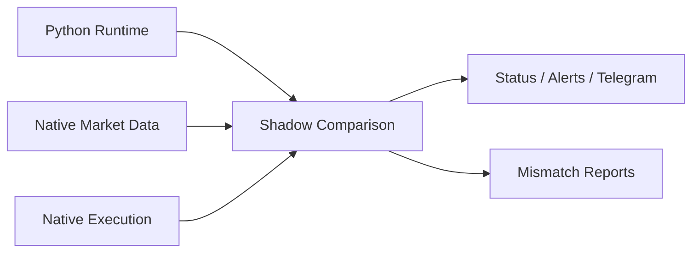

# Phase 22 Native Hot Path Activation Spec

## Status

Draft implementation spec for the twenty-second refactor milestone.

## Purpose

Phase 14 defined the native boundary. Phase 21 productizes low-latency strategies on the Python runtime.

Phase 22 activates the first real native-side canary:

- native market-data normalization
- native execution gateway
- native shadow comparison against Python
- first native-side shadow validation

## Dependencies

Phase 22 depends on:

- [docs/specs/PHASE_14_NATIVE_HOT_PATH_SPEC.md](/home/lekim/Projects/akibaCryptobot/docs/specs/PHASE_14_NATIVE_HOT_PATH_SPEC.md)
- [docs/specs/PHASE_21_LOW_LATENCY_TRADING_PRODUCT_SPEC.md](/home/lekim/Projects/akibaCryptobot/docs/specs/PHASE_21_LOW_LATENCY_TRADING_PRODUCT_SPEC.md)
- [src/runtime/native_shadow.py](/home/lekim/Projects/akibaCryptobot/src/runtime/native_shadow.py)
- [src/runtime/projection.py](/home/lekim/Projects/akibaCryptobot/src/runtime/projection.py)
- [src/api/routes/status.py](/home/lekim/Projects/akibaCryptobot/src/api/routes/status.py)

## Problem Statement

The repo has native hot-path contracts and docs, but no activated native-side canary yet:

1. native IPC is not yet a real product path
2. market-data normalization is still Python-owned in production
3. execution remains Python-owned
4. native shadow mismatch handling has not been exercised as an operator flow
5. no native-side canary exists to validate the hot-path boundary

## Phase 22 Goals

1. Stand up the first real native-side transport and snapshot flow.
2. Validate native market-data normalization in shadow.
3. Validate native execution gateway behavior in shadow.
4. Surface native shadow mismatches clearly to operators.
5. Establish the first native-side canary before any cutover discussion.

## Phase 22 Non-Goals

1. Full HFT production rollout.
2. Colocation.
3. Replacing Python orchestration entirely.
4. Deploying native ownership live without shadow validation.
5. Implementing every native subsystem in one phase.

## Architecture Decision

The first native activation should be shadow-only and comparison-first.



## Required Surfaces

### Native Transport and Snapshots

Priority targets:

- native IPC envelope and bridge
- native snapshot ingestion
- mismatch reporting

Minimum guarantees:

- Python can consume native snapshots without ambiguity
- missing or stale native snapshots are visible

### Operator Surfaces

Priority targets:

- status and websocket
- alerts
- deployment/runbook docs

Minimum guarantees:

- operators can distinguish match, divergence, and no-snapshot states
- native shadow divergence is actionable, not opaque

## File Layout

```text
src/runtime/
  native_shadow.py
  native_bridge.py
src/api/routes/
  status.py
src/api/
  websockets.py
tests/runtime/
  test_phase22_native_shadow_canary.py
docs/
  ARCHITECTURE.md
  DEPLOYMENT.md
  API_REFERENCE.md
```

## Core Design Decisions

### 1. Native Activation Starts With Shadow

Native ownership should not begin before match quality is credible.

### 2. Market Data Comes First

Native market-data normalization is the safest first step because it is lower-risk than native order ownership.

### 3. Divergence Is a Rollout Blocker

Persistent native/Python mismatch is not an operator curiosity. It blocks cutover.

## Task Breakdown

### P22-01: Native transport and snapshot ingestion

Acceptance:

- Python can ingest native shadow snapshots through the reviewed IPC contract
- missing or stale snapshots are surfaced clearly

### P22-02: Native market-data normalization shadow

Acceptance:

- native market-data normalization can be compared against Python runtime state
- mismatch dimensions are explicit

### P22-03: Native execution gateway shadow

Acceptance:

- native execution outputs can be compared in shadow without owning orders
- mismatch reasons are operator-visible

### P22-04: Native shadow operator surfacing

Acceptance:

- status, websocket, and alerts clearly expose match/divergence/no-snapshot states

### P22-05: Native-side canary runbook and integration coverage

Acceptance:

- deploy/runbook docs define how to enable and validate the first native canary
- tests cover match, divergence, and stale-snapshot cases

## Acceptance Criteria

Phase 22 is complete when:

1. a real native-side shadow path exists
2. native market data can be compared against Python runtime state
3. native execution can be observed in shadow
4. divergence is operator-visible and blocks promotion
5. the platform is ready for later native ownership discussions

## Recommended Implementation Order

1. native transport and snapshot ingestion
2. native market-data shadow
3. native execution shadow
4. operator surfaces
5. canary runbook and integration coverage
