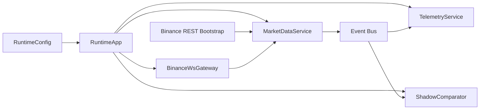

# Phase 2 Websocket-First Market Data and Shadow Mode Spec

## Status

Draft implementation spec for the second refactor milestone.

## Purpose

This document defines the market-data implementation phase that follows the initial runtime/domain contract work from Phase 1.

Phase 2 makes websocket-driven market state the primary source of truth for the new runtime. It also introduces bootstrap loading, symbol normalization, stale-state handling, and shadow-mode validation against the legacy cycle-driven bot.

This phase is still not true HFT. It is the first operational step away from the 60-second loop in [src/bot.py](/home/lekim/Projects/akibaCryptobot/src/bot.py) and toward an event-driven architecture that can later support lower-latency execution.

## Dependencies

Phase 2 depends on the Phase 1 contract layer:

- [docs/specs/PHASE_1_EVENT_RUNTIME_SPEC.md](/home/lekim/Projects/akibaCryptobot/docs/specs/PHASE_1_EVENT_RUNTIME_SPEC.md)
- [src/domain/events.py](/home/lekim/Projects/akibaCryptobot/src/domain/events.py)
- [src/domain/models.py](/home/lekim/Projects/akibaCryptobot/src/domain/models.py)

If any runtime shell pieces from Phase 1 are still missing, they may be implemented as part of this phase as long as scope remains limited to market-data ingestion and shadow-mode operation.

## Current Anchors

Current production and adapter anchors:

- [src/bot.py](/home/lekim/Projects/akibaCryptobot/src/bot.py)
- [src/exchange/websocket_manager.py](/home/lekim/Projects/akibaCryptobot/src/exchange/websocket_manager.py)
- [src/exchange/binance_client.py](/home/lekim/Projects/akibaCryptobot/src/exchange/binance_client.py)
- [src/trading/opportunity_scanner.py](/home/lekim/Projects/akibaCryptobot/src/trading/opportunity_scanner.py)
- [src/trading/position_manager.py](/home/lekim/Projects/akibaCryptobot/src/trading/position_manager.py)

Current limitations:

1. The legacy bot updates market data on a fixed cycle.
2. The websocket manager exists, but it is not the primary source of market state.
3. Current live state is not owned by a dedicated market-data service.
4. Current symbol state does not yet model multi-interval candle buffers cleanly.
5. The legacy bot uses dual-client mode for sandbox trading and production data; the new runtime must preserve that behavior.

## Phase 2 Goals

1. Build a dedicated `MarketDataService` that owns live market state.
2. Make websocket feeds the primary source for top-of-book and kline updates.
3. Bootstrap candle history via REST before websocket-only incremental updates begin.
4. Normalize symbol naming between config pairs such as `BTC/USDT` and exchange websocket symbols such as `BTCUSDT`.
5. Add stale-state detection, reconnect handling, and telemetry for data quality.
6. Run the new market-data path in shadow mode beside the legacy bot without placing orders.
7. Prove that the new runtime can maintain live state for at least one trading session.

## Phase 2 Non-Goals

1. Rewriting execution logic.
2. Replacing `OpportunityScanner` or `PositionManager`.
3. Building a full local depth book with sequence-aware depth reconciliation.
4. Implementing exchange-native stop loss or take profit.
5. Moving strategies fully off the legacy bot.
6. Replacing the current persistence layer.

## Architecture Decision

Phase 2 uses a hybrid ingestion path:

- REST for initial state bootstrap
- websocket streams for incremental live updates
- periodic housekeeping only for health checks and stale-state recovery

This is the correct next step because a websocket-only runtime without bootstrap is not usable for indicator-driven strategies, and a REST-only runtime cannot support lower-latency behavior or accurate state freshness checks.

## Target Runtime Topology



## File Layout

```text
src/
  runtime/
    app.py
    config.py
    service_registry.py
  services/
    base.py
    market_data_service.py
    telemetry_service.py
    shadow_comparator.py
  ports/
    exchange.py
  adapters/
    binance/
      ws_gateway.py
      symbol_mapper.py
  domain/
    events.py
    models.py
tests/
  runtime/
    test_app.py
    test_market_data_service.py
    test_ws_gateway.py
    test_shadow_comparator.py
```

## Core Design Decisions

### 1. Top-of-Book, Not Full Depth

Phase 2 must support:

- best bid
- best ask
- spread
- last traded or last candle-close price
- rolling candles by interval

Phase 2 must not attempt a full order-book engine. Full depth requires sequence-aware reconciliation logic and a different latency budget. That belongs to a later HFT-specific phase.

### 2. Multi-Interval Candle State

The Phase 1 `SymbolState` model with only `candles_1m` is too narrow for the current bot, because configured strategy intervals include `15m` and `1h`.

Phase 2 must generalize candle storage to:

```python
deque_map: dict[str, deque[Candle]]
```

or an equivalent typed structure such as:

```python
class CandleBufferMap:
    by_interval: dict[str, deque[Candle]]
```

Requirements:

- one bounded rolling buffer per `(symbol, interval)`
- configurable history length per interval
- cheap append
- cheap access to the most recent closed candle

### 3. Symbol Normalization

The bot currently uses slash-form symbols like `BTC/USDT`, while Binance websocket streams typically use `BTCUSDT`.

Phase 2 must add a single canonical symbol-mapping layer.

Rules:

- strategy and config layers continue using `BTC/USDT`
- exchange adapters translate to `BTCUSDT`
- normalized runtime events carry the canonical strategy symbol, not the raw exchange symbol
- raw exchange symbol may be included in metadata for logging

### 4. Bootstrap Before Streaming

`MarketDataService` must load recent OHLCV history before it relies on streaming updates.

Bootstrap flow:

1. load configured symbols
2. map to exchange symbol format
3. fetch recent OHLCV history for configured intervals
4. populate `SymbolState` buffers
5. subscribe to websocket streams
6. merge new stream updates onto bootstrapped state

This is required because strategy indicators and spread filters are not meaningful without history.

### 5. Dual-Client Data Mode

The current bot already uses production Binance for market data when sandbox trading is enabled. Phase 2 must preserve this behavior.

Rules:

- execution environment may remain sandbox
- market data environment may be production
- runtime config must make this explicit
- market-data service must not assume its feed source is the same endpoint as execution

## Required Contracts

### Runtime Config

Create or extend [src/runtime/config.py](/home/lekim/Projects/akibaCryptobot/src/runtime/config.py) with:

```python
@dataclass(slots=True, frozen=True)
class RuntimeConfig:
    symbols: tuple[str, ...]
    kline_intervals: tuple[str, ...]
    candle_history_limit: int
    market_data_source: str
    sandbox_execution: bool
    sandbox_market_data: bool
    stale_after_seconds: float
    queue_maxsize: int
    shadow_mode: bool
```

### Exchange Port

Create or extend [src/ports/exchange.py](/home/lekim/Projects/akibaCryptobot/src/ports/exchange.py):

```python
class MarketDataGateway(Protocol):
    async def connect(self) -> None: ...
    async def disconnect(self) -> None: ...
    async def subscribe_book_ticker(self, symbol: str) -> None: ...
    async def subscribe_kline(self, symbol: str, interval: str) -> None: ...
```

Bootstrap support may be provided by:

- a second protocol, or
- a dedicated bootstrap adapter

Example:

```python
class MarketDataBootstrapGateway(Protocol):
    async def fetch_ohlcv(
        self,
        symbol: str,
        interval: str,
        limit: int,
    ) -> list[Candle]: ...
```

### MarketDataService

Create [src/services/market_data_service.py](/home/lekim/Projects/akibaCryptobot/src/services/market_data_service.py) with these responsibilities:

- own all mutable market state
- bootstrap history
- subscribe to streams
- normalize and emit events
- maintain stale-state timestamps
- expose read-only snapshots for downstream consumers

It must not:

- place orders
- write to the database
- compute full strategy signals
- send Telegram notifications

### ShadowComparator

Create [src/services/shadow_comparator.py](/home/lekim/Projects/akibaCryptobot/src/services/shadow_comparator.py).

Responsibilities:

- compare new runtime market state to legacy `price_data_cache`
- compare latest close price and candle timestamps
- report drift, stale state, and missing symbols
- never block the market-data hot path

## Websocket Adapter Requirements

### Gateway Approach

Create [src/adapters/binance/ws_gateway.py](/home/lekim/Projects/akibaCryptobot/src/adapters/binance/ws_gateway.py) as a narrow adapter over [src/exchange/websocket_manager.py](/home/lekim/Projects/akibaCryptobot/src/exchange/websocket_manager.py).

The adapter must:

- normalize callback payloads
- hide raw websocket manager details from services
- register one handler per event type
- expose typed async subscription methods

### Book Ticker Requirement

The current websocket manager supports kline, trade, ticker, depth, and user streams, but the target hot-path state wants best bid and best ask directly.

Phase 2 should prefer `bookTicker` updates for:

- spread calculation
- top-of-book freshness
- execution-aware pre-trade checks

If `bookTicker` support is missing in [src/exchange/websocket_manager.py](/home/lekim/Projects/akibaCryptobot/src/exchange/websocket_manager.py), add it there or implement it in the Binance gateway. The business layer must not care which route is chosen.

### Event Normalization Rules

Websocket payloads must be normalized into:

- `market.tick`
- `market.spread`
- `market.kline`
- `market.kline_closed`

Rules:

- partial kline updates emit `market.kline`
- closed candles also emit `market.kline_closed`
- spread events emit only after both bid and ask are valid
- timestamps are converted once at the adapter boundary

## Symbol State Requirements

Each symbol must maintain:

- `best_bid`
- `best_ask`
- `last_price`
- `spread_bps`
- `last_update_at`
- `last_book_ticker_at`
- `last_kline_by_interval`
- rolling candles per configured interval

State ownership rule:

- only `MarketDataService` may mutate symbol market state

### Stale-State Policy

A symbol is stale when:

- no top-of-book update has been received within `stale_after_seconds`, or
- no kline update has been received for longer than one interval plus tolerance

Required behavior:

- mark state stale
- emit telemetry
- optionally trigger a REST refresh
- do not silently continue as if state is fresh

## Event Bus and Backpressure

Phase 2 still uses in-process queues only.

Queue policy:

- hot-path consumer queues are bounded
- telemetry and shadow queues may drop oldest items under pressure
- dropped-event metrics are mandatory

Reasoning:

- market data must remain live even if secondary consumers lag
- metrics and comparison services must not stall ingestion

## Shadow Mode

Shadow mode is mandatory in Phase 2.

Behavior:

- new runtime ingests market data
- new runtime updates state
- new runtime emits telemetry and comparison logs
- no orders are placed from the new runtime
- legacy bot remains the active trader

The purpose is to validate:

- symbol mapping
- candle bootstrap correctness
- websocket stability
- state freshness
- event rate handling
- parity against legacy market cache

## Failure Modes

Phase 2 must explicitly handle:

1. websocket connection failures
2. bootstrap REST failure for one or more symbols
3. symbol mapping mismatch
4. duplicate closed candles
5. stale market state
6. delayed or missing `bookTicker`
7. queue overflow in warm-path consumers
8. shadow comparator drift

Required behaviors:

- reconnect with bounded backoff
- fail a symbol cleanly without crashing the full runtime if bootstrap fails
- log unmapped symbols as configuration errors
- suppress duplicate closed-candle inserts
- expose stale counters and stale timestamps
- fall back to ticker or last close only if explicitly configured
- drop non-critical queue items with metrics
- log parity drift with enough context to investigate

## Observability

Phase 2 must add:

- ingest count by event type and symbol
- reconnect count
- stale-state count by symbol
- queue depth by consumer
- dropped-event count by consumer
- bootstrap latency by symbol and interval
- last-successful-update timestamp by symbol
- shadow drift count

Recommended structured log fields:

- `event_type`
- `symbol`
- `interval`
- `source`
- `queue_name`
- `latency_ms`
- `drift_bps`

## Testing Plan

### Unit Tests

- symbol mapper conversions
- market-data normalization from raw websocket payloads
- bootstrap merge into symbol state
- duplicate closed-kline suppression
- stale-state detection
- spread calculation from top-of-book

### Integration Tests

- runtime starts and subscribes configured symbols
- mocked websocket callbacks update live state
- bootstrap plus stream merge produces correct final state
- shadow comparator detects parity drift
- telemetry counts events and dropped warm-path items

### Regression Guardrails

- `MarketDataService` has no order-placement dependency
- market state mutation occurs only in `MarketDataService`
- shadow mode cannot place orders
- legacy bot remains runnable during this phase

## Acceptance Criteria

Phase 2 is complete when all of the following are true:

1. The new runtime can bootstrap recent candles for configured symbols and intervals.
2. The new runtime can subscribe to websocket top-of-book and kline streams.
3. `MarketDataService` maintains live per-symbol state without relying on the 60-second cycle.
4. The runtime emits normalized `market.tick`, `market.spread`, `market.kline`, and `market.kline_closed` events.
5. Stale-state handling and reconnect telemetry are visible and tested.
6. The runtime can operate in shadow mode beside the legacy bot for at least one session.
7. The shadow comparator can detect state drift between the new runtime and the legacy bot.
8. No order placement occurs from the new runtime.

## Task Breakdown

### P2-01: Create runtime config and service registry

- create or extend `src/runtime/config.py`
- create or extend `src/runtime/service_registry.py`
- support symbol lists, intervals, queue sizes, stale thresholds, shadow mode

### P2-02: Add symbol mapping adapter

- create `src/adapters/binance/symbol_mapper.py`
- map config symbols to websocket symbols and back
- add tests for reversible mapping rules

### P2-03: Create bootstrap gateway path

- expose REST OHLCV bootstrap access
- return normalized candle objects
- support production data while sandbox execution remains enabled

### P2-04: Create Binance websocket gateway

- create `src/adapters/binance/ws_gateway.py`
- bridge the existing websocket manager
- normalize payload entry points
- add `bookTicker` support

### P2-05: Implement MarketDataService

- own symbol state
- run bootstrap
- subscribe to streams
- update top-of-book and candle buffers
- emit normalized runtime events
- mark stale symbols

### P2-06: Implement TelemetryService

- consume runtime events
- track counts, latency, queue depth, reconnects, and stale-state metrics

### P2-07: Implement ShadowComparator

- compare new runtime state to legacy cache
- log drift and missing-symbol conditions
- ensure non-blocking warm-path operation

### P2-08: Add runtime integration tests

- app startup
- bootstrap and stream merge
- symbol-state updates
- shadow-mode parity checks

## Definition of Done

Phase 2 is done only when:

1. all acceptance criteria pass
2. market-data tests are green
3. shadow mode runs without placing trades
4. stale-state, reconnect, and queue metrics are visible
5. the new runtime can be demonstrated beside the legacy bot using live or sandbox feed data
6. the code remains isolated enough that execution, risk, and strategy migration can happen later without reworking the market-data contracts
