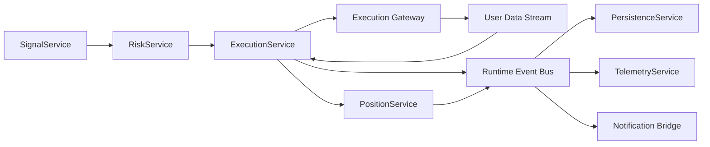

# Phase 3 Execution, Position State, and Native Protection Spec

## Status

Draft implementation spec for the third refactor milestone.

## Purpose

This document defines the first execution-focused phase after the market-data runtime work from Phase 1 and Phase 2.

Phase 3 moves order submission and position lifecycle control toward an event-driven model. It introduces execution and position state machines, native stop-loss and take-profit handling where the exchange supports it, and order/fill tracking that is driven by exchange updates rather than periodic full scans.

This phase is still not true HFT. It is the required bridge between the current cycle-driven bot and a future low-latency execution core.

## Dependencies

Phase 3 depends on:

- [docs/specs/PHASE_1_EVENT_RUNTIME_SPEC.md](/home/lekim/Projects/akibaCryptobot/docs/specs/PHASE_1_EVENT_RUNTIME_SPEC.md)
- [docs/specs/PHASE_2_MARKET_DATA_SHADOW_SPEC.md](/home/lekim/Projects/akibaCryptobot/docs/specs/PHASE_2_MARKET_DATA_SHADOW_SPEC.md)
- [src/domain/events.py](/home/lekim/Projects/akibaCryptobot/src/domain/events.py)
- [src/domain/models.py](/home/lekim/Projects/akibaCryptobot/src/domain/models.py)
- [src/runtime/app.py](/home/lekim/Projects/akibaCryptobot/src/runtime/app.py)
- [src/services/market_data_service.py](/home/lekim/Projects/akibaCryptobot/src/services/market_data_service.py)

## Current Anchors

Current live execution and lifecycle logic is spread across:

- [src/trading/opportunity_scanner.py](/home/lekim/Projects/akibaCryptobot/src/trading/opportunity_scanner.py)
- [src/trading/position_manager.py](/home/lekim/Projects/akibaCryptobot/src/trading/position_manager.py)
- [src/exchange/binance_client.py](/home/lekim/Projects/akibaCryptobot/src/exchange/binance_client.py)
- [src/risk_management.py](/home/lekim/Projects/akibaCryptobot/src/risk_management.py)
- [src/advanced_risk_management.py](/home/lekim/Projects/akibaCryptobot/src/advanced_risk_management.py)
- [src/persistence/trade_store.py](/home/lekim/Projects/akibaCryptobot/src/persistence/trade_store.py)

Current execution limitations:

1. Entry orders are placed directly from `OpportunityScanner.place_trade()`.
2. Protective stop-loss and take-profit values are calculated locally and stored in memory/SQLite, but not submitted as native exchange protection on spot.
3. Open-position management still depends on `PositionManager.manage_positions()` sweeping all positions and polling exchange/order state.
4. Exit handling couples execution, PnL calculation, database writes, performance updates, Telegram notifications, cooldown logic, and risk-manager updates in one function.
5. The bot tracks trades in untyped dictionaries keyed by symbol.
6. There is no explicit order or position state machine.
7. Fill handling is inferred from synchronous order responses and later polling, not from a dedicated user-data event stream.

## Live Flow Today

Current entry flow:

1. [OpportunityScanner.scan_opportunities()](/home/lekim/Projects/akibaCryptobot/src/trading/opportunity_scanner.py#L16) loops pairs.
2. [OpportunityScanner._process_pair()](/home/lekim/Projects/akibaCryptobot/src/trading/opportunity_scanner.py#L38) fetches OHLCV and ticker, checks cooldown, spread, signal, and correlation.
3. [OpportunityScanner._resolve_position_size()](/home/lekim/Projects/akibaCryptobot/src/trading/opportunity_scanner.py#L102) sizes the trade from balance and risk.
4. [OpportunityScanner.place_trade()](/home/lekim/Projects/akibaCryptobot/src/trading/opportunity_scanner.py#L197) computes stop-loss/take-profit, submits a market order, mutates `risk_manager.positions`, writes SQLite, and mutates `active_trades`.

Current exit flow:

1. [PositionManager.manage_positions()](/home/lekim/Projects/akibaCryptobot/src/trading/position_manager.py#L21) loops `active_trades`.
2. It polls open orders with [BinanceClient.get_open_orders()](/home/lekim/Projects/akibaCryptobot/src/exchange/binance_client.py#L188).
3. It checks bot-managed stop-loss and take-profit in [PositionManager.check_order_conditions()](/home/lekim/Projects/akibaCryptobot/src/trading/position_manager.py#L85).
4. It updates the trailing stop in [RiskManager.update_trailing_stop()](/home/lekim/Projects/akibaCryptobot/src/risk_management.py#L188).
5. It asks the active strategy whether to exit.
6. [PositionManager.close_position()](/home/lekim/Projects/akibaCryptobot/src/trading/position_manager.py#L119) submits a market close, computes fees and PnL, updates SQLite, updates performance tracking, removes the risk position, sets cooldown, and deletes the active trade.

## Phase 3 Goals

1. Introduce typed order and position state models.
2. Move order submission into a dedicated `ExecutionService`.
3. Move position lifecycle transitions into a dedicated `PositionService`.
4. Track order and fill state from exchange events first, REST polling second.
5. Submit native protective exits where the exchange supports them.
6. Separate hot-path execution from warm-path persistence, telemetry, and notifications.
7. Keep the legacy bot runnable during migration and support shadow/canary rollout.

## Phase 3 Non-Goals

1. Rewriting all strategy logic.
2. Replacing the entire legacy bot in one cutover.
3. Implementing full order book microstructure or market making.
4. Replacing SQLite with an event store.
5. Moving to Rust/C++ yet.
6. Achieving sub-millisecond HFT latency.

## External Contract Constraints

Phase 3 must follow current exchange capabilities.

Spot:

- Binance Spot supports native `STOP_LOSS`, `STOP_LOSS_LIMIT`, `TAKE_PROFIT`, and `TAKE_PROFIT_LIMIT` orders via `POST /api/v3/order`.
- Binance Spot also supports OCO order lists via `POST /api/v3/orderList/oco`.
- Spot user-data streams publish order updates via `executionReport` and account updates via `outboundAccountPosition`.

Futures:

- Binance USD-M futures support native conditional orders on `POST /fapi/v1/order`.
- Futures orders expose fields such as `reduceOnly` and `closePosition` and support types such as trailing stop market orders.

CCXT:

- CCXT documents `triggerPrice`, `stopLossPrice`, and `takeProfitPrice` support and requires capability checks via exchange feature inspection before relying on normalized behavior.

These facts are from current primary docs:

- [Binance Spot Trading Endpoints](https://developers.binance.com/docs/binance-spot-api-docs/rest-api/trading-endpoints)
- [Binance Spot User Data Stream](https://developers.binance.com/docs/binance-spot-api-docs/user-data-stream)
- [Binance USD-M Futures New Order](https://developers.binance.com/docs/derivatives/usds-margined-futures/trade/rest-api/New-Order)
- [CCXT Manual](https://github.com/ccxt/ccxt/wiki/Manual)

## Architecture Decision

Phase 3 uses a hybrid execution model:

- event-driven order and fill updates from exchange user-data streams where available
- idempotent REST order submission and order query/cancel as the control plane
- periodic reconciliation and timeout recovery as a fallback only

This is the correct next step because execution is now the bottleneck for reliability. Market data can already be maintained by the new runtime, but order and position state is still monolithic and polling-heavy.

## Target Runtime Topology



## File Layout

```text
src/
  domain/
    events.py
    models.py
    state.py
  ports/
    exchange.py
  runtime/
    app.py
    service_registry.py
  services/
    execution_service.py
    position_service.py
    risk_service.py
  adapters/
    binance/
      execution_gateway.py
      user_data_gateway.py
tests/
  runtime/
    test_execution_service.py
    test_position_service.py
    test_execution_gateway.py
```

Phase 3 should not delete the legacy scanner or position manager immediately. The new services must be introduced beside them and cut over by slice.

## Core Design Decisions

### 1. Explicit Order State Machine

Orders must move through explicit states.

Minimum order states:

- `created`
- `submit_pending`
- `accepted`
- `partially_filled`
- `filled`
- `cancel_pending`
- `cancelled`
- `rejected`
- `expired`
- `orphaned`

Rules:

- only `ExecutionService` may mutate live order state
- every transition must be driven by a typed event or a bounded recovery rule
- duplicate updates must be idempotent by `client_order_id` or `exchange_order_id`

### 2. Explicit Position State Machine

Positions must move through explicit states.

Minimum position states:

- `new`
- `entry_pending`
- `open`
- `protective_pending`
- `protected`
- `reduce_pending`
- `closed`
- `reconcile_error`

Rules:

- only `PositionService` may mutate live position state
- position state is derived from fills and protective-order lifecycle, not from a full periodic sweep
- every position must record entry intent, actual fills, average entry price, and active protective order ids

### 3. Native Protection by Venue Capability

Phase 3 must not assume one protection pattern fits all venues.

Spot primary pattern:

1. place entry order
2. wait for entry fill from order response or user-data update
3. place native protective exit structure
4. if supported cleanly for the symbol and venue, prefer OCO for stop-loss plus take-profit
5. if OCO is rejected or unsupported, place supported native stop/take-profit orders individually when safe
6. if native protection cannot be guaranteed, fall back to bot-managed protection only as an explicit degraded mode with telemetry

Futures primary pattern:

1. place entry order
2. place native reduce-only protective triggers after fill
3. use exchange-native conditional order types or trailing stop market orders where configured

Reasoning:

- your current bot uses market entry orders, so spot `OTO` is not the right first implementation because Binance requires the working order to be `LIMIT` or `LIMIT_MAKER`
- for spot, the practical bracket pattern is market entry followed by post-fill protective orders

### 4. User-Data Stream First for Fills

Phase 3 must add a dedicated user-data adapter for:

- order updates
- fills and partial fills
- balance/account position changes
- order-list updates where applicable

REST polling remains only for:

- startup recovery
- missed websocket gaps
- stale order reconciliation
- bounded timeout recovery

### 5. Hot Path vs Warm Path Separation

Execution hot path:

- validate `OrderIntent`
- submit order
- process exchange ack
- process fill/order-update events
- update order and position state
- trigger protective-order workflow

Warm path:

- SQLite writes
- performance tracker updates
- Telegram notifications
- reporting
- reconciliation summaries

The hot path must not wait on SQLite or Telegram.

### 6. Typed Intents Instead of Direct Exchange Calls

Strategies and the future `SignalService` must emit an `OrderIntent`.

Execution decides:

- client order ids
- venue-specific order params
- retry and idempotency behavior
- native protective workflow

This is a required seam for future HFT-oriented execution replacement.

## Required Contracts

### Domain Events

Extend [src/domain/events.py](/home/lekim/Projects/akibaCryptobot/src/domain/events.py) with execution events:

```python
EventType = Literal[
    ...,
    "signal.order_intent",
    "execution.order_submitted",
    "execution.order_update",
    "execution.fill",
    "execution.order_rejected",
    "position.opened",
    "position.protective_submitted",
    "position.closed",
    "risk.blocked",
]
```

Required payloads:

- `OrderIntentPayload`
- `OrderSubmittedPayload`
- `OrderUpdatePayload`
- `FillPayload`
- `PositionOpenedPayload`
- `PositionClosedPayload`
- `RiskBlockedPayload`

### Domain Models

Extend [src/domain/models.py](/home/lekim/Projects/akibaCryptobot/src/domain/models.py) or add [src/domain/state.py](/home/lekim/Projects/akibaCryptobot/src/domain/state.py) with:

```python
class OrderStatus(StrEnum): ...
class PositionStatus(StrEnum): ...

@dataclass(slots=True)
class OrderState:
    order_id: str | None
    client_order_id: str
    symbol: str
    side: str
    order_type: str
    status: OrderStatus
    requested_qty: float
    filled_qty: float
    avg_fill_price: float | None
    reduce_only: bool
    parent_position_id: str | None
    created_at: datetime
    updated_at: datetime

@dataclass(slots=True)
class PositionState:
    position_id: str
    symbol: str
    side: str
    status: PositionStatus
    requested_qty: float
    open_qty: float
    avg_entry_price: float | None
    stop_loss: float | None
    take_profit: float | None
    trailing_stop: float | None
    entry_order_ids: tuple[str, ...]
    protective_order_ids: tuple[str, ...]
    opened_at: datetime | None
    closed_at: datetime | None
```

### Exchange Port

Extend [src/ports/exchange.py](/home/lekim/Projects/akibaCryptobot/src/ports/exchange.py) with execution contracts.

Required protocols:

```python
class ExecutionGateway(Protocol):
    async def place_market_order(...) -> OrderSubmissionResult: ...
    async def place_limit_order(...) -> OrderSubmissionResult: ...
    async def cancel_order(...) -> None: ...
    async def fetch_order(...) -> OrderSnapshot: ...
    async def fetch_open_orders(...) -> list[OrderSnapshot]: ...
    async def cancel_open_orders(...) -> None: ...
    def supports_native_stop_loss(self, symbol: str) -> bool: ...
    def supports_native_take_profit(self, symbol: str) -> bool: ...
    def supports_oco(self, symbol: str) -> bool: ...

class UserDataGateway(Protocol):
    async def connect(self) -> None: ...
    async def disconnect(self) -> None: ...
    def register_order_update_callback(...) -> None: ...
    def register_balance_update_callback(...) -> None: ...
```

### Execution Service

Create [src/services/execution_service.py](/home/lekim/Projects/akibaCryptobot/src/services/execution_service.py).

Responsibilities:

- consume `OrderIntent`
- validate idempotency and client order ids
- submit orders through the gateway
- update `OrderState`
- process order/fill events from the user-data gateway
- place protective orders after entry fill
- emit execution and position events

It must not:

- generate signals
- run strategy logic
- write directly to SQLite in the hot path
- send Telegram notifications directly

### Position Service

Create [src/services/position_service.py](/home/lekim/Projects/akibaCryptobot/src/services/position_service.py).

Responsibilities:

- own mutable `PositionState`
- react to execution events
- manage position transitions
- attach protective order metadata
- handle reduce/close transitions
- detect orphaned or unprotected positions

It must not:

- call the exchange directly for new entries
- compute PnL for analytics-heavy reporting in the hot path

## Migration Strategy

### Stage 1

Introduce typed execution and position contracts in shadow mode.

- order intents may be synthesized from legacy scanner output
- execution service does not place live orders yet
- user-data adapter and state machines are tested with mocked exchange events

### Stage 2

Cut over entry submission only.

- legacy strategy and market-data flow still decide when to trade
- `OpportunityScanner` emits or hands off `OrderIntent`
- `ExecutionService` performs submission and state tracking
- protective orders are placed natively when supported

### Stage 3

Cut over exit management.

- `PositionManager.manage_positions()` becomes read-only or disabled
- user-data updates and `PositionService` own close transitions
- periodic fallback sweeps remain only for reconciliation

Recommended cutover order:

1. typed contracts
2. execution gateway
3. execution service submission path
4. user-data order updates
5. position service
6. protective-order workflow
7. legacy close-loop retirement

## Failure Modes

Phase 3 must explicitly handle:

1. duplicate order acknowledgements
2. partial fills
3. entry fill succeeds but protective order placement fails
4. protective order partially succeeds or only one leg is accepted
5. websocket user-data gap or disconnect
6. stale order status after submission
7. exchange reject due to min notional, precision, or filter changes
8. cancel-on-close races
9. restart with open position but missing in-memory state
10. restart with exchange-side protection present but local state missing
11. order-list cancellation semantics on spot OCO
12. degraded mode where only bot-managed protection is available

Required behaviors:

- all order submissions must be idempotent by client order id
- entry fills without native protection must raise a high-severity telemetry event
- partial fills must update average fill price and remaining quantity correctly
- restart recovery must reconcile exchange orders and balances before taking new action
- fallback polling must be bounded and targeted, not global full sweeps

## Observability

Phase 3 must add:

- order submit latency
- submit-to-ack latency
- ack-to-fill latency
- fill-to-protection-submitted latency
- active order count by status
- active position count by status
- native-protection success rate
- protection fallback count
- stale order-recovery count
- reconciliation mismatch count

Recommended structured log fields:

- `symbol`
- `client_order_id`
- `exchange_order_id`
- `position_id`
- `event_type`
- `order_status`
- `position_status`
- `latency_ms`
- `protective_mode`
- `fallback_reason`

## Testing Plan

### Unit Tests

- order state transition validity
- position state transition validity
- duplicate order update idempotency
- partial fill aggregation
- post-fill protective-order workflow selection
- spot capability downgrade behavior

### Integration Tests

- entry intent to submitted order event
- fill event opens position state
- protective orders submitted after entry fill
- native-protection failure triggers degraded mode telemetry
- restart recovery rebuilds state from exchange snapshots

### Regression Guardrails

- `ExecutionService` must not import strategy modules
- `PositionService` must not depend on SQLite
- hot-path services must not await Telegram or analytics writes
- degraded mode must be explicit and observable, never silent

## Acceptance Criteria

Phase 3 is complete when all of the following are true:

1. Typed order and position states exist and are tested.
2. The runtime can accept an `OrderIntent` and submit it through a dedicated execution service.
3. Exchange order updates can update order state without relying on a full periodic position sweep.
4. Entry fills open typed position state.
5. Native protective orders are placed where supported and their lifecycle is tracked.
6. The system can recover open orders and positions after restart.
7. SQLite, performance, and notification work are off the execution hot path.
8. The legacy bot remains available as fallback during rollout.

## Task Breakdown

### P3-01: Add typed execution and position contracts

- extend `src/domain/events.py`
- extend `src/domain/models.py` or add `src/domain/state.py`
- add tests for order and position schemas

### P3-02: Extend exchange ports for execution

- extend `src/ports/exchange.py`
- define `ExecutionGateway` and `UserDataGateway`
- define capability methods for native protection support

### P3-03: Add Binance execution gateway

- create `src/adapters/binance/execution_gateway.py`
- wrap REST order placement, cancel, and fetch logic
- normalize order snapshots
- add client order id generation and idempotency helpers

### P3-04: Add Binance user-data gateway

- create `src/adapters/binance/user_data_gateway.py`
- normalize order update and account update events
- bridge websocket manager or direct user-data stream support

### P3-05: Implement ExecutionService

- accept `OrderIntent`
- submit entry orders
- update `OrderState`
- process exchange updates
- emit execution events

### P3-06: Implement PositionService

- own `PositionState`
- react to fills and close events
- track protective-order ids
- detect unprotected positions

### P3-07: Implement native protection workflow

- spot: market entry then post-fill OCO or supported native equivalent
- futures: reduce-only native conditional orders
- degraded fallback path with telemetry

### P3-08: Add restart recovery and reconciliation hooks

- rebuild live order/position state from exchange and persistence
- detect orphaned exchange orders
- ensure recovery is bounded and deterministic

### P3-09: Add runtime integration tests

- full entry/fill/protect/close lifecycle
- partial fill path
- restart recovery path
- degraded protection path

## Definition of Done

Phase 3 is done only when:

1. all acceptance criteria pass
2. execution and position tests are green
3. native protection is demonstrated in paper/testnet or a safe sandboxed environment where supported
4. degraded mode is visible in metrics and logs
5. the runtime can manage live order/position state without the legacy full-position polling loop as the primary control mechanism
