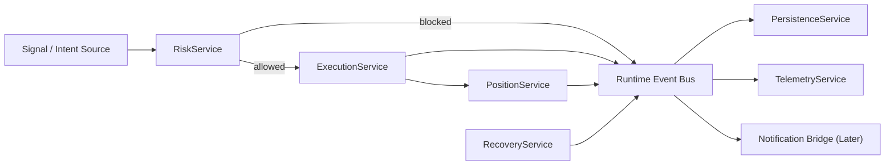

# Phase 4 Risk, Persistence, and Warm-Path Offload Spec

## Status

Draft implementation spec for the fourth refactor milestone.

## Purpose

Phase 4 moves the runtime from "execution state exists" to "execution state is governed and persisted correctly."

After Phase 3, the new runtime can:

- normalize exchange/user-stream events
- track typed order state
- track typed position state
- submit native protection
- recover runtime state after restart

What is still missing is the operational discipline around that flow:

- a hot-path risk gate that can block or allow order intents before execution
- warm-path persistence that records execution/position events without stalling trading
- explicit telemetry for degraded execution and protection conditions
- runtime wiring that lets the new services operate as a coherent low-latency path

This phase is the bridge between "event-driven execution prototype" and "runtime that can safely own more of live trading."

## Dependencies

Phase 4 depends on:

- [docs/specs/PHASE_1_EVENT_RUNTIME_SPEC.md](/home/lekim/Projects/akibaCryptobot/docs/specs/PHASE_1_EVENT_RUNTIME_SPEC.md)
- [docs/specs/PHASE_2_MARKET_DATA_SHADOW_SPEC.md](/home/lekim/Projects/akibaCryptobot/docs/specs/PHASE_2_MARKET_DATA_SHADOW_SPEC.md)
- [docs/specs/PHASE_3_EXECUTION_POSITION_SPEC.md](/home/lekim/Projects/akibaCryptobot/docs/specs/PHASE_3_EXECUTION_POSITION_SPEC.md)
- [src/services/execution_service.py](/home/lekim/Projects/akibaCryptobot/src/services/execution_service.py)
- [src/services/position_service.py](/home/lekim/Projects/akibaCryptobot/src/services/position_service.py)
- [src/services/recovery_service.py](/home/lekim/Projects/akibaCryptobot/src/services/recovery_service.py)

## Current Anchors

Legacy operational logic still lives mainly in:

- [src/risk_management.py](/home/lekim/Projects/akibaCryptobot/src/risk_management.py)
- [src/advanced_risk_management.py](/home/lekim/Projects/akibaCryptobot/src/advanced_risk_management.py)
- [src/persistence/trade_store.py](/home/lekim/Projects/akibaCryptobot/src/persistence/trade_store.py)
- [src/performance/metrics_tracker.py](/home/lekim/Projects/akibaCryptobot/src/performance/metrics_tracker.py)
- [src/notifications/telegram_bot.py](/home/lekim/Projects/akibaCryptobot/src/notifications/telegram_bot.py)
- [src/bot.py](/home/lekim/Projects/akibaCryptobot/src/bot.py)

Current limitations after Phase 3:

1. `ExecutionService` accepts intents directly but there is no dedicated runtime `RiskService` in front of it.
2. Runtime services emit events, but SQLite persistence is not yet a warm-path event consumer.
3. Execution and position state are recoverable, but persistence and reconciliation still depend heavily on legacy bot pathways.
4. Degraded states such as protection fallback or reconcile errors exist, but there is no dedicated runtime telemetry/materialization path.
5. The new runtime still does not own enough of the lifecycle to safely replace the legacy orchestrator for paper trading.

## Phase 4 Goals

1. Add a dedicated `RiskService` that evaluates `OrderIntentPayload` before execution.
2. Add a dedicated `PersistenceService` that consumes runtime events and writes state asynchronously.
3. Define a runtime persistence port so the new services do not depend directly on SQLite implementation details.
4. Materialize execution, position, and recovery events into durable records without blocking the hot path.
5. Add runtime telemetry counters and degraded-state tracking for execution, protection, and recovery.
6. Wire the new services together behind the runtime shell so the Phase 3 path can move closer to paper-trading ownership.

## Phase 4 Non-Goals

1. Replacing the full legacy bot in one cutover.
2. Rewriting every existing risk rule from the legacy bot.
3. Replacing SQLite with PostgreSQL or an event store.
4. Reworking Telegram or dashboard UX.
5. Optimizing for sub-millisecond latency.

## Architecture Decision

Phase 4 introduces two explicit lanes:

- hot path: `signal/order intent -> risk decision -> execution -> user-stream updates -> position transitions`
- warm path: `runtime events -> persistence -> telemetry -> reporting/notification adapters`

The hot path must remain in-memory and bounded.
The warm path must be eventually consistent and never delay order submission or fill handling.

## Target Runtime Topology



## File Layout

```text
src/
  ports/
    persistence.py
  services/
    risk_service.py
    persistence_service.py
    telemetry_service.py
  adapters/
    sqlite/
      runtime_store.py
tests/
  runtime/
    test_risk_service.py
    test_persistence_service.py
    test_phase4_integration.py
```

Phase 4 should remain additive. Do not remove the legacy risk manager or trade store during this phase.

## Core Design Decisions

### 1. Risk Must Be a Runtime Gate

`RiskService` owns the allow/block decision for runtime order intents.

Minimum checks in this phase:

- max open runtime positions
- per-symbol duplicate-entry block
- stop-loss/take-profit sanity
- invalid quantity/notional guard
- runtime kill-switch / circuit-breaker input

If blocked, emit `risk.blocked` with structured reason.
Do not call the exchange from `RiskService`.

### 2. Persistence Must Be Event-Driven

`PersistenceService` consumes runtime events and writes them asynchronously.

At minimum it must persist or materialize:

- order submission
- order update
- fill
- position opened
- position closed
- position protective submitted
- recovery report summary or reconciliation issues

This phase does not require full event sourcing, but persistence must be event-consumer-based.

### 3. Recovery Must Stay Bounded

Phase 3 recovery introduced typed restart handling.
Phase 4 must preserve these constraints:

- bounded item count
- bounded fetch timeout
- explicit degraded/unprotected reporting
- no unbounded exchange scans on the hot path

### 4. Telemetry Must Be First-Class

Telemetry should consume runtime events, not scrape internal service state.

Minimum counters/gauges:

- `risk_block_count`
- `order_submit_count`
- `order_reject_count`
- `protection_native_submitted_count`
- `protection_degraded_count`
- `recovery_orphaned_count`
- `recovery_unprotected_count`
- queue lag / backlog for persistence

## Required Contracts

### Domain Events

Phase 4 can reuse most existing event contracts. It must standardize payload handling for:

- `risk.blocked`
- `position.protective_submitted`
- `position.closed`
- recovery/reconcile issues as persistence/telemetry inputs

If a new payload is introduced, prefer a typed dataclass over raw dictionaries.

### Persistence Port

Add [src/ports/persistence.py](/home/lekim/Projects/akibaCryptobot/src/ports/persistence.py) with a minimal runtime-facing protocol.

Suggested shape:

```python
class RuntimeStore(Protocol):
    async def record_event(self, event: RuntimeEvent) -> None: ...
    async def record_recovery_report(self, report: RecoveryReport) -> None: ...
```

The port should remain narrow so SQLite can be swapped later.

### Risk Service

Create [src/services/risk_service.py](/home/lekim/Projects/akibaCryptobot/src/services/risk_service.py).

Responsibilities:

- evaluate `OrderIntentPayload`
- emit `risk.blocked` when an intent is rejected
- allow safe intents to proceed unchanged
- use typed runtime order/position state as inputs

It must not:

- submit orders
- write directly to SQLite
- depend on Telegram

### Persistence Service

Create [src/services/persistence_service.py](/home/lekim/Projects/akibaCryptobot/src/services/persistence_service.py).

Responsibilities:

- consume runtime events from a queue
- forward them to a `RuntimeStore`
- keep write errors isolated from the hot path
- expose bounded failure/backlog state for telemetry

### SQLite Runtime Store

Create [src/adapters/sqlite/runtime_store.py](/home/lekim/Projects/akibaCryptobot/src/adapters/sqlite/runtime_store.py).

Responsibilities:

- adapt runtime events into persistent records
- use existing SQLite infrastructure where practical
- avoid schema churn unless clearly necessary

## Migration Strategy

### Stage 1

Introduce `RiskService` and `PersistenceService` in isolation with unit tests.

### Stage 2

Wire `ExecutionService` behind `RiskService` for runtime-owned intents.

### Stage 3

Persist runtime execution/position/recovery events asynchronously.

### Stage 4

Add Phase 4 integration tests to prove:

- blocked intents never hit execution
- accepted intents do hit execution
- fills/position transitions are persisted
- recovery issues are persisted/observable

## Failure Modes

Phase 4 must handle:

1. persistence write failure without blocking execution
2. queue growth if persistence lags
3. repeated `risk.blocked` spam for the same symbol/intent
4. missing runtime state at the point of risk evaluation
5. recovery report persistence failure
6. raw dict payloads leaking into persistence without normalization

Required behavior:

- persistence failures must be logged and counted, not crash the hot path
- risk decisions must be deterministic for a given runtime snapshot
- queue backlogs must be observable

## Observability

Phase 4 must add:

- risk allow/block counts
- persistence queue depth
- persistence write failures
- average persistence write latency
- number of unprotected positions after recovery
- number of reconcile-error positions

Recommended structured log fields:

- `symbol`
- `intent_id`
- `client_order_id`
- `position_id`
- `risk_reason`
- `event_type`
- `persistence_result`
- `queue_depth`

## Testing Plan

### Unit Tests

- `RiskService` allows valid intents
- `RiskService` blocks invalid/unsafe intents
- `PersistenceService` drains events and survives store failures
- SQLite runtime store correctly materializes representative runtime events

### Integration Tests

- intent blocked by risk never reaches execution
- allowed intent flows through execution and position services
- recovery report and unprotected positions are persisted asynchronously
- persistence lag does not block execution/position handling

## Acceptance Criteria

Phase 4 is complete when all of the following are true:

1. Runtime `RiskService` exists and is tested.
2. Runtime `PersistenceService` exists and is tested.
3. Runtime events can be written asynchronously without blocking execution/position services.
4. `risk.blocked` is emitted and observable.
5. Recovery issues are durable/observable through the warm path.
6. Phase 4 integration tests prove the hot path is separated from persistence.

## Task Breakdown

### P4-01: Add runtime persistence port and telemetry/risk payload normalization

- create `src/ports/persistence.py`
- normalize any remaining raw runtime payload shapes used by warm-path services

### P4-02: Implement `RiskService`

- create `src/services/risk_service.py`
- block duplicate/open-position conflicts
- block invalid quantity / stop-loss / take-profit combinations
- emit `risk.blocked`

### P4-03: Implement `PersistenceService`

- create `src/services/persistence_service.py`
- consume runtime events asynchronously
- isolate write failures from the hot path

### P4-04: Add SQLite runtime adapter

- create `src/adapters/sqlite/runtime_store.py`
- persist representative runtime events through a narrow port

### P4-05: Wire runtime services together

- register `RiskService` and `PersistenceService` in the runtime shell
- ensure `ExecutionService` only receives risk-approved intents

### P4-06: Add Phase 4 integration coverage

- blocked intent path
- allowed intent path
- persistence lag/failure path
- recovery issue materialization path

## Definition of Done

Phase 4 is done only when:

1. all acceptance criteria pass
2. the runtime can evaluate risk and persist execution lifecycle data without blocking the hot path
3. degraded runtime conditions are observable through telemetry and persistence
4. the new runtime owns more of paper-trading control flow than the legacy monolith
