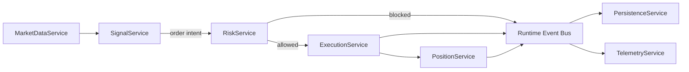

# Phase 5 Signal Runtime, Strategy Contracts, and Entry-Flow Cutover Spec

## Status

Draft implementation spec for the fifth refactor milestone.

## Purpose

Phase 5 moves trade intent generation into the new runtime.

After Phase 4, the runtime can:

- maintain market state from websocket/bootstrap data
- evaluate runtime risk
- submit and track execution
- track position state
- persist runtime events asynchronously
- expose degraded runtime conditions through telemetry

What is still missing is the decision layer that produces entry intents.

Today, live entry decisions are still anchored to the legacy cycle-driven path:

- [src/trading/opportunity_scanner.py](/home/lekim/Projects/akibaCryptobot/src/trading/opportunity_scanner.py)
- [src/strategies/base_strategy.py](/home/lekim/Projects/akibaCryptobot/src/strategies/base_strategy.py)
- [src/bot.py](/home/lekim/Projects/akibaCryptobot/src/bot.py)

Phase 5 is the bridge between "runtime can safely execute" and "runtime can safely decide."

## Dependencies

Phase 5 depends on:

- [docs/specs/PHASE_1_EVENT_RUNTIME_SPEC.md](/home/lekim/Projects/akibaCryptobot/docs/specs/PHASE_1_EVENT_RUNTIME_SPEC.md)
- [docs/specs/PHASE_2_MARKET_DATA_SHADOW_SPEC.md](/home/lekim/Projects/akibaCryptobot/docs/specs/PHASE_2_MARKET_DATA_SHADOW_SPEC.md)
- [docs/specs/PHASE_3_EXECUTION_POSITION_SPEC.md](/home/lekim/Projects/akibaCryptobot/docs/specs/PHASE_3_EXECUTION_POSITION_SPEC.md)
- [docs/specs/PHASE_4_RISK_PERSISTENCE_SPEC.md](/home/lekim/Projects/akibaCryptobot/docs/specs/PHASE_4_RISK_PERSISTENCE_SPEC.md)
- [src/runtime/app.py](/home/lekim/Projects/akibaCryptobot/src/runtime/app.py)
- [src/services/market_data_service.py](/home/lekim/Projects/akibaCryptobot/src/services/market_data_service.py)
- [src/services/risk_service.py](/home/lekim/Projects/akibaCryptobot/src/services/risk_service.py)
- [src/services/execution_service.py](/home/lekim/Projects/akibaCryptobot/src/services/execution_service.py)

## Current Anchors

Legacy signal-generation and entry orchestration still live mainly in:

- [src/trading/opportunity_scanner.py](/home/lekim/Projects/akibaCryptobot/src/trading/opportunity_scanner.py)
- [src/strategies/base_strategy.py](/home/lekim/Projects/akibaCryptobot/src/strategies/base_strategy.py)
- [src/strategies/momentum_strategy.py](/home/lekim/Projects/akibaCryptobot/src/strategies/momentum_strategy.py)
- [src/strategies/ensemble_strategy.py](/home/lekim/Projects/akibaCryptobot/src/strategies/ensemble_strategy.py)
- [src/strategies/freqai/base_freqai_strategy.py](/home/lekim/Projects/akibaCryptobot/src/strategies/freqai/base_freqai_strategy.py)
- [src/strategies/strategy_manager.py](/home/lekim/Projects/akibaCryptobot/src/strategies/strategy_manager.py)
- [src/bot.py](/home/lekim/Projects/akibaCryptobot/src/bot.py)

Current limitations after Phase 4:

1. Signal generation is still timer-driven through the legacy trading loop.
2. The legacy scanner fetches OHLCV/ticker/order-book data inline for each pair instead of using runtime-owned symbol state.
3. Strategies still operate on ad hoc pandas inputs rather than a stable runtime strategy contract.
4. Duplicate or repeated signal evaluation is bounded by the legacy cycle timing, not by candle-close or market-state events.
5. The new runtime can execute safely, but it still does not own the decision path for paper trading.

## Phase 5 Goals

1. Add a dedicated `SignalService` that consumes runtime market state and emits entry/exit intents.
2. Define a stable strategy contract that isolates strategies from exchange clients and legacy bot objects.
3. Introduce an indicator/window cache so strategy evaluation is incremental and runtime-owned.
4. Trigger signal evaluation on candle-close and bounded market-state events, not the legacy global sleep loop.
5. Wire `SignalService -> RiskService -> ExecutionService` in the runtime shell.
6. Keep the legacy bot runnable during migration while proving the runtime can own paper-trading entry flow.

## Phase 5 Non-Goals

1. Rewriting every existing strategy from scratch.
2. Replacing pandas everywhere in one phase.
3. Turning candle strategies into true HFT strategies.
4. Replacing hyperopt or FreqAI training flows.
5. Removing the legacy scanner in one cutover.

## Architecture Decision

Phase 5 introduces a decision lane ahead of the hot-path gate:

- decision lane: `market state -> strategy evaluation -> signal/intents`
- hot path: `risk gate -> execution -> position transitions`
- warm path: `persistence -> telemetry -> reporting`

The decision lane must be deterministic for a given market snapshot and must not call the exchange.

## Target Runtime Topology



## File Layout

```text
src/
  domain/
    strategy.py
  services/
    signal_service.py
  strategies/
    contracts.py
    indicator_cache.py
    runtime_adapter.py
tests/
  runtime/
    test_signal_service.py
    test_phase5_integration.py
  strategies/
    test_indicator_cache.py
```

Phase 5 should remain additive. Do not delete the legacy scanner or strategy manager during this phase.

## Core Design Decisions

### 1. Strategy Evaluation Must Be Runtime-Owned

`SignalService` owns when strategies are evaluated.

Minimum trigger rules in this phase:

- evaluate on completed-candle events for the strategy timeframe
- optionally evaluate on bounded market-state updates when the strategy explicitly requires it
- deduplicate repeated evaluations for the same symbol, timeframe, and candle-close timestamp

Do not keep the legacy "scan every pair every cycle" model as the primary decision path.

### 2. Strategies Must Consume Stable Inputs

Add a runtime strategy contract with typed inputs:

- symbol
- timeframe
- recent completed candles
- current top-of-book or last trade summary
- current position state for the symbol
- optional strategy context metadata

Strategies must not:

- fetch exchange data
- write to persistence
- mutate runtime state directly

They may emit:

- no signal
- entry intent
- exit intent
- diagnostic metadata

### 3. Indicator State Must Be Reused

Add an indicator/window cache owned by the runtime or strategy adapter.

Minimum requirements:

- reuse recent candles already owned by `MarketDataService`
- avoid rebuilding full indicator dataframes for every symbol on every loop
- expose a bounded strategy input window per symbol/timeframe
- keep the first implementation simple and correct; only introduce deeper vectorization if profiling proves it is needed

### 4. Legacy Strategies Must Be Adapted, Not Rewritten First

Phase 5 should introduce a runtime adapter around existing strategies so that:

- `MomentumStrategy`
- `EnsembleStrategy`
- FreqAI-backed strategy variants

can run under the new runtime contract without direct access to the legacy bot object.

The adapter may still convert runtime windows into pandas for existing strategies, but that conversion must happen in one explicit compatibility layer.

### 5. Entry Flow Must Be Event-Driven and Bounded

The runtime should emit order intents only when:

- the candle needed by the strategy is complete
- symbol state is fresh enough
- there is no duplicate in-flight intent for the symbol

This is not yet true HFT, but it is the correct architecture step toward HFT because the decision path becomes event-driven, deterministic, and isolated from execution.

## Required Contracts

### Strategy Snapshot

Add a typed strategy snapshot model under [src/domain/strategy.py](/home/lekim/Projects/akibaCryptobot/src/domain/strategy.py).

Suggested shape:

```python
@dataclass(slots=True)
class StrategySnapshot:
    symbol: str
    timeframe: str
    closed_candles: tuple[Candle, ...]
    best_bid: float | None
    best_ask: float | None
    last_price: float | None
    position: RuntimePosition | None
    generated_at: datetime
```

### Strategy Contract

Add [src/strategies/contracts.py](/home/lekim/Projects/akibaCryptobot/src/strategies/contracts.py) with a minimal runtime-facing protocol.

Suggested shape:

```python
class RuntimeStrategy(Protocol):
    async def generate_intent(
        self,
        snapshot: StrategySnapshot,
    ) -> OrderIntentPayload | None: ...
```

If existing strategies still return legacy `TradingSignal`, adapt them in `runtime_adapter.py` and convert them into runtime intents there.

### Signal Service

Create [src/services/signal_service.py](/home/lekim/Projects/akibaCryptobot/src/services/signal_service.py).

Responsibilities:

- subscribe to market-data events
- maintain bounded per-symbol/timeframe evaluation state
- generate runtime strategy snapshots
- call the configured runtime strategy adapter
- emit intents to `RiskService`
- emit a typed runtime event when a signal is suppressed or rejected before risk

It must not:

- submit orders directly
- persist directly
- fetch raw exchange data on the hot path

### Indicator Cache

Create [src/strategies/indicator_cache.py](/home/lekim/Projects/akibaCryptobot/src/strategies/indicator_cache.py).

Responsibilities:

- maintain bounded indicator inputs per symbol/timeframe
- expose consistent windows for strategy evaluation
- invalidate or rebuild cleanly after market-data gaps or restart recovery

## Migration Strategy

### Stage 1

Introduce typed strategy snapshot models and the runtime strategy contract.

### Stage 2

Add `SignalService` in isolation with unit tests and mock runtime strategies.

### Stage 3

Add a legacy strategy adapter so current strategies can run under the runtime signal path.

### Stage 4

Wire `SignalService -> RiskService -> ExecutionService` in the runtime shell for paper-mode ownership.

### Stage 5

Add integration/shadow coverage to compare runtime signal decisions against the legacy scanner for selected symbols/timeframes.

## Failure Modes

Phase 5 must handle:

1. duplicate candle-close events for the same symbol/timeframe
2. stale or missing candle windows
3. strategy exceptions without crashing the runtime
4. adapter mismatch between runtime snapshot and legacy strategy expectations
5. repeated intent emission for the same candle
6. high-latency strategies causing decision-lane backlog

Required behavior:

- strategy exceptions must be logged and counted, not crash the runtime
- duplicate candle events must not create duplicate intents
- stale snapshot state must suppress intent generation deterministically
- signal backlog must be observable

## Observability

Phase 5 must add:

- signal evaluation count
- signal generation count
- signal suppression count
- strategy exception count
- per-symbol decision lag
- decision queue depth if a queue is introduced

Recommended structured log fields:

- `symbol`
- `timeframe`
- `strategy_name`
- `candle_close_ts`
- `signal_result`
- `suppression_reason`
- `decision_latency_ms`

## Testing Plan

### Unit Tests

- `SignalService` evaluates only on completed-candle events
- duplicate candle events do not emit duplicate intents
- stale symbol state suppresses intent generation
- strategy exceptions are isolated and observable
- indicator cache returns bounded windows correctly

### Integration Tests

- runtime signal path emits an allowed intent that reaches risk/execution
- runtime signal path emits a blocked intent that remains observable
- runtime signal path stays non-blocking when persistence is slow
- legacy strategy adapter produces deterministic intents for representative snapshots

## Acceptance Criteria

Phase 5 is complete when all of the following are true:

1. Runtime `SignalService` exists and is tested.
2. Runtime strategy contracts are explicit and isolated from exchange clients.
3. At least one existing live strategy can run through the runtime adapter path.
4. The runtime can produce intents on candle-close without the legacy scanner driving the decision.
5. Duplicate signal generation for the same candle is prevented.
6. Phase 5 integration tests prove the runtime owns paper-trading entry flow for the migrated path.

## Task Breakdown

### P5-01: Add runtime strategy snapshot and strategy contracts

- create `src/domain/strategy.py`
- create `src/strategies/contracts.py`
- normalize signal/intents at the runtime boundary

### P5-02: Implement indicator/window cache

- create `src/strategies/indicator_cache.py`
- provide bounded candle windows per symbol/timeframe
- define cache invalidation behavior for stale/gap states

### P5-03: Implement `SignalService`

- create `src/services/signal_service.py`
- subscribe to completed-candle events
- deduplicate evaluations by symbol/timeframe/candle-close

### P5-04: Add legacy strategy runtime adapter

- create `src/strategies/runtime_adapter.py`
- adapt current `TradingSignal` strategies to runtime intents

### P5-05: Wire signal -> risk -> execution in the runtime shell

- register `SignalService`
- ensure only runtime-generated intents reach the Phase 4 gate for the migrated path

### P5-06: Add Phase 5 integration and shadow coverage

- runtime-owned entry flow
- duplicate-event suppression
- strategy-exception isolation
- adapter parity against the legacy path

## Definition of Done

Phase 5 is done only when:

1. all acceptance criteria pass
2. the runtime can generate intents from market state without the legacy scanner driving the migrated path
3. the decision lane is deterministic, observable, and bounded
4. the runtime owns more of paper-trading decision flow than the legacy monolith
