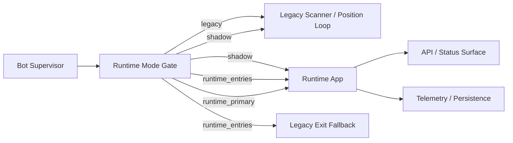

# Phase 6 Runtime Cutover, Exit Ownership, and Legacy Loop Carve-Out Spec

## Status

Draft implementation spec for the sixth refactor milestone.

## Purpose

Phase 5 gave the new runtime an event-driven entry path:

- market data is runtime-owned
- strategy evaluation is runtime-owned
- risk, execution, positions, persistence, and telemetry are runtime-owned
- the runtime can generate and route entry intents safely in paper mode

What is still missing is cutover control.

Today, the legacy bot loop still owns the operational trading path:

- [src/bot.py](/home/lekim/Projects/akibaCryptobot/src/bot.py)
- [src/trading/opportunity_scanner.py](/home/lekim/Projects/akibaCryptobot/src/trading/opportunity_scanner.py)
- [src/trading/position_manager.py](/home/lekim/Projects/akibaCryptobot/src/trading/position_manager.py)

That means the new runtime can decide and execute, but it is not yet the primary runtime surface for paper trading or controlled cutover.

Phase 6 defines how the runtime becomes the authoritative paper-trading path without breaking the existing bot.

## Dependencies

Phase 6 depends on:

- [docs/specs/PHASE_1_EVENT_RUNTIME_SPEC.md](/home/lekim/Projects/akibaCryptobot/docs/specs/PHASE_1_EVENT_RUNTIME_SPEC.md)
- [docs/specs/PHASE_2_MARKET_DATA_SHADOW_SPEC.md](/home/lekim/Projects/akibaCryptobot/docs/specs/PHASE_2_MARKET_DATA_SHADOW_SPEC.md)
- [docs/specs/PHASE_3_EXECUTION_POSITION_SPEC.md](/home/lekim/Projects/akibaCryptobot/docs/specs/PHASE_3_EXECUTION_POSITION_SPEC.md)
- [docs/specs/PHASE_4_RISK_PERSISTENCE_SPEC.md](/home/lekim/Projects/akibaCryptobot/docs/specs/PHASE_4_RISK_PERSISTENCE_SPEC.md)
- [docs/specs/PHASE_5_SIGNAL_STRATEGY_SPEC.md](/home/lekim/Projects/akibaCryptobot/docs/specs/PHASE_5_SIGNAL_STRATEGY_SPEC.md)
- [src/runtime/app.py](/home/lekim/Projects/akibaCryptobot/src/runtime/app.py)
- [src/services/signal_service.py](/home/lekim/Projects/akibaCryptobot/src/services/signal_service.py)
- [src/services/position_service.py](/home/lekim/Projects/akibaCryptobot/src/services/position_service.py)
- [src/bot.py](/home/lekim/Projects/akibaCryptobot/src/bot.py)

## Problem Statement

Current gaps after Phase 5:

1. The legacy global cycle still owns entry scanning and operational control.
2. There is no explicit runtime mode switch that says who owns entries and exits.
3. The runtime is not yet launched from the main bot in a controlled, observable way.
4. Position exits are still anchored mainly to legacy position-management logic.
5. The frontend/API status surface does not expose runtime cutover state clearly.
6. There is no clean single-writer rule preventing legacy and runtime entry logic from both acting on the same symbol set.

## Phase 6 Goals

1. Introduce an explicit runtime cutover mode in config.
2. Launch the new runtime from the main bot in shadow or primary mode.
3. Allow the runtime to own paper-trading entries without the legacy scanner competing.
4. Add runtime-owned exit intent generation for open positions.
5. Expose cutover state in status/telemetry so paper rollout is observable.
6. Keep a clean rollback path back to the legacy loop.

## Phase 6 Non-Goals

1. Full live-money cutover.
2. Deleting the legacy bot loop.
3. Rewriting every strategy for native runtime-only exits.
4. True HFT microstructure logic.
5. Replacing the API/frontend in one phase.

## Architecture Decision

Phase 6 introduces an explicit owner for decision flow.

Only one path may own entries at a time:

- `legacy`: legacy scanner owns entries and exits
- `shadow`: runtime evaluates and records decisions, but legacy remains authoritative
- `runtime_entries`: runtime owns entries, legacy still provides fallback exit management
- `runtime_primary`: runtime owns both entries and exits for paper mode

This is a cutover-control phase, not just another service phase.

## Target Topology



## Required Runtime Modes

Add explicit runtime ownership modes under [src/runtime/config.py](/home/lekim/Projects/akibaCryptobot/src/runtime/config.py).

Suggested values:

- `legacy`
- `shadow`
- `runtime_entries`
- `runtime_primary`

Rules:

- `legacy`: do not start the runtime trading path
- `shadow`: start runtime, but suppress execution side effects
- `runtime_entries`: runtime owns new entries, legacy scanner is disabled
- `runtime_primary`: runtime owns both entries and exits, legacy trade loop is disabled except for compatibility hooks

## Bot Integration Rules

The bot must become a supervisor, not the owner of all trading logic.

Minimum integration requirements:

1. Bot startup decides which runtime mode is active.
2. Bot starts the runtime app when mode is not `legacy`.
3. Legacy opportunity scanning is skipped when runtime owns entries.
4. Legacy position-management sweeps are skipped when runtime owns exits.
5. Shutdown must stop runtime services before exchange teardown finishes.

## Exit Ownership Rules

Phase 6 adds runtime-owned exit intent generation.

Minimum requirements:

- runtime strategies may emit reduce-only exit intents for open positions
- exit evaluation remains event-driven and symbol-scoped
- duplicate exit intents for the same open position must be bounded
- native protective orders remain the first line of protection
- strategy exits are supplemental logic, not a substitute for native protection

## Observability Requirements

The runtime cutover state must be visible through:

- API status payloads
- runtime telemetry counters
- persistence events showing which owner made the decision

Minimum status fields:

- `runtime_mode`
- `runtime_is_running`
- `runtime_owns_entries`
- `runtime_owns_exits`

## File Layout

```text
src/
  runtime/
    config.py
    app.py
    mode.py
  services/
    signal_service.py
  bot.py
  api/
    app.py
tests/
  runtime/
    test_runtime_mode.py
    test_phase6_runtime_cutover.py
  test_bot_logic.py
  test_api_app.py
```

## Task Breakdown

### P6-01: Add runtime mode config and ownership helpers

Add the typed runtime mode model and helper predicates.

Acceptance:

- config can express runtime ownership mode clearly
- helpers answer whether runtime owns entries or exits
- tests cover all modes and invalid values

### P6-02: Launch runtime from bot supervisor

Start the runtime shell from [src/bot.py](/home/lekim/Projects/akibaCryptobot/src/bot.py) when mode requires it.

Acceptance:

- bot can start/stop runtime cleanly
- startup/shutdown order is deterministic
- legacy-only mode behavior is unchanged

### P6-03: Disable legacy entry scanner when runtime owns entries

Gate [src/trading/opportunity_scanner.py](/home/lekim/Projects/akibaCryptobot/src/trading/opportunity_scanner.py) usage through runtime ownership mode.

Acceptance:

- no duplicate entry ownership
- paper mode can run with runtime-owned entries only

### P6-04: Add runtime-owned exit intent flow

Extend `SignalService` and strategy adapters so open positions can produce bounded reduce-only exits.

Acceptance:

- runtime can generate reduce-only exits for open positions
- duplicate exit intents are suppressed
- focused tests cover exit ownership

### P6-05: Expose runtime cutover state in API and status payloads

Update status surfaces so rollout state is observable.

Acceptance:

- API exposes runtime mode and ownership fields
- tests cover both legacy and runtime-primary cases

### P6-06: Add integration coverage for cutover modes

Add end-to-end tests proving the ownership boundary works.

Acceptance:

- shadow mode never submits live intents
- runtime entry mode suppresses legacy scanning
- runtime primary mode suppresses legacy scanning and legacy exit sweeps

## Acceptance Criteria

Phase 6 is complete when:

1. paper trading can run with runtime-owned entries end to end
2. the ownership boundary is explicit and testable
3. API/status output exposes the active mode
4. rollback to `legacy` mode is one config change
5. there is no dual-entry path in runtime entry or runtime primary modes

## Rollback Plan

Rollback is configuration-driven:

1. set runtime mode to `legacy`
2. restart the service
3. verify runtime ownership fields are false
4. confirm the legacy loop resumes ownership

Do not remove legacy code paths during this phase.
