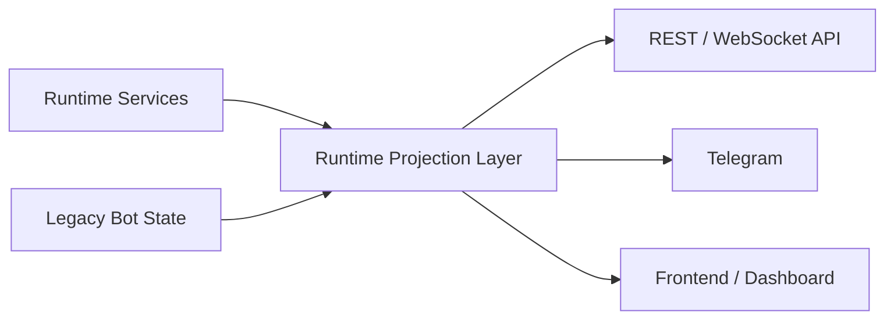

# Phase 7 Runtime Compatibility, Control Surfaces, and Paper-Primary Rollout Spec

## Status

Draft implementation spec for the seventh refactor milestone.

## Purpose

Phase 6 established ownership control:

- runtime ownership modes now exist
- the bot can supervise the runtime lifecycle
- runtime-owned entry flow is cut over safely
- runtime-owned exit flow is available
- legacy entry scanning and legacy exit sweeps are suppressed when ownership moves to the runtime
- API status now exposes runtime mode and ownership fields

What is still missing is compatibility and operator trust.

Today, most operator-facing surfaces still assume the legacy bot is the source of truth:

- [src/bot.py](/home/lekim/Projects/akibaCryptobot/src/bot.py)
- [src/api/routes/trading.py](/home/lekim/Projects/akibaCryptobot/src/api/routes/trading.py)
- [src/api/routes/account.py](/home/lekim/Projects/akibaCryptobot/src/api/routes/account.py)
- [src/api/routes/performance.py](/home/lekim/Projects/akibaCryptobot/src/api/routes/performance.py)
- [src/api/websockets.py](/home/lekim/Projects/akibaCryptobot/src/api/websockets.py)
- [src/notifications/telegram_bot.py](/home/lekim/Projects/akibaCryptobot/src/notifications/telegram_bot.py)

That means runtime-primary paper trading can execute correctly while the dashboard, API, and Telegram surfaces still report legacy-oriented state such as `active_trades` rather than runtime position/order state.

Phase 7 closes that gap.

## Dependencies

Phase 7 depends on:

- [docs/specs/PHASE_1_EVENT_RUNTIME_SPEC.md](/home/lekim/Projects/akibaCryptobot/docs/specs/PHASE_1_EVENT_RUNTIME_SPEC.md)
- [docs/specs/PHASE_2_MARKET_DATA_SHADOW_SPEC.md](/home/lekim/Projects/akibaCryptobot/docs/specs/PHASE_2_MARKET_DATA_SHADOW_SPEC.md)
- [docs/specs/PHASE_3_EXECUTION_POSITION_SPEC.md](/home/lekim/Projects/akibaCryptobot/docs/specs/PHASE_3_EXECUTION_POSITION_SPEC.md)
- [docs/specs/PHASE_4_RISK_PERSISTENCE_SPEC.md](/home/lekim/Projects/akibaCryptobot/docs/specs/PHASE_4_RISK_PERSISTENCE_SPEC.md)
- [docs/specs/PHASE_5_SIGNAL_STRATEGY_SPEC.md](/home/lekim/Projects/akibaCryptobot/docs/specs/PHASE_5_SIGNAL_STRATEGY_SPEC.md)
- [docs/specs/PHASE_6_RUNTIME_CUTOVER_SPEC.md](/home/lekim/Projects/akibaCryptobot/docs/specs/PHASE_6_RUNTIME_CUTOVER_SPEC.md)
- [src/runtime/app.py](/home/lekim/Projects/akibaCryptobot/src/runtime/app.py)
- [src/services/position_service.py](/home/lekim/Projects/akibaCryptobot/src/services/position_service.py)
- [src/services/execution_service.py](/home/lekim/Projects/akibaCryptobot/src/services/execution_service.py)
- [src/services/persistence_service.py](/home/lekim/Projects/akibaCryptobot/src/services/persistence_service.py)
- [src/bot.py](/home/lekim/Projects/akibaCryptobot/src/bot.py)

## Problem Statement

Current gaps after Phase 6:

1. Runtime-primary can own trading decisions, but the legacy bot still owns most operator-facing state.
2. API routes still read mostly legacy state and legacy persistence assumptions.
3. Telegram status and control commands are not runtime-aware.
4. The dashboard cannot reliably reflect runtime-owned positions/orders during cutover.
5. There is no explicit compatibility projection layer translating runtime state into legacy-facing summaries.
6. Paper rollout still depends on users inferring runtime behavior from low-level status flags instead of first-class runtime state views.

## Phase 7 Goals

1. Add a runtime compatibility projection layer that summarizes runtime positions, orders, and health for operator surfaces.
2. Make API routes runtime-aware when runtime owns entries or exits.
3. Make Telegram status/control surfaces runtime-aware.
4. Keep the legacy API contract stable where possible while improving accuracy under runtime-primary mode.
5. Make paper-mode runtime rollout observable enough that the frontend can be trusted for visual verification.
6. Preserve clean rollback to legacy mode.

## Phase 7 Non-Goals

1. Live-money cutover.
2. Removing the legacy bot or API in one phase.
3. Rewriting the frontend UI completely.
4. Full portfolio/accounting redesign.
5. Native-core/HFT execution changes.

## Architecture Decision

Phase 7 introduces a compatibility projection boundary.

The runtime remains the source of truth for runtime-owned trading state.
Operator surfaces consume a projection of that state rather than reading legacy bot fields directly.



The projection layer must answer:

- what positions are open
- what orders are in flight
- who owns entries/exits
- whether runtime is healthy and active
- whether legacy state is authoritative or compatibility-only

## Target Topology

Runtime ownership rules after Phase 7:

- `legacy`: operator surfaces read legacy state directly
- `shadow`: operator surfaces show legacy state plus shadow/runtime diagnostics
- `runtime_entries`: operator surfaces show runtime entry ownership but may still use legacy-compatible exit summaries
- `runtime_primary`: operator surfaces prefer runtime projection for active positions, open orders, and runtime health

## Required Compatibility Surfaces

### Runtime Projection

Add a projection layer under a new runtime-facing module.

Suggested files:

- [src/runtime/projection.py](/home/lekim/Projects/akibaCryptobot/src/runtime/projection.py)
- [src/runtime/view_models.py](/home/lekim/Projects/akibaCryptobot/src/runtime/view_models.py)

Minimum projection outputs:

- runtime mode summary
- runtime running/healthy flags
- projected active positions
- projected in-flight orders
- projected counts for active positions, protected positions, pending exits, and rejected orders
- source-of-truth marker: `legacy`, `shadow`, `runtime_projection`

### API Cutover

Update API routes so they use the runtime projection when runtime owns the relevant state.

Priority targets:

- [src/api/routes/status.py](/home/lekim/Projects/akibaCryptobot/src/api/routes/status.py)
- [src/api/routes/trading.py](/home/lekim/Projects/akibaCryptobot/src/api/routes/trading.py)
- [src/api/routes/account.py](/home/lekim/Projects/akibaCryptobot/src/api/routes/account.py)
- [src/api/routes/performance.py](/home/lekim/Projects/akibaCryptobot/src/api/routes/performance.py)
- [src/api/websockets.py](/home/lekim/Projects/akibaCryptobot/src/api/websockets.py)

Rules:

- preserve existing response keys where practical
- add runtime ownership/source metadata explicitly
- do not silently mix legacy and runtime positions in one list without a source marker

### Telegram Cutover

Update [src/notifications/telegram_bot.py](/home/lekim/Projects/akibaCryptobot/src/notifications/telegram_bot.py) so runtime-primary mode reports runtime-owned positions and health.

Minimum commands to update:

- `/status`
- `/positions`
- `/performance`
- any pause/resume or reconcile command that assumes legacy-only ownership

## File Layout

```text
src/
  runtime/
    projection.py
    view_models.py
  api/
    routes/
      status.py
      trading.py
      account.py
      performance.py
    websockets.py
  notifications/
    telegram_bot.py
  bot.py
tests/
  runtime/
    test_runtime_projection.py
    test_phase7_projection_integration.py
  test_api_app.py
  test_bot_logic.py
```

## Core Design Decisions

### 1. Runtime State Must Not Be Rehydrated Through Legacy Dicts

Do not solve Phase 7 by copying runtime state back into `bot.active_trades` as the primary mechanism.

That would hide ownership boundaries and recreate the exact ambiguity the refactor is trying to eliminate.

Instead:

- keep runtime state in runtime services
- build explicit view models for operator use
- expose compatibility summaries intentionally

### 2. Operator Surfaces Need Source Metadata

Every runtime-aware surface should be able to answer where the displayed state came from.

Minimum values:

- `legacy`
- `shadow`
- `runtime_projection`

This matters for rollout and debugging.

### 3. Paper Rollout Should Favor Read Accuracy Over Contract Purity

If an API route currently returns an approximate legacy shape, it is acceptable to keep that shape in Phase 7 as long as:

- it is accurate under runtime-primary mode
- the source marker is explicit
- the route does not imply legacy state is authoritative when it is not

### 4. Projection Logic Must Be Read-Only

The projection layer may summarize runtime state, but it must not mutate positions, orders, or persistence.

### 5. Frontend and Telegram Should Use the Same Projection Rules

Do not let the dashboard and Telegram drift into separate interpretations of runtime state.

## Task Breakdown

### P7-01: Add runtime projection/view-model layer

Acceptance:

- runtime positions and orders can be summarized without touching legacy active-trade dicts
- projection includes ownership/source metadata
- focused tests cover empty, open, protected, and pending-exit states

### P7-02: Make status and trading routes runtime-aware

Acceptance:

- `/api/status` and trading routes use runtime projection when runtime owns the relevant state
- legacy mode behavior remains unchanged
- tests cover legacy, shadow, runtime-entries, and runtime-primary cases

### P7-03: Make Telegram status/runtime summaries runtime-aware

Acceptance:

- Telegram status/position summaries reflect runtime-owned positions in runtime-primary mode
- command output includes runtime ownership mode where relevant

### P7-04: Add projection-backed websocket/status feed updates

Acceptance:

- websocket status updates include runtime projection fields
- frontend consumers can distinguish legacy from runtime-projected state

### P7-05: Add paper-primary rollout integration coverage

Acceptance:

- runtime-primary mode exposes runtime-projected positions through operator surfaces
- rollback to legacy mode restores legacy state surfaces cleanly
- tests cover source metadata and ownership boundaries end to end

## Acceptance Criteria

Phase 7 is complete when:

1. The runtime is the clear source of truth for runtime-owned paper trading state.
2. API, websocket, and Telegram surfaces do not misreport runtime-primary trading as legacy-owned state.
3. Operator surfaces expose source metadata and ownership mode.
4. Legacy mode remains unchanged.
5. Paper rollout can be visually inspected and trusted from the frontend.

## Rollout Notes

Recommended implementation order:

1. projection layer
2. status/trading API routes
3. Telegram/runtime summaries
4. websocket/status updates
5. integration coverage

Recommended deployment order:

1. deploy projection and read-path changes while remaining in `legacy`
2. enable `shadow`
3. enable `runtime_entries`
4. enable `runtime_primary` only after operator surfaces match runtime state
