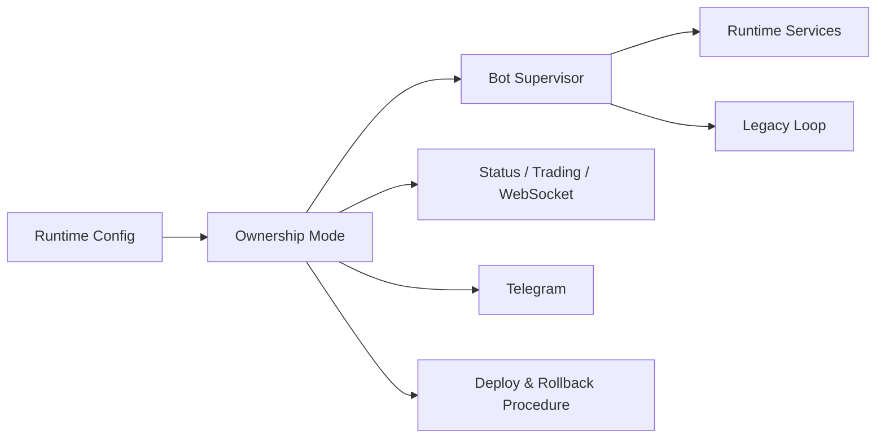

# Phase 8 Paper-Primary Runtime Activation, Rollout Control, and Legacy Default Reversal Spec

## Status

Draft implementation spec for the eighth refactor milestone.

## Purpose

Phase 7 makes operator-facing surfaces runtime-aware.
That closes the visibility gap, but it does not yet complete the rollout.

After Phase 7, the system can accurately describe runtime-owned state, yet the deployed bot still defaults to legacy ownership unless a runtime block is explicitly configured.
The remaining work is operational rather than architectural: make runtime-primary paper trading a controlled, observable, and reversible default for the paper environment.

Phase 8 introduces the rollout machinery needed to activate the runtime in paper mode with confidence while preserving a clean rollback path to legacy mode.

## Dependencies

Phase 8 depends on:

- [docs/specs/PHASE_1_EVENT_RUNTIME_SPEC.md](/home/lekim/Projects/akibaCryptobot/docs/specs/PHASE_1_EVENT_RUNTIME_SPEC.md)
- [docs/specs/PHASE_2_MARKET_DATA_SHADOW_SPEC.md](/home/lekim/Projects/akibaCryptobot/docs/specs/PHASE_2_MARKET_DATA_SHADOW_SPEC.md)
- [docs/specs/PHASE_3_EXECUTION_POSITION_SPEC.md](/home/lekim/Projects/akibaCryptobot/docs/specs/PHASE_3_EXECUTION_POSITION_SPEC.md)
- [docs/specs/PHASE_4_RISK_PERSISTENCE_SPEC.md](/home/lekim/Projects/akibaCryptobot/docs/specs/PHASE_4_RISK_PERSISTENCE_SPEC.md)
- [docs/specs/PHASE_5_SIGNAL_STRATEGY_SPEC.md](/home/lekim/Projects/akibaCryptobot/docs/specs/PHASE_5_SIGNAL_STRATEGY_SPEC.md)
- [docs/specs/PHASE_6_RUNTIME_CUTOVER_SPEC.md](/home/lekim/Projects/akibaCryptobot/docs/specs/PHASE_6_RUNTIME_CUTOVER_SPEC.md)
- [docs/specs/PHASE_7_RUNTIME_COMPATIBILITY_SPEC.md](/home/lekim/Projects/akibaCryptobot/docs/specs/PHASE_7_RUNTIME_COMPATIBILITY_SPEC.md)
- [src/runtime/config.py](/home/lekim/Projects/akibaCryptobot/src/runtime/config.py)
- [src/runtime/app.py](/home/lekim/Projects/akibaCryptobot/src/runtime/app.py)
- [src/bot.py](/home/lekim/Projects/akibaCryptobot/src/bot.py)
- [src/api/routes/status.py](/home/lekim/Projects/akibaCryptobot/src/api/routes/status.py)
- [src/api/websockets.py](/home/lekim/Projects/akibaCryptobot/src/api/websockets.py)
- [src/notifications/telegram_bot.py](/home/lekim/Projects/akibaCryptobot/src/notifications/telegram_bot.py)
- [config/config.json](/home/lekim/Projects/akibaCryptobot/config/config.json)
- [docs/CONFIGURATION.md](/home/lekim/Projects/akibaCryptobot/docs/CONFIGURATION.md)
- [docs/DEPLOYMENT.md](/home/lekim/Projects/akibaCryptobot/docs/DEPLOYMENT.md)

## Problem Statement

Current gaps after Phase 7:

1. Runtime mode is implemented, but paper deployments still require manual configuration to activate it.
2. There is no rollout-focused config contract describing when paper should run `shadow`, `runtime_entries`, or `runtime_primary`.
3. There is no first-class operator control flow for promoting or rolling back runtime ownership cleanly.
4. Paper deployment health is visible, but rollout-specific health criteria and rollback triggers are not yet codified.
5. Legacy remains the effective default on the server, which slows confidence-building for runtime-primary paper trading.

## Phase 8 Goals

1. Make runtime mode a documented, supported paper-deployment control surface.
2. Add explicit rollout states and promotion/rollback rules for paper environments.
3. Ensure operator surfaces clearly show whether paper is in `legacy`, `shadow`, `runtime_entries`, or `runtime_primary` mode.
4. Make paper-primary activation repeatable through config and deploy procedure, not manual inference.
5. Preserve a one-step rollback path to legacy mode.

## Phase 8 Non-Goals

1. Live-money runtime activation.
2. Removing the legacy bot loop from the codebase.
3. High-frequency execution changes or native-core migration.
4. Replacing the existing dashboard UI wholesale.
5. Exchange/accounting redesign beyond rollout support.

## Architecture Decision

Phase 8 treats runtime ownership as an operational mode with an explicit rollout lifecycle.



The key decision is that rollout state belongs in configuration and deployment procedure, not in undocumented server-local behavior.

## Target Topology

Paper environments should support this ordered rollout path:

1. `legacy`
2. `shadow`
3. `runtime_entries`
4. `runtime_primary`

Each mode must satisfy clear health conditions before promotion to the next mode.

## Required Surfaces

### Runtime Config and Samples

Add or update the runtime section in the paper configuration surface.

Priority targets:

- [config/config.json](/home/lekim/Projects/akibaCryptobot/config/config.json)
- [docs/CONFIGURATION.md](/home/lekim/Projects/akibaCryptobot/docs/CONFIGURATION.md)
- [src/runtime/config.py](/home/lekim/Projects/akibaCryptobot/src/runtime/config.py)

Minimum fields to document and support clearly:

- `runtime_mode`
- `shadow_mode` compatibility rules if still supported
- whether runtime owns entries
- whether runtime owns exits
- rollout guidance for paper deployment

### Operator Rollout Visibility

Priority targets:

- [src/api/routes/status.py](/home/lekim/Projects/akibaCryptobot/src/api/routes/status.py)
- [src/api/websockets.py](/home/lekim/Projects/akibaCryptobot/src/api/websockets.py)
- [src/notifications/telegram_bot.py](/home/lekim/Projects/akibaCryptobot/src/notifications/telegram_bot.py)

Minimum operator-visible rollout data:

- current runtime mode
- whether runtime is healthy
- whether runtime owns entries/exits
- whether paper deployment is promotion-ready or rollback-recommended

### Deployment and Rollback Procedure

Priority targets:

- [docs/DEPLOYMENT.md](/home/lekim/Projects/akibaCryptobot/docs/DEPLOYMENT.md)
- deploy helper scripts only if needed for config-safe rollout

Minimum deployment guarantees:

- pinned SHA deploys remain mandatory
- runtime mode change is explicit and reviewable
- rollback to legacy mode is a documented fast path

## File Layout

```text
config/
  config.json
src/
  runtime/
    config.py
  api/
    routes/
      status.py
    websockets.py
  notifications/
    telegram_bot.py
tests/
  runtime/
    test_runtime_config.py
    test_phase8_rollout.py
  test_api_app.py
docs/
  CONFIGURATION.md
  DEPLOYMENT.md
  specs/
    PHASE_8_PAPER_PRIMARY_ACTIVATION_SPEC.md
```

## Core Design Decisions

### 1. Promotion Must Be Explicit

Do not implicitly promote paper deployments from `legacy` to a runtime-owned mode based on partial health checks.
Mode changes must come from reviewed config or a clearly bounded operator action.

### 2. Rollback Must Be Faster Than Promotion

If runtime-primary paper behavior is suspect, operators must be able to revert to `legacy` without code changes.
That means the configuration and deploy procedure must privilege rollback simplicity.

### 3. Runtime Mode Is Part of the Public Operator Contract

Once paper-primary is supported, runtime mode is no longer an internal implementation detail.
Status surfaces, websocket feeds, Telegram, and deployment docs all need to represent it consistently.

### 4. Phase 8 Is About Operational Confidence

This phase is not a refactor-only phase.
Its value is that a human operator can intentionally turn runtime on in paper, observe it, and revert it safely.

## Task Breakdown

### P8-01: Finalize runtime config contract for paper rollout

Acceptance:

- runtime configuration keys are documented and validated clearly
- paper rollout modes are explicitly described in config docs
- tests cover mode parsing and invalid combinations

### P8-02: Add rollout-health summary to status and websocket surfaces

Acceptance:

- operator feeds expose promotion/rollback-relevant runtime health data
- shadow and runtime-primary states are distinguishable without reading logs
- legacy mode remains unchanged

### P8-03: Add Telegram/operator rollout summaries

Acceptance:

- Telegram reports the paper rollout state clearly
- runtime mode and ownership are explicit in operator summaries
- rollback-relevant health signals are visible

### P8-04: Document and test the paper activation procedure

Acceptance:

- deployment docs describe how to move paper from `legacy` to `shadow`, `runtime_entries`, and `runtime_primary`
- rollback steps are documented and minimal
- tests or checklists cover expected status outputs after activation

### P8-05: Add end-to-end paper rollout integration coverage

Acceptance:

- tests cover legacy, shadow, runtime_entries, and runtime_primary operator surfaces end to end
- rollback to legacy mode restores legacy-facing behavior cleanly

## Acceptance Criteria

Phase 8 is complete when:

1. Paper deployments can be intentionally activated into runtime-owned modes through documented config.
2. Operators can tell whether promotion is safe from status, websocket, and Telegram surfaces.
3. Runtime-primary paper deployment is reversible without code changes.
4. Deployment docs and config docs match the actual rollout behavior.
5. Legacy mode remains a clean rollback path.

## Rollout Notes

Recommended implementation order:

1. runtime config contract
2. rollout health projection/status surface
3. Telegram rollout summaries
4. deployment/config docs
5. end-to-end rollout coverage

Recommended deployment order:

1. deploy Phase 8 read-path and config-validation changes while still in `legacy`
2. enable `shadow`
3. verify operator surfaces
4. enable `runtime_entries`
5. verify order ownership and exit visibility
6. enable `runtime_primary` only after paper state is trusted
