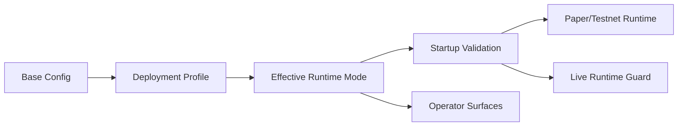

# Phase 9 Paper Runtime Default, Deployment Profiles, and Live Guardrails Spec

## Status

Draft implementation spec for the ninth refactor milestone.

## Purpose

Phase 8 completed the paper rollout contract:

- runtime rollout modes are documented
- operator surfaces describe rollout health
- rollback-to-legacy is explicit
- paper activation has end-to-end coverage

What Phase 8 does **not** do is change the actual deployment default.
The repository sample config and the live paper server still run `legacy`, and promotion still relies on editing the main config directly.

Phase 9 moves the project from "paper runtime is supported" to "paper runtime is a controlled deployment target" while explicitly preventing accidental live-money runtime activation.

## Dependencies

Phase 9 depends on:

- [docs/specs/PHASE_6_RUNTIME_CUTOVER_SPEC.md](/home/lekim/Projects/akibaCryptobot/docs/specs/PHASE_6_RUNTIME_CUTOVER_SPEC.md)
- [docs/specs/PHASE_7_RUNTIME_COMPATIBILITY_SPEC.md](/home/lekim/Projects/akibaCryptobot/docs/specs/PHASE_7_RUNTIME_COMPATIBILITY_SPEC.md)
- [docs/specs/PHASE_8_PAPER_PRIMARY_ACTIVATION_SPEC.md](/home/lekim/Projects/akibaCryptobot/docs/specs/PHASE_8_PAPER_PRIMARY_ACTIVATION_SPEC.md)
- [src/runtime/config.py](/home/lekim/Projects/akibaCryptobot/src/runtime/config.py)
- [src/bot.py](/home/lekim/Projects/akibaCryptobot/src/bot.py)
- [start_bot.py](/home/lekim/Projects/akibaCryptobot/start_bot.py)
- [config/config.json](/home/lekim/Projects/akibaCryptobot/config/config.json)
- [docs/CONFIGURATION.md](/home/lekim/Projects/akibaCryptobot/docs/CONFIGURATION.md)
- [docs/DEPLOYMENT.md](/home/lekim/Projects/akibaCryptobot/docs/DEPLOYMENT.md)

## Problem Statement

Current gaps after Phase 8:

1. Paper runtime activation exists, but the default paper config still resolves to `legacy`.
2. Promotion between `legacy`, `shadow`, `runtime_entries`, and `runtime_primary` is documented, but deployment still depends on editing the main config in place.
3. There is no first-class deployment profile surface for paper rollout stages.
4. There is no hard startup guard preventing runtime-owned live-money deployments unless the operator opts in explicitly.
5. Runtime cutover is operationally safer than before, but still too easy to misconfigure.

## Phase 9 Goals

1. Introduce explicit deployment profiles for paper runtime rollout stages.
2. Make paper/testnet runtime promotion reviewable without mutating the base config by hand on every deploy.
3. Keep live-money deployments on legacy unless an explicit runtime-live override is set.
4. Surface startup guard failures clearly so bad deployment combinations fail fast.
5. Preserve the one-step rollback path to paper `legacy`.

## Phase 9 Non-Goals

1. Enabling runtime-primary for live money by default.
2. Removing the legacy loop from the codebase.
3. True HFT execution changes.
4. New trading strategies or signal logic.
5. Dashboard redesign.

## Architecture Decision

Phase 9 separates the deployment role from the runtime ownership mode.



The key decision is that deployment selection should be explicit and layered, while live runtime ownership should remain opt-in and guarded.

## Target Topology

Paper/testnet deployments should support reviewed profiles:

1. `paper_legacy`
2. `paper_shadow`
3. `paper_runtime_entries`
4. `paper_runtime_primary`

Live deployments should default to:

1. `live_legacy`

Any live deployment that requests `shadow`, `runtime_entries`, or `runtime_primary` must fail validation unless a dedicated live-runtime override is set.

## Required Surfaces

### Runtime Config and Validation

Priority targets:

- [src/runtime/config.py](/home/lekim/Projects/akibaCryptobot/src/runtime/config.py)
- [config/config.json](/home/lekim/Projects/akibaCryptobot/config/config.json)
- [docs/CONFIGURATION.md](/home/lekim/Projects/akibaCryptobot/docs/CONFIGURATION.md)

Minimum support:

- deployment profile naming for paper/live roles
- explicit effective runtime mode derivation
- explicit live-runtime override flag
- validation errors for unsafe combinations

### Startup Guardrails

Priority targets:

- [start_bot.py](/home/lekim/Projects/akibaCryptobot/start_bot.py)
- [src/bot.py](/home/lekim/Projects/akibaCryptobot/src/bot.py)

Minimum guarantees:

- unsafe live runtime combinations fail before the trading loop starts
- paper runtime profile selection is logged and observable
- legacy rollback remains a config-only switch

### Deployment Procedure

Priority targets:

- [docs/DEPLOYMENT.md](/home/lekim/Projects/akibaCryptobot/docs/DEPLOYMENT.md)
- deployment helper scripts only if needed

Minimum guarantees:

- deploy steps specify which profile is being activated
- rollout and rollback commands remain pinned-SHA and reviewable
- operators do not need to hand-edit the main config on the server during normal promotion

## File Layout

```text
config/
  config.json
src/
  runtime/
    config.py
  bot.py
start_bot.py
tests/
  runtime/
    test_runtime_config.py
    test_phase9_runtime_profiles.py
  test_bot_logic.py
docs/
  CONFIGURATION.md
  DEPLOYMENT.md
  specs/
    PHASE_9_PAPER_DEFAULT_AND_LIVE_GUARDS_SPEC.md
```

## Core Design Decisions

### 1. Deployment Profiles Are the Promotion Surface

Operators should promote paper runtime through named deployment profiles, not ad hoc edits to the main config.

### 2. Live Runtime Must Be Explicitly Unsafe-By-Default

If the exchange is not in sandbox/testnet mode, runtime-owned modes must be rejected unless a dedicated override clearly says otherwise.

### 3. Effective Runtime Mode Must Stay Observable

If a profile or override changes runtime ownership, operator surfaces and logs must make that obvious.

### 4. Rollback Must Stay Simple

Returning to `paper_legacy` must remain easier than promotion.

## Task Breakdown

### P9-01: Add runtime deployment profile contract

Acceptance:

- runtime config supports a reviewed deployment profile concept
- effective runtime mode is derived consistently from base config plus profile
- invalid profile combinations are rejected

### P9-02: Add live-runtime guardrails

Acceptance:

- startup rejects runtime-owned modes on non-sandbox exchange configs by default
- override requirements are explicit and tested
- error messages are operator-readable

### P9-03: Add paper profile startup/logging visibility

Acceptance:

- startup and status surfaces show the selected paper deployment profile
- effective ownership remains easy to inspect
- no ambiguity exists between configured mode and effective mode

### P9-04: Document and support deployment profile usage

Acceptance:

- deployment docs describe how to apply paper profiles and roll back safely
- configuration docs match the implemented profile contract
- helper tooling is added only if it reduces config drift materially

### P9-05: Add end-to-end rollout and live-guard integration coverage

Acceptance:

- tests cover paper profile promotion
- tests cover rollback to paper legacy
- tests cover live-runtime rejection without explicit override

## Acceptance Criteria

Phase 9 is complete when:

1. Paper runtime promotion is profile-driven and reviewable.
2. Live runtime ownership is blocked by default.
3. Startup fails fast on unsafe deployment combinations.
4. Deployment and configuration docs match the implemented behavior.
5. Rollback to paper legacy remains a simple, explicit operation.

## Rollout Notes

Recommended implementation order:

1. profile contract and validation
2. live-runtime startup guards
3. startup/operator visibility
4. docs and helper tooling
5. integration coverage

Recommended deployment order after Phase 9:

1. deploy profile/guard support while staying on `paper_legacy`
2. promote to `paper_shadow`
3. verify operator surfaces and startup logs
4. promote to `paper_runtime_entries`
5. promote to `paper_runtime_primary`
6. keep `paper_legacy` as the immediate rollback profile
